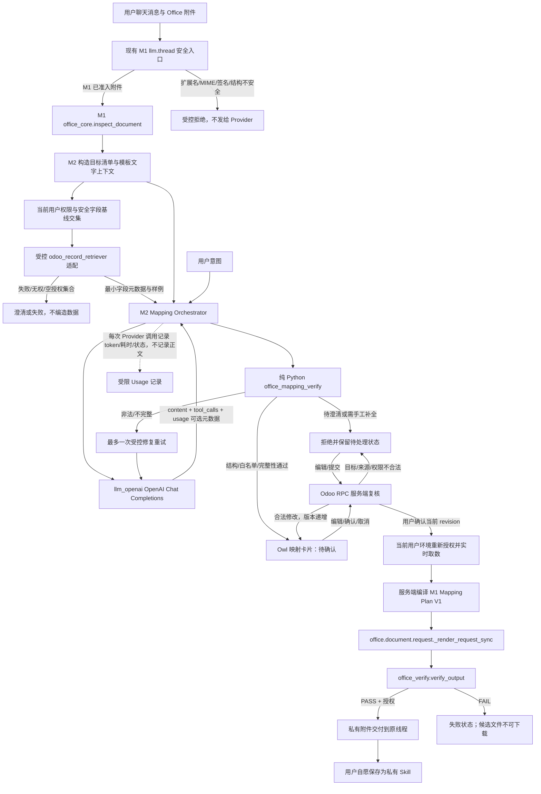

<!-- Skill bundle metadata
Source template: docs/skill/odoo-project-workflow/references/templates/Designing/TDD模板.md
Source version/status: v1.0.0; Frozen
Template synchronization check: PASS, 2026-10-22
-->

# Odoo Office Engine M2 AI 映射与导出 Skill 技术设计说明书（TDD）

| 项目 | 内容 |
|---|---|
| 文档编号 | TDD-OFFICE-ENGINE-M2 |
| 文档路径 | `docs/design/TDD_office_engine_m2_v0.1.md` |
| 文档版本 | V0.1 |
| 状态 | **Draft — 供技术评审；不是编码授权** |
| 起草日期 | 2026-10-22 |
| 上游需求 | 《Odoo Office Engine M2：AI 映射与导出 Skill SRS》V1.0.0 Frozen |
| 上游技术验证 | TV-OFFICE-ENGINE-M2-PLAN V0.2（负责人批准冻结）；TV 报告 V1.1（负责人于本任务批准冻结） |
| M1 基线 | TDD-OFFICE-ENGINE-M1 V0.4 Frozen；M1 最终交付报告 PARTIAL，按已验证格式/结构门禁开放 |
| DDD | **适用性待负责人确认**。M2 包含映射会话与私有 Skill 生命周期；本稿不擅自将 DDD 判为 N/A。若负责人确认 N/A，须在 TDD 冻结记录给出依据；若触发 DDD，则先冻结适用 DDD 再冻结 TDD |
| 批准记录 | 起草稿；待技术评审与负责人批准 |

> 本稿定义 M2 的技术实现方案。M2 当前唯一 Provider/模型验证基线为 Odoo 配置的 OpenAI Provider `gpt-5.6-luna`。该范围是当前部署准入，不把其他 Provider 的能力推定为已验证。SRS、TV 报告和 TDD 均不得被本稿静默改写。

## 0 文档说明

### 0.1 目的

定义 M2 的映射编排、AI Provider Usage 观测、纯 Python Mapping Proposal 校验、聊天确认卡片、授权取数、M1 调用和个人私有 Skill 的技术边界。M2 将用户表达、M1 模板结构和当前用户有权使用的数据字段转换为可确认的映射规则；只有经过确定性校验和用户确认后，才生成 M1 可执行的 Mapping Plan。

### 0.2 权威基线与事实状态

| 基线 | 状态/版本 | 本稿使用方式 |
|---|---|---|
| `docs/requirement/SRS_office_engine_m2_ai_mapping.md` | V1.0.0 Frozen | 唯一 M2 业务需求基线；覆盖 FR-M2-001 至 FR-M2-013、AC-01 至 AC-24、BR、权限、私有 Skill 和开放项 |
| `docs/requirement/SRS_office_document_automation_v1.1.0.md` | V1.1.0 Frozen | 总体 M1-M4 范围基线；私有 Skill 最小能力属于 M2，公共 Skill 治理仍属 M3 |
| `docs/design/TDD_office_engine_m1_v0.4.md` | V0.4 Frozen | M1 同步服务、`office_core` / `office_verify` 边界、Mapping Plan V1、权限/附件交付约束 |
| `docs/implementation/office-engine-m1/M1-FINAL-DELIVERY-REPORT.md` | PARTIAL 核心交付 | 逐项遵循其中已验证能力和 HVR 门禁；总体 PARTIAL 不等于所有 Office 结构已开放 |
| `docs/verification/TV_office_engine_m2_plan.md` | V0.2；负责人批准冻结 | M2 TV 的唯一模型范围及方法基线 |
| `docs/verification/TV_office_engine_m2_report.md` | V1.1；负责人于 2026-10-22 批准冻结 | 采用其中真实响应、Usage、Retriever 与 Owl Spike 证据及失败/未决状态 |

TV V1.1 的**已测事实**：在合成输入下，`gpt-5.6-luna` 4/4 返回严格可解析 JSON、无 Markdown 围栏、无未知字段/目标，但每次只映射 5/20 个目标；补救提示仍遗漏 15 个目标。单次合成 50 行请求 Usage 为 3,563 prompt / 385 completion / 3,948 total tokens，耗时 4.4844 秒。真实 Odoo Retriever 仅以当前用户权限读取公开 `res.currency` 样例，不是 50 行销售订单。Owl 最小卡片与 RPC 正负例通过；初次缺少 `rpc` 服务的根因为组件调用了不可用的 `useService("rpc")`，修正方案为从 `@web/core/network/rpc` 导入 `rpc` 并注册至 `Message.components`。TV-M2-004 注入防御仍 `INCONCLUSIVE`。

上述事实不证明产品级映射完整性、真实销售订单上下文、广泛注入免疫或生产性能。TV 报告文件的元数据当前仍显示 Draft，与负责人本任务中的冻结批准不一致；在本 TDD 冻结/实施计划基线化前，文档责任人须同步报告的状态元数据，历史结果不得改写。

### 0.3 决策类型

- **已由上游确定**：权限继承、白名单、安全字段基线、当前数据实时读取、用户确认、M1 回读验证、Skill 不存业务值、M2 格式范围及 Provider 数据政策门禁。
- **本稿技术提案**：Mapping Proposal 与 M1 Mapping Plan 分离、纯 Python 校验接口、每次映射最多一次自动修复重试、使用 `office_engine_m2` 适配 Addon，以及最小 Usage 记录模型。
- **待上游关闭**：SRS §13 `OPEN-M2-002/003/005/006`，以及文中列明的目标结构、源码基线、留存和同步交互风险。未决项未关闭前，不得通过 TDD 冻结或部署门禁扩大其对应范围。

## 1 技术上下文与基线冻结

### 1.1 技术栈

| 层 | 基线 | 状态/说明 |
|---|---|---|
| Odoo | 18.0 | TV 环境已核验源码版本 |
| Python | 3.11.9 | TV 环境快照；实施实例仍须确认一致 |
| PostgreSQL | 版本未在 M2 TV 中记录 | 实施计划前补环境快照 |
| OpenAI SDK | 2.54.0 | TV 环境实测；产品依赖以目标 `venv` 实际锁定版本为准，不在本 TDD 猜测升级 |
| Provider / 模型 | OpenAI / `gpt-5.6-luna` | 本轮唯一允许验证和启用的配置 |
| 请求 API | `client.chat.completions.create` | 当前 `llm_openai` 实际路径；M2 Mapping 请求使用非流式响应以便完整解析及读取 Usage |
| Web 前端 | Odoo 18 Owl、`mail.Message` | 最小组件扩展已通过 TV；产品资产与生命周期尚未实现 |
| M1 文件服务 | `office_core.inspect_document`、`office_core.render_candidate`、`office_verify.verify_output` | 复用 M1 服务；不复制读写/回读逻辑 |

TV 所用 `odoo-llm` commit 为 `609ec6dda3645165f6a4a843d7af5d286081a29d`，当时工作树有未提交变更；这不是可复现的干净基线。当前源码检查确认 `llm_openai.models.openai_provider.LLMProvider.openai_chat()` 在非流式路径拿到 SDK response 后调用 `_openai_process_non_streaming_response()`，当前标准化只返回 `content` / `tool_calls`，没有 `usage`。`TV-M2-002` 从已配置 SDK response 直接观察到了真实 Usage。实施前须冻结实际 `odoo-llm` commit 与补丁集，不得以 dirty tree 的测试结果冒充干净可复现基线。

### 1.2 M2 格式能力门禁

| 输入 | M2 处理策略 | 当前证据与附加门禁 |
|---|---|---|
| `.xlsx` | 可进入 M1 当前已开放的结构读取/写入/回读范围 | 复杂 Excel 有 M1 聊天生成、独立回读和浏览器下载证据；未知/未开放 OOXML 结构仍由 M1 拒绝 |
| 基础 `.docx` | 仅对 M1 已验证的基础结构开放 | M1 报告指出浏览器文件选择上传/下载 HVR 尚未完成；该聊天 UI 路径在其真实浏览器 HVR 通过前不得启用 |
| `.xls`、`.doc` | 拒绝 | 当前 M2 SRS §0.2、AC-02 明确不开放 |
| `.xlsm`、宏/VBA、复杂 VML、文本框、未知 Word 对象 | 拒绝或由 M1 能力清单受控拒绝 | M2 不扩大 M1 格式/结构能力 |

### 1.3 目标与非目标

**本 TDD 范围**：自然语言导出请求编排；M1 模板结构到受控 Prompt 上下文；当前用户权限下的数据字段发现/读取；Mapping Proposal 校验、补全与有限修复；映射确认卡片和 RPC；确认后实时取数并交给 M1；私有 Skill 保存、匹配和复用；OpenAI Usage 采集及最小监控。

**不属于本 TDD**：修改 Office 底层读写/格式引擎；通用文件导入；任意业务分析；AI 直接读写文件或运行代码；公共 Skill 发布/审核；任意模型 Provider 启用；其他 Provider 的 Usage 兼容；未获批准的安全字段或向 Provider 发送业务内容。

## 2 核心架构与数据流

### 2.1 架构图



### 2.2 分层职责

| 层 | 职责 | 明确禁止 |
|---|---|---|
| `office_engine_m2` Odoo 编排层 | 绑定线程/附件/记录/用户；调用 M1 和授权查询能力；驱动状态、重试、卡片与 Skill | 不绕过 ACL，不把模型文本当事实，不把未经验证 Mapping 交给 M1 |
| `llm_openai` Provider 适配 | 非流式 SDK 响应中保留 `response.usage`、模型响应 ID 和必要标准字段 | 不把原始提示/响应正文写入 Usage 记录；不改变现有 Chat Completions 请求语义 |
| `office_mapping_verify` 纯 Python 层 | 严格 JSON 解析、Schema、目标/字段白名单、类型、重复与完整性校验 | 不导入 Odoo、ORM、LLM SDK、网络库；不自行查询权限或业务数据 |
| `odoo_record_retriever` | 在当前 Odoo 用户 `env` 下执行已约束的记录/字段读取 | 不接收未经服务端约束的任意模型、domain 或字段；不使用 `sudo()` |
| M1 `office_core` / `office_verify` | 结构识别、受限渲染、结果回读校验 | 不负责 AI 推理、业务字段查询或 Skill |
| Owl 映射卡片 | 展示完整映射、样例和澄清项；收集修改、确认/取消 | 不在浏览器判定映射安全，不把前端状态当用户授权事实 |

## 3 模块与物理边界

### 3.1 拟议目录

```text
mymodules/
├── office_mapping_verify/                 # 独立纯 Python 包；无 Odoo/LLM imports
│   ├── __init__.py
│   ├── contracts.py                        # Proposal / TargetManifest / FieldAllowlist 数据结构
│   ├── parser.py                           # 严格 JSON 解析与尺寸/重复键拒绝
│   ├── validator.py                        # 字段、目标、类型、完整性校验
│   └── tests/
├── office_engine_m2/                       # 新增 Odoo Addon，承载 M2 编排与 UI
│   ├── models/                              # Mapping session、Skill、Usage 记录
│   ├── services/                            # orchestration、retriever adapter、plan compiler
│   ├── controllers/                         # 用户态映射 RPC
│   ├── static/src/                          # Owl mapping card 与模板/样式
│   ├── security/                            # ACL、Record Rules
│   └── tests/
└── odoo-llm/llm_openai/                     # 扩展现有自有 Odoo-LLM Provider 适配
    ├── models/openai_provider.py             # 非流式 response usage 归一化
    └── tests/                                 # Provider 返回兼容回归
```

`office_engine_m2` 作为新 Addon 的提案，依赖 `office_engine_odoo`、`llm_assistant`、`llm_tool`、`llm_openai`。不改 Odoo 官方源码/官方 Addon。Provider Usage 不能仅靠在外围 `_inherit` 中调用 `super()` 实现：当前 `openai_chat()` 返回标准化 dict 时原始 SDK response 已丢弃 Usage。因此需要在仓库自有 `llm_openai` 适配代码中作向后兼容的增量扩展，具体变更文件须在 CC 冻结时列入白名单。

### 3.2 方法清单（拟议接口）

| 所属模块 | 方法/组件 | 输入与输出 | 责任 |
|---|---|---|---|
| `llm_openai.models.openai_provider.LLMProvider` | `_openai_process_non_streaming_response(response)` | SDK response → `{content?, tool_calls?, usage?, response_id?}` | 保留已有键，追加可选标准化 Usage；Usage 缺失时不伪造零值 |
| `office_mapping_verify.parser` | `parse_mapping_proposal(raw_text, limits)` | 原始文本 → Proposal 或稳定解析错误 | 拒绝 Markdown 围栏、前后解释文本、重复 JSON key、过大输入、非对象根值 |
| `office_mapping_verify.validator` | `validate_proposal(proposal, target_manifest, allowed_fields)` | Proposal + 服务端构造的授权集合 → 校验报告 | 结构、ID、类型、重复、未知项与完整性；纯函数/纯数据 |
| `office_mapping_verify.validator` | `apply_manual_edits(proposal, edits, target_manifest, allowed_fields)` | 用户 edits → 新版本 Proposal/错误 | 不信任前端 payload；每次修改重新执行同一校验 |
| `office_engine_m2.services.mapping_service` | `start_mapping_session(thread, message, attachment, intent)` | 当前用户上下文 → session/state/card payload | 校验上下文并读取 M1 结构，建立最小授权数据快照 |
| `office_engine_m2.services.mapping_service` | `_build_target_manifest(inspection, intent, prior_skill)` | M1 inspection + 明确意图/已验证 Skill → TargetManifest | 仅服务器生成目标 ID/可写性；required 不从模型输出采信 |
| `office_engine_m2.services.mapping_service` | `_retrieve_authorized_context(session)` | 绑定的 model/record + 当前 env → field allowlist/sample | 通过现有 Retriever 能力，在当前用户 env 下精确约束模型、记录、字段；无 `sudo()` |
| `office_engine_m2.services.mapping_service` | `_call_mapping_provider(session, prompt_context)` | 脱敏最小 Prompt → content/usage/latency | 仅当前准入 OpenAI `gpt-5.6-luna`；M2 映射调用非流式 |
| `office_engine_m2.services.mapping_service` | `_generate_and_validate(session)` | Provider Proposal → validated/clarification/error | parse → validate → completeness → 最多一次修复重试；不合格转手工补全 |
| `office_engine_m2.services.mapping_service` | `_confirm_and_render(session, revision, confirmation_token)` | 已确认 revision → M1 结果 | 检查状态/revision/权限，实时取数，编译 M1 Mapping Plan，调用 M1 同步服务 |
| `office_engine_m2.services.mapping_service` | `_compile_m1_plan(session, proposal, fresh_record_data)` | 字段映射 + 新鲜数据 → M1 Mapping Plan V1 | 只生成字面值 writes；不复制 M1 验证逻辑 |
| `office_engine_m2.controllers.mapping_controller` | `/office_engine_m2/mapping/update`、`/office_engine_m2/mapping/confirm` | authenticated JSON-RPC → 受控状态/错误 | 校验当前用户、线程、session owner/company、状态与 revision；拒绝客户端传 uid/owner/权限声明 |
| `office_engine_m2.models.office_export_skill` | `match_for_request()` / `save_from_success()` | 模板指纹、模型、当前用户/公司、确认规则 → Skill | 私有 Skill 精确匹配/保存；不存业务值或文件内容 |
| `office_engine_m2.models.office_llm_usage` | `record_usage()` | token、耗时、关联 ID、结果状态 → usage row | 仅记录计量元数据；不记录 Prompt/响应全文/API key |
| Owl `OfficeMappingCard` | `onEdit()` / `onSubmit()` / `onConfirm()` / `onCancel()` | Card props → authenticated RPC | 从 `@web/core/network/rpc` 导入 `rpc`；服务端为授权与状态 SSOT |

方法名为 TDD 拟议接口，不宣称已存在。实施时若既有服务提供等价方法，应以实现评审更新 TDD，而非重复造轮子。

## 4 Mapping Proposal、目标清单与 M1 契约

### 4.1 两种映射对象不可混用

LLM 输出为**不可信 Mapping Proposal**，仅引用目标元素 ID 和 Retriever 实际提供的字段 ID，不包含业务字段值、可执行表达式、URL、文件路径或 Odoo 操作。它不是 M1 `Mapping Plan`，不能直接交给 M1。

经服务端结构/字段/目标/完整性校验、用户确认、权限重验及实时取数后，M2 才将其编译为 M1 TDD §3.3 的 Mapping Plan V1：`schema_version`、服务端计算的 `template_sha256` 和 `writes[{element_id, operation:"set_value", value:{type,data}}]`。M1 继续独立执行自身 Mapping 校验和 `office_verify` 回读校验。

### 4.2 Proposal Schema（技术提案）

```json
{
  "schema_version": "m2.mapping-proposal.v1",
  "mappings": [
    {
      "element_id": "xlsx:Sheet1!B1",
      "source_field": "partner_id.name",
      "value_type": "string"
    }
  ],
  "clarifications": [],
  "skipped_targets": []
}
```

| 项 | 规则 |
|---|---|
| 根键 | 必须且仅能包含 `schema_version`、`mappings`、`clarifications`、`skipped_targets`；未知键拒绝 |
| `element_id` | 必须在当前 M1 inspection 目标目录与本次 `TargetManifest` 的交集内；禁止模型创建元素 |
| `source_field` | 必须是当前 Retriever 返回并通过安全字段基线/当前用户权限的精确字段标识；不接受模型臆造、自由域路径或方法名 |
| `value_type` | 仅使用服务器字段类型与 M1 目标类型共同允许的类型；模型声明不能覆盖权威类型 |
| `clarifications` | 仅可指向本次合法目标；原因代码受服务端枚举约束；问题文本限长并按纯文本展示，不作为指令执行 |
| `skipped_targets` | 目标必须合法；必填目标不能由模型自行跳过。只有用户明确确认非必填目标跳过后才能从完整性阻断集合移除 |
| 业务值 | Proposal 中禁止 `value/data/sample`。预览样例由服务端关联已授权 Retriever 快照后单独呈现，不采信 LLM 生成的样例 |
| 显式空值 | `null`、缺失、空字符串、数字 0 分别按 Schema/M1 契约处理；不得将 `null` 自动转为空字符串 |

严格 JSON Schema 与长度/数量限制在编码前冻结于 CC 附件/Schema 文件。解析器必须拒绝重复键，避免 Python 标准 JSON Parser 默认“最后一个键覆盖前值”的歧义。

### 4.3 TargetManifest 与完整性

`office_core.inspect_document()` 提供 M1 可识别元素目录、可写标记、类型/值、未知结构和模板指纹；它本身不表达某个模板位置在业务上是否必填。故 M2 必须提供服务端构造的 `TargetManifest`，每项包含 `element_id`、M1 可写性/类型、必要性来源及是否需要用户确认。

- 模型不能提供或修改 `required`、`optional`、`approved_to_skip` 标志。
- 目标必要性只能来自本次用户明确意图、已批准模板/Skill 规则或用户确认；不能从模型漏项反推“可选”。
- 若模型/模板文字不能确定必填范围，卡片进入 `needs_clarification`，用户确认目标范围或明确某目标可跳过。目标清单未闭合前，不显示可执行确认状态。
- `office_mapping_verify.validate_proposal()` 将已映射、已澄清、已明确跳过目标与服务器目标集合比较。任何必填目标未映射、无待处理澄清或未获准跳过时结果为 `incomplete`；不允许按部分命中执行。
- 本技术提案需要业务/产品确认其“先确认目标清单、再确认字段映射”的卡片表现是否符合 FR-M2-006/AC-07；若评审认为改变业务交互，应先回到 SRS，而非在实施中私自调整。

### 4.4 纯 Python 校验器边界

`office_mapping_verify` 只接受 JSON 文本/普通 dict、不可变 TargetManifest、字段允许集合、类型表和校验策略；只返回稳定校验结果，不持有 `env`、Odoo recordset、Provider、网络/数据库客户端。

```text
parse_mapping_proposal(raw_text, limits)
  -> Proposal | MappingParseError

validate_proposal(proposal, target_manifest, allowed_fields)
  -> ValidationReport(
       structural_errors, unknown_targets, unknown_fields,
       type_errors, duplicates, missing_required,
       clarifications, skipped_unapproved, ready_for_review
     )

validate_user_revision(revision, edits, target_manifest, allowed_fields)
  -> ValidationReport
```

Odoo 层负责产生授权集合，并在调用 validator 前/确认生成前重新验证权限和数据；纯 Python validator 的 `field_id in allowed_fields` 只证明集合成员关系，不代替 ACL/Record Rule 或字段白名单审批。`office_mapping_verify` 必须有静态隔离检查，禁止导入 `odoo`、`office_core`、`office_verify`、`openai`/LLM SDK、HTTP 客户端或数据库模块。

## 5 AI 映射生成、校验与有限重试

### 5.1 Provider 请求

- 仅使用 thread 当前明确批准并与 M2 准入基线一致的 OpenAI `gpt-5.6-luna`；其他 Provider/模型不匹配时停止映射，不自动切换。
- M2 映射请求使用 `stream=False` 的 Chat Completions。TV 证明该模型在 4 次合成调用中可输出可解析 JSON，但不证明 20/20 完整性；TDD 不依赖 `response_format=json_schema` 等未经本轮 TV 验证的特性。
- Prompt 只包含完成映射所需的用户意图、M1 可用模板目标/文本、当前请求的受限字段目录和已批准可发送的最小样例。发送业务数据前必须关闭 SRS `OPEN-M2-002` / `OPEN-M2-003`。
- Template content、用户文本、字段标签及其说明均用明确数据边界序列化，并作为不可信输入；隔离标签仅为纵深防护，不能被视为注入安全保证。
- Provider 的字段/目标选择输出不触发任意工具。若模型请求 Retriever 工具，必须由 Odoo 适配器检查请求中的 model、record/domain、fields、limit 与已绑定请求完全匹配；不允许模型自行扩大查询范围。

### 5.2 自动重试与失败转人工

`_generate_and_validate()` 状态路径：

1. 发送一次 Provider 请求，取得原始 `content` 和 Usage 元数据。
2. 纯 Python 严格解析 Proposal；依次运行结构、字段、目标、类型、重复、完整性校验。
3. 若失败是可修复的 JSON/Schema/必填遗漏，记录稳定错误代码和缺项目标 ID，向同一模型发**一次**修复请求。错误提示只包括必要的错误类别、目标 ID/允许枚举，不包含 traceback、敏感样例或未授权数据。
4. 每个映射会话最多自动调用 2 次（首调 + 1 次修复）；禁止无界循环。TV 观察到修复提示仍漏 15/20 目标，因此不以重试成功为前提。
5. 修复仍非法、不完整、含未知字段/目标或超时/失败时，状态必须为 `needs_clarification` 或 `failed`，并显示缺失项供用户手动补全/选择；不交给 M1、不报告生成成功。
6. 未知/越权字段不应通过自动替换、猜测或扩大 allowlist“修复”。可向用户显示受控错误并要求重新选择合法字段。

重试次数为技术提案：单次请求总计两次 Provider 调用上限；用户之后显式要求重新分析是否可重置预算、限频和用量控制尚需 CC/Implementation Plan 定义。任何重试均独立记录 Usage 和结果状态。

### 5.3 Prompt Injection 与确定性控制

模型无权读取秘密、任意模型、额外字段或服务器资源。Prompt 中的 `<template_content>` 等分隔仅提示内容边界，不能保证模型不服从恶意文字。实际安全保证来自：

1. AI context 仅含当前用户和公司边界内已授权、且通过批准字段基线的字段；不向 AI 提供管理员密码、API key、系统提示词秘密或与本次映射无关记录。
2. 所有 AI `source_field` 必须精确命中本次 `odoo_record_retriever` 权限校验返回字段集合，且在 Odoo 服务端再次通过字段基线检查。
3. 所有 AI `element_id` 必须命中本次 M1 inspection 目录及 TargetManifest；M1 再执行自己的 Mapping Plan 白名单校验。
4. 所有修改、Skill 规则和最终 Mapping Plan 均重新经过服务端验证；前端值、模型理由和置信度不能成为权限事实。
5. 未知工具请求、未知字段/目标、提示词尝试越权或不完整结果都 fail closed；不将 Office 二进制发送给 Provider。

因此 M2 可保证“即使模型受注入影响，也不能借输出绕过 Odoo 权限、字段/目标白名单或 M1”，但不能以有限模型样本宣称模型层面对所有 Prompt Injection 免疫。

## 6 Odoo 数据查询与 M1 计划编译

### 6.1 Retriever 适配

使用现有 `odoo_record_retriever` 能力，不复制 ORM 搜索逻辑。适配层以当前 `env`/UID 执行，并把查询约束绑定到用户已明确指定的唯一 `model`、`record_id` 和服务端批准字段集合。推荐输入语义为 `domain=[("id","=",record_id)]`、`fields=allowed_fields`、`limit=1`；实际调用 `llm.tool.execute` 参数契约必须在首个实现 CC 前复核。严禁模型指定任意 `uid`、domain、limit 或 fields 绕过绑定，也不使用 `sudo()`。

读取返回须只含且仅含指定记录；记录不存在、重复/不一致、访问拒绝、字段不在安全基线或工具失败时停止，向用户展示受控澄清/失败状态。`odoo_record_retriever` 现有实现依赖 `env[model].search_read()`；其真实行为会经 ACL/Record Rules，但它没有替 M2 完成安全字段策略，须由调用适配器补足白名单。TV 只验证了公开 `res.currency` 的一次普通用户读取；真实销售订单、多公司/字段权限矩阵仍需自动化和运行时验证。

### 6.2 Mapping Plan 编译

只有用户确认当前映射 revision 且最终权限重验成功时，服务端才读取记录最新值。预览样例和 Skill 只用于展示/规则，不可作为生成值来源。

`_compile_m1_plan()` 将每个映射字段的实时值按已验证 Odoo 字段类型转换为 M1 `value.type/data`。转换表必须在实施 CC 中明确支持的 Odoo 字段类型；关系字段仅能使用 Retriever 实际返回的规范值，不猜测 `.display_name` 或关联字段。不可无损转换、缺失字段、值类型变化或 `None` 时，返回澄清/校验错误；不得隐式将 None 变为 `""`、0 或字符串 `"None"`。

输出必须符合 M1 Mapping Plan V1，包含服务端模板 SHA-256、允许的 `set_value` 和目标字面值；AI 不创建 `template_sha256`、M1 输出附件链接或最终结果事实。随后调用既有 `office.document.request._render_request_sync()`，由 M1 核验、回读并安全交付。M2 不修改 M1 内部公式/样式/附件边界。

## 7 Provider Usage 与 Token 监控

### 7.1 Provider 层增量契约

在自有 `llm_openai` 非流式响应适配中读取 `response.usage` 并标准化：

```json
{
  "prompt_tokens": 3563,
  "completion_tokens": 385,
  "total_tokens": 3948,
  "reasoning_tokens": 255
}
```

其中 `reasoning_tokens` 等细分值可缺失；`usage` 整体也允许缺失。缺失记为 `null/status=usage_missing`，不能当成 0。标准化响应增加可选 `usage`、`response_id` 元数据，同时保留既有 `content`、`tool_calls` 结构。M2 只要求非流式映射调用；其他流式路径不声称已捕获完整 Usage。

追加字段前须检查 `llm_assistant._handle_non_streaming_response()`、工具循环及其他 Provider 调用者的响应兼容性。通用聊天 UI 不得把 Usage JSON 显示为聊天文本或持久化到 `mail.message.body_json`；M2 编排器单独取用其元数据。

### 7.2 计量记录

提议新增受保护的 `office.llm.usage` 记录，每次 Provider 请求（初调、修复、失败）一行：

| 字段 | 目的/约束 |
|---|---|
| `call_uuid` | 服务端唯一关联键；不得作为授权凭证 |
| `mapping_session_id` / `thread_id` | 可空的受限关联；只允许有权运维角色读取 |
| `owner_id` / `company_id` | 服务端从当前 env 生成，不接受客户端赋值 |
| `provider_code` / `model_name` / `response_id` | 诊断 Provider 路径；不含 API key/base URL |
| `prompt_tokens` / `completion_tokens` / `total_tokens` / `reasoning_tokens` | 可空非负整数；不重算 Provider 数值 |
| `elapsed_ms` / `attempt_no` / `outcome` / `error_code` / `created_at` | 计时、重试与受控失败分析 |

Usage 表不保存 System/User Prompt、模板全文、业务样例、Completion 原文或文件内容。金额成本不计算，除非维护已批准、带生效日期的模型计价基线。ACL 默认仅系统运维授权组可读，普通业务用户不可浏览；是否提供按用户的费用视图不在当前 SRS 范围。数据留存期依据 `OPEN-M2-003`/部署政策确定，未确认前限制为最小必要且禁止长期留存。

## 8 ORM 数据模型与状态

### 8.1 拟议模型

| 模型 | 作用 | 关键约束 |
|---|---|---|
| `office.mapping.session` | 将一次聊天映射交互绑定到用户、公司、线程、上传消息/附件、目标记录和映射 revision | owner/company 服务端写入；附件/线程必须关联；`state` 状态机受控；原始 Prompt、样例明文与完整 Provider 响应不存储 |
| `office.export.skill` | 个人私有映射规则及模板/模型关系 | 用户+公司隔离；不存业务值、样例、模板或输出文件；只能本人管理/使用 |
| `office.llm.usage` | Provider 调用计量元数据 | 见 §7.2；运维权限组只读；不保存提示内容 |
| `office.document.request` | M1 已有持久处理请求 | M2 仅在用户确认并准备交给 M1 时调用；不改其 M1 状态语义或放宽 ACL |

会话记录只保留继续交互所需最小映射规则和 revision。是否持久化已验证 Proposal、字段样例/目标清单、清理周期和会话到期行为必须在实施前按数据最小化审查定案；推荐不持久化业务值/样例，刷新后按当前权限重新取样，映射规则只在会话必要期限保存。不要将附件 `datas` 或完整 Prompt 写入模型字段。

Skill 最小字段提案：`name`、`owner_id`、`company_id`、`template_fingerprint`、`model_name`、`mapping_rules_json`、`state`、`revision`、`created_at/write_date`。规则不含记录 ID、字段值、样例或附件 ID。精确匹配至少校验当前用户/公司、M1 支持的模板结构指纹和绑定模型；同样模板/模型可有多个 Skill，不强加可能阻止用户保存不同映射的唯一约束。

### 8.2 状态映射

| 映射会话状态 | SRS 业务状态 | 入口/允许动作 |
|---|---|---|
| `collecting` | 信息收集中 | 收集模板、记录或意图；补充/取消 |
| `needs_clarification` | 待澄清 | 缺目标、缺来源、模糊或重试耗尽；补充、手工映射、取消 |
| `awaiting_confirmation` | 待确认 | 结构、权限、完整性验证通过；修改、确认、取消 |
| `editing` | 待确认（技术子态） | 有合法编辑草稿；提交后再校验，必要时回到澄清 |
| `rendering` | 处理中 | 当前 revision 已明确确认、权限重验通过 |
| `completed` | 已完成 | M1 回读通过且授权附件已提交 |
| `failed` | 失败 | Provider/Retriever/M1/附件失败 |
| `cancelled` | 已取消 | 用户主动取消；终态 |

状态不可由客户端直接 `write`。服务端动作负责受控转移，并校验 `revision`/模板哈希/确认标识。修改任一映射后递增 revision，旧确认失效；确认只对该 session 的当前 revision 和源附件/目标记录有效。失败/取消不能由模型响应或旧 RPC 自动转为完成。

Skill 状态遵循 SRS：`active`、`pending_validation`、`disabled`。新增/修改规则进入待验证，只有成功生成并验证后才可设为有效；停用 Skill 不自动匹配。删除/历史留存语义遵循 `OPEN-M2-006`，未决前不得编造永久删除/归档产品行为。

## 9 同步生命周期、事务与并发

M1 服务目前是有界同步调用；本 TDD 不将 TV 单次 4.48 秒 Provider 调用当作全流程时限，也不承诺端到端 SLA。M2 的 provider、Retriever 和 M1 调用都须设置连接/请求超时并返回明确状态。长耗时恢复/异步语义按总 SRS 与 M1 相关基线另行处理；生产 Queue Job 容量未验证不等于可声称异步就绪。

1. **入口短事务**：以当前用户验证 thread/message/attachment 关联、文件准入与记录上下文；建立 mapping session，不持有业务记录锁做文件解析或 LLM 网络请求。
2. **准备上下文**：调用 M1 检查模板；在当前用户环境调用受约束 Retriever；确认 provider 数据政策及安全字段基线已批准。任何门禁未满足即 fail closed。
3. **Provider 阶段**：以非流式 `gpt-5.6-luna` 生成 Proposal；不得持有显式业务行锁等待网络。Odoo HTTP/RPC 请求本身可能在 provider 等待期间保持外层 cursor/事务打开；本稿不把它虚称为已剥离的短事务。实施前须测请求持续时间、连接/事务占用和并发影响，验证 session 状态提交与失败回滚；禁止在请求中途手动 `commit()` 后继续使用旧 env/recordset。若运行预算不满足，返回受控拒绝，并提交后续异步/分段交互技术变更评审，不在本稿中临时引入队列。
4. **卡片阶段**：将不含真实业务样例的 mapping rule/revision 持久化到受限 session；用户卡片通过当前权限重新取少量样例后显示。持久化样例与 Prompt 内容默认禁止。
5. **确认与重验**：RPC 确认时再次核验 owner/company/thread/source attachment、revision、字段策略和记录读权限；重新执行 Retriever 读取最新值。
6. **M1 渲染阶段**：编译 M1 Plan 并调用现有 M1 同步接口。必须遵守 M1 request UUID 幂等、短事务/文件处理边界、结果附件私有、回读 PASS 后才交付等约束。
7. **失败与取消**：失败时不暴露 Candidate 输出；映射 session 状态/错误按 SRS 表达；用户取消后拒绝旧 revision 后续确认。是否取消正在进行的同步 M1 子进程按 M1 能力处理，不承诺当前不存在的取消功能。

同一 mapping session 上的编辑/确认须有 revision 乐观并发检查，避免两个浏览器标签用旧卡片覆盖新选择。生成动作需幂等关联确认 revision 与 M1 request UUID；重复确认读取已有状态/结果，不重复产生有效输出。

## 10 Owl 卡片与 RPC 契约

### 10.1 前端扩展

复用 TV-M2-003 已验证的最小扩展点：显式在 Addon `web.assets_backend` 中注册 JS/XML；JS 使用 `import { rpc } from "@web/core/network/rpc"`；通过 Odoo `Message.components` 注册映射卡片，并用 QWeb/Owl 模板扩展仅在 M2 mapping message/card 类型渲染。禁止以 `useService("rpc")` 作为该聊天客户端的依赖，因为 TV 已观察到其服务不可用。

TV 只证明 Spike `<select>` 卡片和一次 RPC 往返，不证明产品卡片渲染、错误恢复、刷新、分页或各类权限已实现。正式资产需针对 M2 专用 server message type/受控 message payload 做显式判断；不能靠自由文本 marker 或模型输出 HTML 判定显示卡片。

### 10.2 卡片交互状态

| UI 状态 | 展示 | 用户动作 |
|---|---|---|
| 待确认 | 完整目标、模型字段、类型、服务端预提取样例/注意项 | 修改字段、跳过获准的非必填目标、确认、取消 |
| 需澄清 | 缺失/冲突目标及安全字段候选；未完成项不可提交生成 | 选择合法候选、补充说明、明确 optional/skip、取消 |
| 修改中 | 当前编辑值与服务端 revision | 保存后发 RPC 重验；服务端拒绝则保留未确认并显示错误 |
| 处理中/完成/失败 | 由服务端状态提供，前端不推断成功 | 等待、查看安全错误或打开已授权结果附件 |

前端样例只从服务端授权结果取；HTML 使用安全模板转义。消息组件销毁/重渲染后，状态从服务端 session 重新读取，不依赖 JS 内存为授权事实。

### 10.3 RPC 服务端验证

使用 authenticated Odoo JSON-RPC 路由（具体 Controller vs ORM RPC 实现由实施 CC 根据当前聊天数据加载机制确认），前端 API 调用使用 `rpc` 模块。至少提供编辑/澄清提交、确认和取消动作。每个入口必须：

- 从 request session 取当前 `env.uid` 与公司上下文；拒绝客户端传入 uid、owner、company、ACL 结果、模型权限声明或 M1 file URL。
- 按当前用户验证 mapping session/thread/message/attachment/Skill 的关系和 Record Rules；检查 session 是可编辑状态。
- 校验 session revision 与请求 revision 匹配；检查每个 `element_id`、`source_field`、`value_type`、skip 标志都属于服务器当前 allowlist。
- 将用户输入限制为映射关系和受支持的固定文本，不接受表达式、Python、domain、任意工具参数或 M1 原始 writes。
- 每次修改运行纯 Python validator；每次确认再次做 Odoo 授权验证与实时取数。
- 失败返回稳定可见错误/澄清内容，不泄露无权字段名称或记录存在性；输入框仍可继续使用。

## 11 Skill 与数据访问控制

私有 Skill 的规则只包含模板结构指纹、绑定模型和确认过的来源字段/目标元素关系。Skill 无记录值/样例/文件，不等于权限凭据。每次匹配均检查 owner、company、模型、模板指纹、Skill 当前状态、字段 allowlist 和当前 M1 capability；成功匹配仍须显示 Skill/目标记录摘要并按 SRS 获取本次确认，之后实时取数。M2 禁止公共 Skill publish/审核。

ORM ACL 与 Record Rule 以 `owner_id = current user` 及 SRS 公司边界隔离 Skill/session；在跨公司模式必须以 SRS 明确公司规则为准。普通用户不能读他人 Skill 或 Usage；管理员不因系统角色自动获得用户业务数据或私有 Skill 内容。权限校验通过 `env` 运行，禁止 `sudo()` 查询业务记录或为了展示样例提升权限。

安全字段集合为 `current-user-readable fields ∩ approved security baseline`。安全字段基线为空、配置未批准、Provider 数据处理政策未批准时，不向 LLM 发送任何业务字段/样例；按 SRS AC-23 清楚停止。该集合的实际模型/字段范围由 `OPEN-M2-002/003` 关闭，不由本 TDD 填空。

## 12 异常、错误码与用户反馈

| 错误类别 | 例子 | 服务端处理与 UI 状态 |
|---|---|---|
| `MAPPING_JSON_INVALID` | 非法 JSON、围栏、重复键、过大响应 | 一次修复后仍失败则 `needs_clarification`，明确要求手工补全 |
| `MAPPING_SCHEMA_INVALID` | 缺键/额外键/类型错误/错误版本 | 拒绝进入待确认/渲染；不执行模型给出的未知指令 |
| `MAPPING_TARGET_UNKNOWN` | 目标不在 M1 inspection/manifest | 不自动扩展目标目录；进入受控澄清或失败 |
| `MAPPING_SOURCE_UNKNOWN` | 字段不在 Retriever 授权集合/安全基线 | 立即拒绝该映射；不以其它字段代替 |
| `MAPPING_INCOMPLETE` | 必填目标缺映射或澄清未闭合 | 卡片标缺项；手工补全前不允许确认生成 |
| `MAPPING_REVISION_STALE` | 旧卡片/并发修改/附件指纹变化 | 丢弃旧确认并要求刷新/重新确认 |
| `RETRIEVER_DENIED/FAILED` | ACL 拒绝、记录无权、工具异常、超时 | 区分无权/失败/无数据；不返回伪值 |
| `PROVIDER_NOT_APPROVED` | 不是准入 Provider/model 或数据政策未批准 | 阻止外发并明确提示管理员/用户 |
| `PROVIDER_FAILED` | Timeout/API error/空响应 | 失败态，不编造映射；重试只按受控规则 |
| `M1_RENDER_FAILED` | M1 mapping/资源/回读/附件交付失败 | 不返回下载附件；保留稳定关联 ID 和安全错误 |

用户错误不得包含 traceback、API key、原始 Prompt、无权资源名称、文件系统路径或未经授权业务值。服务器诊断可以有 correlation ID、错误类别和经过脱敏的阶段数据。

## 13 测试设计

### 13.1 纯 Python 自动化（不访问真实 LLM/Odoo）

以 fake 输入/依赖注入验证 `office_mapping_verify` 和映射编排策略，真实 Provider 不作为单元测试依赖：

1. JSON parse：合法响应、Markdown 包裹、前后文本、空/截断 JSON、重复 key、非对象根值、额外键、超限文本。
2. Schema/allowlist：未知/越权字段、未知目标、错类型、重复目标、单项同时 mapped/clarified/skipped、模型伪造 required、伪造 sample/value、未准许操作。
3. Completeness：所有必填目标齐全 PASS；缺少任意一个必填目标为 incomplete；澄清未答复不通过；非必填跳过仅在服务端确认后通过；空目标集、目标目录与模板 hash 不匹配。
4. Retry policy：用 fake provider 返回非法 JSON → 错误修复响应；初次/第二次调用数严格等于 2；第二次仍漏项进入 `needs_clarification`，M1 调用次数为 0。未知权限字段不触发 allowlist 扩大。
5. Injection fixtures：模板文本要求泄密、改 system rule、调用任意工具；断言 validator 拒绝未知字段/目标，编排器不把秘密注入 Prompt，注入文本不触发写操作。
6. Mapping Plan compiler：Mock Retriever 值按允许类型转换；`None`、关系字段、日期/货币/大数值按显式映射规则测试；确认时使用新数据而非旧样例；输出符合 M1 V1 并由 M1 fake 验证调用。
7. Token usage：有/无 Usage、非负/非法 Usage、Provider 异常、重试两行日志、不会保存 Prompt/Completion/API key；旧响应消费者忽略新增可选键且原 `content` / `tool_calls` 无变化。

### 13.2 Odoo 自动化与权限测试

通过 Odoo `TransactionCase`/HTTP 测试：当前用户读取、无权模型/字段/记录、公司隔离、私有 Skill 跨用户拒绝、线程/附件关系验证、RPC revision 过期、确认后撤权、M1 失败附件不交付、取消/失败终态、provider/model allowlist、Usage ACL、每条 `office_mapping.session` 记录 owner/company 从 `env` 生成且不能客户端伪造。Retriever 调用必须真实走 `llm.tool` 对应实现，但业务数据使用测试库夹具；不得用 `sudo()` 代替普通用户测试。

### 13.3 Owl/HVR 与真实 Provider 验收

- Owl 测试覆盖 `Message.components` 渲染、`rpc` 正常/拒绝/错误/旧 revision 响应、待确认/需澄清/修改中、前端错误后可继续输入。最终人工 HVR 使用标准聊天界面核验文件附件真实上传、卡片显示、编辑、确认、成功/失败可视反馈和受控结果下载；DOCX 聊天路径须先通过 M1 指定 HVR。
- 真实 Provider 验收仅使用获批 OpenAI Provider `gpt-5.6-luna` 和合成/获准数据；每项明确记录模型、SDK、耗时、Usage、严格 JSON parse、金标映射完整性及重试。TV 现有 5/20 映射结果是回归失败夹具，预期必须触发 completeness reject/人工补全，不得把它改为 PASS。
- Prompt Injection HVR/ATR 不以“模型未说密码”作为单独 PASS。通过标准是模型输出全经过纯 Python/Odoo 白名单；恶意文本不能扩大查询、工具、字段、目标或生成权限。`TV-M2-004` INCONCLUSIVE 必须在相应验收前按计划补验证。

### 13.4 测试追踪初始矩阵

| SRS | 主要设计/测试 |
|---|---|
| FR-M2-001/002 | mapping session 创建、M1 inspection、格式门禁、自然语言信息缺失澄清 |
| FR-M2-003 / BR-M2-001/002 / AC-03/04/23 | Retriever 普通用户权限、字段基线交集、超时/失败不伪造 |
| FR-M2-004/005 / BR-M2-003 / AC-05/06 | Proposal strict parse、schema/allowlist/completeness、retry 和手工补全 |
| FR-M2-006/007 / AC-07/08/09 | Owl 卡片、编辑、服务端再次校验、revision 绑定 |
| FR-M2-008 / BR-M2-004/005/008 / AC-10/11/21 | 明确确认、确认后重授权、实时取数、M1 回读和附件失败安全 |
| FR-M2-009/010/011 / BR-M2-006/007 / AC-12—17/22/24 | 私有 Skill 保存/修改/精确命中/用户公司隔离/停用 |
| FR-M2-012/013 / AC-19 | 非导出分析拒绝、Provider/Retriever/M1 错误分类 |
| NFR-M2-001 / BR-M2-009 / AC-18 | 注入恶意提示下无权限扩大；仅真实模型观察不作为安全证明 |
| NFR-M2-003/004/005/006 | fail-closed、错误不伪造、当前值与最小化/Skill 不存业务数据 |
| NFR-M2-007 / AC-24 | 用量和延迟可观察；不承诺 SRS 未批准的固定秒级门槛 |

## 14 可观测性与日志

Provider 每次尝试记录 Usage、响应 ID、延迟和结果。映射工作流记录 `mapping_session_id`、M1 request UUID、失败阶段、重试次数、校验错误类别和最终状态。只记录 ID、计量数据、稳定错误码及必要统计；禁止日志正文包含 Prompt、模板文本、字段样例、LLM 原文、附件 bytes 或 API key。

缺失 Usage、非法响应、mapping completeness reject、未知字段拒绝、M1 回读失败都必须有可计数的事件，区分 `usage_missing`、`retry_exhausted`、`manual_completion_required` 与 `provider_failure`。日志 retention、脱敏和读取授权服从部署隐私政策及 `OPEN-M2-003`；未批准数据不得留存。

## 15 部署与运行前置条件

1. 基线 Odoo/`odoo-llm` Python 依赖与 Provider/model 运行版本；锁定 clean commit 和 patch；不将 TV dirty tree 直接作为生产输入。
2. SRS `OPEN-M2-002` 安全字段基线及 `OPEN-M2-003` Provider 数据使用/留存批准已关闭；否则不能向 Provider 发送业务字段、样例或模板内容。
3. 当前模型必须是经批准的 OpenAI `gpt-5.6-luna`；所有其他 Provider/model 默认禁用 M2 mapping flow，直至单独技术验证/审批。
4. M1 能力矩阵中 `.xlsx` 对应特征已开放。`.docx` 聊天 UI 上传/下载在 M1 浏览器 HVR 完成前禁用；`.xls/.doc`、VBA、宏、复杂 VML、文本框和未知结构拒绝。
5. M1 与 `office_mapping_verify` 包在 Odoo 实际运行环境可导入；纯 Python 包执行独立静态隔离检查。
6. `office_engine_m2` assets 已构建/更新，卡片消息标记与现有聊天 Message 数据合同验证；RPC 使用当前 session，不接受客户端身份参数。
7. Usage/Mapping Session/Skill 的 ACL、company/user Record Rules、保留策略与备份中敏感数据处理已确认。
8. 同步 Provider/Retriever/M1 全链路超时不得超过目标 HTTP/worker预算；SRS/部署性能门槛未批准时，不宣称满足端到端“秒级”。

## 16 技术风险、开放决策与门禁

| 项 | 状态 | 影响/处理阶段 | 责任/关闭条件 |
|---|---|---|---|
| SRS `OPEN-M2-002` 安全字段基线 | OPEN | 阻塞向 Provider 提供业务字段；不阻塞纯 Python validator 起草/单测 | 部署/隐私负责人批准实际模型字段基线 |
| SRS `OPEN-M2-003` Provider 数据政策/留存 | OPEN | 阻塞真实模板文字/业务样例发送及日志留存 | 数据/隐私负责人批准可发送数据、用途和保留策略 |
| SRS `OPEN-M2-004` DOCX UI HVR | CLOSED with gate | 仅 `.xlsx` 可按已验证范围推进；DOCX chat UI 门禁仍未通过前禁用 | M1 HVR 负责人留下真实浏览器上传/下载证据 |
| SRS `OPEN-M2-005` 秒级/性能目标 | OPEN | 不阻塞功能设计；阻塞任何固定性能承诺/SLO | 产品/部署负责人确定测量点和目标，之后环境实测 |
| SRS `OPEN-M2-006` Skill 删除/历史策略 | OPEN | 阻塞删除/历史保留产品行为，不阻塞最小保存/匹配设计 | 业务负责人定义生命周期和留存 |
| TV-M2-001 completeness/retry FAIL | TV 已知失败 | 不阻塞 fail-closed 设计；阻塞宣称 AI 自动完整映射已通过 | 自动化 validator/人工补全验收闭环；真实模型只能作补充证据 |
| TV-M2-002 50 行真实订单 INCONCLUSIVE | TV 未闭环 | 不阻塞合成/隔离测试；阻塞宣称真实销售订单端到端 token/数据路径通过 | 数据获批后，以普通用户 Retriever 取真实或脱敏样本复测 |
| TV-M2-003 Owl Spike PASS | 最小技术可行性已证 | 不等同正式产品 UI/安全验收 | 正式 `office_engine_m2` 资产与 HVR 完成 |
| TV-M2-004 Prompt Injection INCONCLUSIVE | 安全观察不足 | 通过后端确定性约束降低风险；不得以模型行为独立放行 | 补真实 provider + validator/Odoo whitelist 验证 |
| DDD 适用性 | 待负责人确认 | 不阻塞本 Draft；阻塞 TDD 冻结，直到记录 DDD Frozen 或有依据的 N/A | 业务/技术负责人按项目工作流完成触发判断 |
| TV 报告状态元数据 | 不一致 | 不阻塞 Draft 起草；阻塞 TDD/Plan 干净基线引用 | 文档责任人同步 V1.1 Frozen 状态，不改测试结果 |
| Odoo-LLM dirty source baseline | 不可复现风险 | 阻塞基于该代码生成可复现 CC/实施 | 实施前记录 clean commit、差异补丁及版本兼容验证 |
| TargetManifest 必填定义 | 本稿技术提案 | 不明确时映射卡片停在需澄清；不允许完整性绕过 | 技术评审确认先确认目标清单与 SRS FR-M2-006 的一致性 |
| Usage/session 样例留存期限 | OPEN | 阻塞生产记录/样例持久化范围 | 隐私负责人批准最小期限和清理策略 |
| Odoo 外层请求事务等待 Provider 的资源占用 | 未验证 | 不阻塞纯校验器设计；阻塞同步 Provider 路径生产启用/性能承诺 | 在目标 Odoo 运行时测请求持续时间、事务/连接占用及并发影响；超预算时拒绝并另行评审分段/异步设计 |

TV 为 Partial/FAIL/INCONCLUSIVE 不阻止 TDD 继续评审；但在涉及安全字段、Provider 数据、DOCX UI、真实数据、成本留存的功能启用前，必须关闭其表中对应门禁。不能把 TDD Draft 当编码授权。

## 17 Implementation Guardrails（T）

| ID | 强制约束 |
|---|---|
| `T-M2-SEC-001` | 当前准入模型仅为获批 OpenAI `gpt-5.6-luna`；其他 Provider/model 不匹配时拒绝，禁止静默 fallback |
| `T-M2-SEC-002` | 未批准字段/Provider 数据政策时不向 LLM 发送模板正文、业务字段或样例；服务端 fail closed |
| `T-M2-SEC-003` | LLM Proposal、前端字段、模板指令均为不可信数据；所有 source/target/operation/type 在服务端校验 |
| `T-M2-SEC-004` | Retriever 执行使用当前用户 `env`；查询绑定已选 model/record/allowlist 字段；禁止 `sudo()` 和任意模型/domain/UID 扩大 |
| `T-M2-MAP-001` | Mapping Proposal 与 M1 Mapping Plan 分离；只有服务端编译并经 M1 再验证的计划可渲染 |
| `T-M2-MAP-002` | 必填目标范围由服务器/用户确认清单权威确定；任何缺项、未答澄清、未经许可跳过均不得渲染 |
| `T-M2-MAP-003` | 每个 mapping generation 最多两次 Provider 调用（初调+一次修复）；失败后必须转用户手工补全/受控失败 |
| `T-M2-UI-001` | Owl 使用 `@web/core/network/rpc` 的 `rpc` 并注册 `Message.components`；所有 RPC server-side 再验证权限、状态、revision |
| `T-M2-LLM-001` | 非流式 OpenAI 响应标准化必须读取并透出 SDK 提供的 Usage；Usage 不可用时明确记缺失，不伪造零值；保持原 content/tool_calls 兼容且不得向聊天正文泄漏 Usage |
| `T-M2-DATA-001` | Skill 只保存规则/模板和模型关联；禁止保存业务样例、记录实际值、文件 bytes 或输出文件 |
| `T-M2-DATA-002` | Token/运行日志不保存 Prompt/Completion 原文、API key、模板内容或业务样例；权限和留存按批准政策 |
| `T-M2-M1-001` | 不绕过 M1；格式/结构按 M1 capability 开放；M1 回读与附件权限任何失败均不交付 |
| `T-M2-BASE-001` | CC/实施须引用冻结 SRS、冻结 TV、冻结 TDD 和经基线化 Implementation Plan；上游冲突先回设计流程 |

## 18 技术决策记录

| 编号 | 决策 | 依据 | 状态 |
|---|---|---|---|
| TD-M2-001 | 把 LLM 输出定义为 Mapping Proposal；服务端确认/重取数据后再编译 M1 Mapping Plan V1 | M1 Mapping Plan 只接受显式字面写入；SRS 禁止 AI 替代事实来源 | 本稿提案 |
| TD-M2-002 | 严格解析与字段/目标/完整性校验放入独立纯 Python `office_mapping_verify` | TV-M2-001 已显示合法 JSON 仍可稳定漏 15/20 目标；校验不依赖 Provider | 本稿提案 |
| TD-M2-003 | 映射调用非流式，最多一次自动修复；失败转手工补全，不静默部分执行 | TV 修复仍遗漏；可靠性由后端完整性门禁保证 | 本稿提案；重试上限待评审 |
| TD-M2-004 | 当前只允许 OpenAI `gpt-5.6-luna`；架构可 Provider 无关但不据此启用别的 Provider | TV 唯一模型限定及单模型 Usage 事实 | 已由 TV Plan/用户批准限定 |
| TD-M2-005 | 在自有 `llm_openai` 非流式标准化层附加 Usage 元数据，保留既有响应字段 | 当前标准化丢 Usage；SDK 原始响应有 usage | 本稿提案；须评估所有响应消费者兼容 |
| TD-M2-006 | 记录每次模型调用 token/耗时/状态，不记录 prompt/response 文本或业务值 | Usage 监控需要与数据最小化并行 | 本稿提案；保留期受 OPEN-M2-003 限制 |
| TD-M2-007 | 使用 Owl `Message.components` + 标准 `rpc` 导入实现映射卡片 | TV-M2-003 最小浏览器 Spike PASS | 扩展点有证据；产品实现尚未验证 |
| TD-M2-008 | Skill 私有、仅保存映射规则；每次实时取数且仍执行 M1 验证 | SRS FR-M2-009/010、BR-M2-005/006/008 | 由 Frozen SRS 确定 |
| TD-M2-009 | 当前 M2 不开放 `.xls/.doc`；基础 `.docx` 聊天路径保留 M1 HVR 门禁 | SRS §0.2、OPEN-M2-004、M1 交付事实 | 由 Frozen SRS 确定 |

## 19 需求追溯矩阵

| SRS 编号 | TDD 落点 | 实施验证重点 |
|---|---|---|
| FR-M2-001/002 | §§2、3、6、10 | 意图/模板入口与 M1 准入，不支持格式明确拒绝 |
| FR-M2-003 | §§5、6、11、17 | Retriever 当前 env、字段基线交集、Provider 数据政策 |
| FR-M2-004/005 | §§4、5、12、13 | JSON/字段/目标/完整性、澄清、有限重试、手工补全 |
| FR-M2-006/007 | §§8、10、13 | Card 展示完整映射、修改版本失效、RPC server-side validation |
| FR-M2-008 | §§6、8、9 | 用户明确确认、实时取数、调用 M1、回读/附件安全 |
| FR-M2-009/010/011 | §§8、11、13 | 私有 Skill 保存/匹配/修改/停用、隔离和当前数据重读 |
| FR-M2-012/013 | §§5、12、13 | 越界业务问答拒绝；Provider/Retriever/M1 错误不伪造 |
| BR-M2-001—011 | §§4—6、11、17 | 不可信 Proposal、授权字段、目标完整、确认、实时取数、格式门禁 |
| NFR-M2-001 | §§5.3、13 | Injection 不扩大权限；模型不接触秘密，后端白名单回归 |
| NFR-M2-002 | §§6、8、10、11 | 用户/company/线程/附件/Skill 隔离 |
| NFR-M2-003/004 | §§4、5.2、12、13 | 不完整不渲染；错误与无数据区分 |
| NFR-M2-005/006 | §§6、7.2、8、11、14 | 确认后取最新数据；Skill/日志数据最小化 |
| NFR-M2-007 / AC-24 | §§7、14、15 | Usage/延迟可观测；不承诺无批准的固定秒级目标 |
| NFR-M2-008 | §§8、10、12 | 卡片/状态清晰呈现并可恢复交互 |
| CFG-M2-001/002/003 | §§5.1、11、15、16 | 未批准策略/字段基线拒绝 Provider 外发；Skill 精确匹配 |
| AC-01—AC-24 | §13.4 与对应小节 | 后续 Implementation Plan/CC 需映射到具名测试和 HVR；不得将 TV 观察冒充产品验收 |

## 附录 A 术语

| 术语 | 定义 |
|---|---|
| Mapping Proposal | 模型提出的、不可信的目标元素到授权字段关系；不含实际数据值，不可直接执行 |
| TargetManifest | 由服务端建立并可要求用户确认的目标目录/必填集合；模型不能决定 required 属性 |
| M1 Mapping Plan | M1 TDD V0.4 §3.3 定义的显式字面写入 JSON 契约 |
| 当前用户字段集合 | 当前用户 Retriever 可读字段与已批准安全字段基线的交集 |
| 自动修复重试 | 服务端基于校验错误向同一 Provider 再发一次受控修复提示；单个映射生成最多一次 |

## 附录 B 冻结前评审问题

1. 是否接受通过用户确认 TargetManifest 来确定必填范围，作为防止漏填的确定性边界？
2. Mapping Proposal 自动修复最多一次是否满足质量/成本平衡？模型仍失败时只提供手工补全，不再自动重试。
3. Usage 记录仅供获准运维组读取，保留期限待数据政策确定，是否符合成本监控需要？
4. `office_engine_m2` 新 Addon + 自有 `llm_openai` 小范围改动，是否为合适的物理部署边界？
5. 是否确认 M2 真实 Provider 输入须等待 `OPEN-M2-002/003` 关闭，测试阶段只用合成数据？

## 附录 C 版本变更记录

| 版本 | 日期 | 状态 | 说明 |
|---|---|---|---|
| V0.1 | 2026-10-22 | Draft | 基于 M2 SRS V1.0.0 Frozen、M2 TV V1.1 审批输入及 M1 TDD V0.4，设计 Provider Usage、映射完整性与有限重试、纯 Python 校验、Owl 确认卡片、授权取数和私有 Skill |

