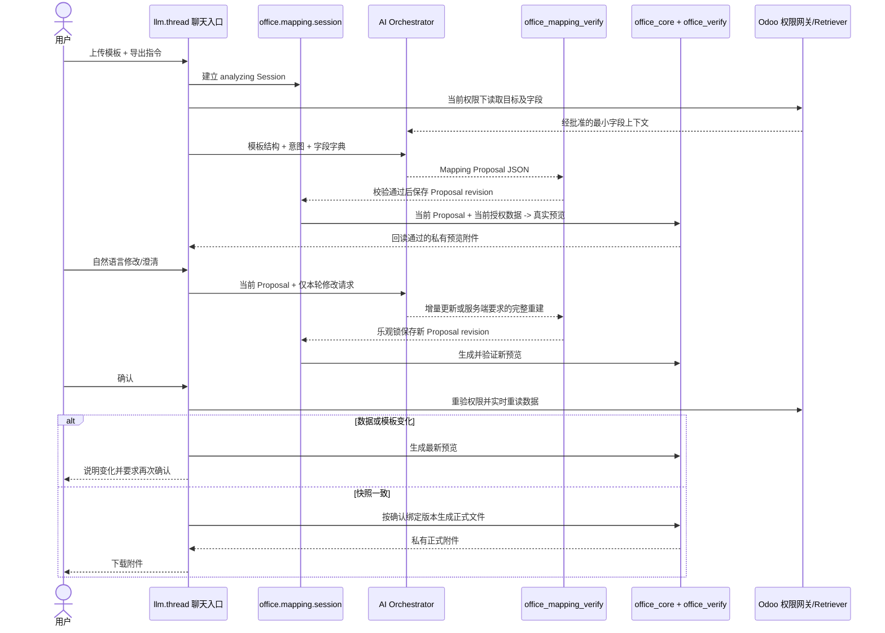

# Odoo Office Engine M2 技术设计变更：自然语言映射与版本化预览

| 项目 | 内容 |
|---|---|
| 文档编号 | TDD-OFFICE-ENGINE-M2 |
| 版本 | V1.1.0 |
| 状态 | **FROZEN V1.1.0 — 依据负责人本轮批准** |
| 基线 | `TDD_office_engine_m2.md` V1.0.0 Frozen；SRS M2 V1.1.0 Frozen Change Baseline |
| 适用范围 | 替代 V1.0.0 中映射 Owl 卡片、映射确认和聊天纠错相关设计；其余章节继续有效 |
| DDD | N/A，延续 V1.0.0 判定 |

## 1. 架构决策

废弃 `office_mapping_card` 的逐项下拉组件。用户通过原生聊天输入框完成自然语言纠错和明确确认；AI 仅产生/修改 Proposal，Python 校验器负责强校验，M1 产生真实预览和正式文件。普通业务字段及模板内容仍受已批准的数据使用策略和字段白名单约束。



## 2. Session 数据与状态机

沿用 `office.mapping.session`。`mapping_rules_json` 保存 Proposal，不保存样例值、业务数据、完整模板文本或 Prompt。新增/使用以下非业务数据元数据：

| 字段 | 用途 |
|---|---|
| `proposal_revision` | 仅在已校验 Proposal 变化时递增，代表映射版本 |
| `template_fingerprint` | 模板内容 SHA-256；不保存文件内容 |
| `proposal_data_fingerprint` | 已授权源数据快照 SHA-256；不保存字段明文 |
| `preview_attachment_id` | 当前私有预览附件 |
| `preview_proposal_revision` | 预览对应的 Proposal revision |
| `preview_data_fingerprint` | 预览渲染使用的数据快照 SHA-256 |
| `confirmed_revision` | 用户明确确认的 Proposal revision |

Session `revision` 是所有并发修改/状态写的乐观锁版本；`proposal_revision` 专门绑定映射规则。两者不可互相替代。

唯一状态集合：

`analyzing → revision_pending → preview_ready → confirmation_required → confirmed → generating → completed`

校验缺失/错误、资源失败或 Provider 错误进入 `failed`；适用状态可按合法流转重新分析。`preview_ready` 是预览已通过回读但尚未进入用户确认等待的短暂状态。Session 状态迁移仅可由服务层方法执行，状态和 revision 字段拒绝普通 ORM/RPC 写入。Addon 升级时将旧状态做确定性迁移：`collecting→analyzing`、`needs_clarification/editing→revision_pending`、`awaiting_confirmation→confirmation_required`、`rendering→generating`、`cancelled→failed`。旧 `awaiting_confirmation` 不自动视为已确认；因无当前版本预览绑定，用户必须重新生成预览。

## 3. 自然语言编排

### 3.1 初始 Proposal

首次请求仍复用现有 Provider、Retriever、结构化 JSON 和 `office_mapping_verify`。AI 接收模板目标/附近标签、用户意图及最小授权字段字典。非法 JSON 或不完整映射按现有上限做一次错误反馈重试；重试后仍缺失必填目标则保存安全的澄清 Proposal，回复缺失项原因，不生成可确认预览。

完整 Proposal 通过纯 Python 校验后，服务端保存为新版本并触发预览。摘要用自然语言展示语义标签与映射字段，不展示满屏坐标表单。预览附件为唯一真实填充样例，用户通过文件内容做复核。

### 3.2 增量修改与全量重建

普通纠错 Prompt 包含当前 Proposal、目标清单、授权字段标识/显示名和用户本轮语句；不得重复发送模板二进制或无必要业务样例。模型须明确保持用户未提及的映射不变。服务端对完整返回 Proposal 再次做 schema、字段、目标和完整性校验，只有验证通过才替换已存版本。

纠错之前，服务端在当前用户权限下复核模板哈希和授权源数据指纹：

- 指纹未变：受控增量更新；未改动项保留。
- 源记录字段值/行集合变化：丢弃旧 Proposal 作为依据，以最新授权数据和用户意图完整重建 Proposal。
- 模板内容变化：重新调用 M1 检查模板、重建目标清单并完整生成 Proposal；如果现有附件无法安全重新检查，明确要求重新上传，不得沿用旧坐标。
- 权限变化：停止读取/生成，显示权限错误；不得通过缓存绕过。

模型输出不能直接改变数据库。Proposal 保存前先校验候选版本，再在短事务内锁定 Session 行，比较 `expected_revision` 后写入，并递增 Session/Proposal revision。旧 revision 竞争失败时返回 stale 错误，旧结果绝不能覆盖新版本。

## 4. M1 预览与正式渲染

### 4.1 预览

`render_preview(env, session_id, expected_revision)` 使用 M1 `_inspect_chat_attachment` 检查源附件；使用 M1 `office_core.render_candidate` 生成候选，再用独立 `office_verify.verify_output` 回读。沿用 M1 的文件大小、ZIP 膨胀、内存和 15 秒 worker 超时预算；不建立无界进程，不使用浏览器或 AI 读写文件。

渲染耗时期间不持有 Session 数据库行锁。候选通过回读后，用短事务执行 `SELECT … FOR UPDATE` 并检查 Session revision、Proposal revision、模板指纹和 owner/company。通过后才创建私有、Session 绑定的 `ir.attachment`，将 `preview_proposal_revision` 和 `preview_data_fingerprint` 写入 Session，再在当前线程回复该预览。若 revision 已变化，候选立即由 ORM 清理，不得挂到线程。

新 Proposal 保存时旧预览引用失效。旧预览只通过 Odoo ORM 删除；新预览生成失败时保留当前 Proposal，状态为待处理，并明确报错。预览附件不得 public，不得作为正式交付或 Skill 成功凭证。

### 4.2 正式确认与生成

自然语言确认只有在 Session 处于 `confirmation_required` 且预览绑定当前 Proposal revision 时有效。服务端重新执行所有权、公司、Thread、源消息、源附件、目标记录、字段 ACL/白名单和当前数据检查。

在映射值按当前用户 Retriever 重新读取后，服务端比较当前模板/数据指纹与预览快照：

- 一致：将 `confirmed_revision` 绑定当前 `proposal_revision`，进入 `confirmed → generating`，调用 M1 `_render_request_sync`。幂等 UUID 由 Session 与 confirmed Proposal revision 稳定派生。M1 成功回读且交付后才转为 `completed` 并附加正式文件。
- 不一致：不调用正式生成。使用最新数据/模板刷新预览，并回复变化原因和“请再次确认”。刷新预览自身仍执行回读校验及 revision 锁。
- 权限撤销、读取失败、结构变化、M1 回读或交付失败：进入可见失败状态；不得生成可下载的候选输出。

## 5. 附件与并发安全

- 每个候选和最终文件均使用 M1 的同步、有界 Worker 能力；超出资源预算时拒绝并说明，不等待无限时长。
- Odoo 数据库行锁只用于 Proposal/预览/确认的短提交段，绝不覆盖 Office worker 的整个运行期。
- 预览附件 `res_model/res_id` 绑定当前 Session，`public=False`；Thread 消息只附加经过回读验证的预览。
- Proposal 替换后旧预览不得继续满足确认条件；回收仅通过 `ir.attachment.unlink()` 等 Odoo ORM/API。
- 正式附件只能由 M1 request 交付流程创建和归档；预览不能复用为正式输出。
- 失败时不保存明文 Prompt、数据样例或堆栈内容到 Session；日志使用 Session/请求 ID 和错误类别。

## 6. Owl / 聊天 UI 变更

删除 `office_mapping_card` 的 JS、QWeb、SCSS 资产以及 `Message.components` 注册。映射/纠错/确认使用 `llm.thread` 原生输入框和普通 Assistant `mail.message`。确认控件不是必需的 Owl 卡片；聊天回复明确说明用户可输入“确认”。预览和正式结果使用 Odoo 原生附件卡片显示。保留服务端 RPC 仅供必要内部集成/兼容；其存在不再意味着存在映射卡片 UI。

`ai_orchestrator.py` 负责 Proposal 初始生成、错误重试、语义增量纠错及指纹变化后的全量重建。`mapping_conversation.py` 区分普通修改、缺失澄清和最终确认。`render_bridge.py` 分离 `render_preview` 与 `render_confirmed_mapping`。`mapping_service.py` 负责 Session 所有权、revision 锁与 Proposal/预览绑定。

## 7. 验收测试设计（Mock Provider；M1 使用真实本地引擎）

| ID | Given / When | 必须断言 |
|---|---|---|
| TDD-M2-PREVIEW-01 | 首次请求；Mock 返回完整合法 Proposal | 一次生成受限真实 XLSX 候选、office_verify PASS、产生私有预览附件；附件和消息绑定相同 Proposal revision |
| TDD-M2-PREVIEW-02 | 当前预览就绪，用户修改 B12 | Provider Mock 收到当前 Proposal 和修改指令；其他映射保留；Proposal revision 增加；新预览 PASS，旧预览不可确认 |
| TDD-M2-PREVIEW-03 | 再次修改后明确确认 | 先验证最新预览；正式 request UUID 稳定；最终附件通过 M1 并归档；重复确认不产生第二正式附件 |
| TDD-M2-PREVIEW-04 | Mock 缺字段/字段未授权 | 回复缺失原因；不允许确认、不产生预览/正式文件 |
| TDD-M2-PREVIEW-05 | M1 预览 worker 抛错/超时 | Proposal JSON 和 Proposal revision 不回滚/不丢失；无半成品附件可访问；显示可理解错误 |
| TDD-M2-PREVIEW-06 | 旧 expected revision 或两个并发修改 | 仅一个版本提交成功；另一请求 stale 拒绝；附件/Proposal 不被覆盖 |
| TDD-M2-PREVIEW-07 | 用户 ACL/公司变化或预览后业务值变化 | ACL 变化阻断；值变化时仅刷新预览并要求再次确认；正式 request 不被调用 |

全套 Odoo 集成测试使用 TransactionCase/Mock Provider，不访问外网。真实 Provider 只在有明确数据授权的验证窗口测试。M1 引擎至少在独立 TransactionCase 中运行 synthetic `.xlsx` 真实读取、写入和回读；单元测试可 Mock Office core 错误分支。

## 8. 需求和实施边界

本设计的产品需求基线是 SRS M2 V1.1.0；仍受 TV 唯一模型、Provider 预算及既有 Data Policy 限制。此设计不增加任意文件格式、通用导入、自由业务分析或 AI 文件读写能力。V1.0.0 的私有 Skill 逻辑继续有效；成功保存 Skill 的条件仍为正式 M1 生成交付成功，预览成功不算成功导出。

## 9. 实现与验收证据补充（2026-10-31）

> 本节记录当前工作树中已核实的实现与测试，不改变 V1.1.0 冻结的产品设计决策。实现、自动化和真实浏览器结果分别列示；未覆盖事项不视为通过。

### 9.1 多轮 Proposal 与版本语义

- 当前有效 Proposal 来源是当前 Thread / owner / company 绑定的 `office.mapping.session.mapping_rules_json`；`revision` 是 Session 乐观锁版本，`proposal_revision` 是 Mapping 版本。历史快照由 `_save_mapping_from_service()` 写入 `proposal_history_json`，最多保留 20 个不同旧 Proposal revision。
- `office_save_mapping_preview()` 先规范化合并单元格别名，再将本轮 `mappings`、`clarifications`、`skipped_targets`、`clear_targets` 中实际出现的目标视为 patch。没有出现在 patch 中的目标保留原规则；空数组不代表删除全部规则；明确 `clear_targets` 仅覆盖相同目标。
- 带 `repeat_rows` 的轮次会先把上轮已扩展坐标还原到原模板坐标，再重新计算行扩展；之后将普通目标、公式引用、clear/skip 坐标按 M1 插行量转换。该行为由 `test_native_repeat_rows_tool_runs_generic_expansion_and_m1_preview` 和 `test_five_rows_shift_summary_formulas_merges_and_references` 覆盖。跨多轮对同一 repeat group 反复改变 `record_count` 的独立专用测试尚未发现；本次真实 V2/V3 修改未改变明细数量。
- 规范化后的 Proposal 有实际变化才保存新 Proposal revision。新 Proposal 保存、预览生成、回读验证、附件消息发布在一个数据库 savepoint 中；其中任一步抛错会回滚本次新 Proposal 和附件变更，保留上一有效 Proposal / 预览。该行为现由 `test_preview_failure_rolls_back_patch_and_preserves_previous_preview_delivery` 明确验证。失败时新 Patch 不成为当前 Proposal；用户需要在修复后重新提交修改。

### 9.2 恢复和文件交付语义

- 当前版本恢复：若当前 Proposal revision 与有效预览相同，返回现有预览及实际 Thread 关联元数据，不递增 revision；若无匹配预览，则重建并发布当前预览。
- 历史版本恢复：服务端依据 `proposal_revision` 找历史快照，使用当前模板 Manifest 和当前可读 Odoo 字段重新验证，然后将该快照作为一个新的 Proposal revision 保存、重新渲染并发布；不把 revision 计数器倒退。历史快照缺失或当前授权/结构验证失败时拒绝恢复。自动化覆盖为 `test_mapping_proposal_history_can_restore_a_prior_valid_revision`、`test_historical_restore_creates_new_revision_and_publishes_restored_preview` 及 `test_restore_current_proposal_returns_existing_preview_instead_of_history_error`。
- 预览成功条件依次为 M1 `render_candidate()` 成功、`office_verify.verify_output()` 回读状态为 `PASS`、Session 锁定绑定附件到准确 Proposal revision、`_post_preview_message()` 把私有附件关联到当前 `llm.thread` 消息。工具返回的 `attachment_posted_to_thread` 通过查询/验证实际消息关联后构造；它不单独证明用户已下载文件。
- 自动化测试分别覆盖文件生成/回读、附件与 Thread 消息关联、工具返回附件元数据、真实浏览器下载 HTTP 200。只有最后一项配合本次实际浏览器打开下载，才作为用户可取得文件的运行证据。

### 9.3 本次真实 Thread V1 → V2 → V3 验收

环境：Odoo 数据库 `odoo18ce`，服务端口 8091，现有原生 `llm.thread` 8217，模型 `gpt-5.6-luna`（OpenAI Provider）。使用该 Thread 中已绑定的 S05457 与原模板，没有新建测试模型、模拟 Provider 或重置会话。V1 是本次验证的有效预览基线；为让随后清空可被逐格验证，V1 有意把订单号放入 F17 对应的合并写入锚点 E17。

| 版本 | 用户操作 | 工具与附件证据 | 下载文件 |
|---|---|---|---|
| V1 | 基于当前 Thread 绑定的订单和模板生成第一版预览 | Thread 8217 的原生 Provider 请求返回 HTTP 200；预览附件 22324 的下载请求 HTTP 200 | `~/Downloads/preview_S05457_CMR-危险品禾麦CMR模板 (14).xlsx` |
| V2 | 只清空 F17 对应的合并区域 E17:H17 | Tool 返回 `preview_ready`；附件 22325、消息 60509、`attachment_posted_to_thread=true`；下载请求 HTTP 200 | `~/Downloads/preview_S05457_CMR-危险品禾麦CMR模板 (15).xlsx` |
| V3 | 只清空 B7；保留其他字段、明细和公式 | Session 6549，Session revision 31，Proposal revision 10；附件 22326、消息 60516、`attachment_posted_to_thread=true`；下载请求 HTTP 200 | `~/Downloads/preview_S05457_CMR-危险品禾麦CMR模板 (16).xlsx` |

使用 `openpyxl.load_workbook(..., data_only=False)` 对下载后的三份文件做全工作表单元格比较：

- V1 → V2 唯一差异：`E17: "S05457" → None`。
- V2 → V3 唯一差异：`B7: 原客户地址 → None`。
- B3、B4、F16、D23:D28 六行明细、G29 的 `=SUM(G23:G28)`、工作表范围和 15 个合并区域在三个版本间保持不变；E17 在 V2/V3 均为空。
- `data_only=False` 证明公式文本仍在文件中；本次未运行 Excel/LibreOffice 公式计算器，因此不声称验证了公式计算缓存值。

服务器日志 `/private/tmp/m2_incremental_browser_8091.log` 记录了三轮 `/llm/thread/generate` 请求、OpenAI Chat Completions HTTP 200、Thread 8217 generation 完成及附件 22324/22325/22326 的 `/web/content` 下载 HTTP 200。V3 期间 Provider 曾记录一条 `Removing tool message ... no matching assistant message with tool_calls` 警告；随后模型调用继续完成、工具返回预览并成功下载。该非致命历史消息兼容警告应继续观察，不能用本次成功掩盖。

### 9.4 自动化验证记录

最终工作树执行命令（没有 `-u`，未升级模块）：

```bash
./venv/bin/python odoo-bin -c odoo.conf -d odoo18ce --http-port=0 \
  --test-enable --test-tags /office_engine_m2 --stop-after-init \
  --log-level=test --logfile=/private/tmp/m2_multiturn_addon_tests_final.log
```

结果：Addon 测试统计 `140 tests`，实际 runner 汇总 `0 failed, 0 error(s) of 112 tests`，命令退出码 0。`TestOfficeMappingRpcHttp.test_real_backend_browser_renders_select_and_saves_over_rpc` 因测试环境缺少 `websocket-client` 被跳过；该遗留测试仍断言旧 Owl 下拉卡片 UI，不是本次原生聊天验收的证据。本次实际浏览器验证由真实 8091 Thread 8217 完成。日志同时报告三个无关自定义模块不可加载：`wd_advanced_m2o_record_panel`、`wd_evidence_album`、`wd_qooling_app`。

多轮修改相关自动化证据：

- `test_partial_mapping_update_preserves_other_rules_and_returns_published_attachment`
- `test_explicit_clear_renders_blank_and_ignored_formula_skip_preserves_formula`
- `test_preview_failure_rolls_back_patch_and_preserves_previous_preview_delivery`
- `test_mapping_proposal_history_can_restore_a_prior_valid_revision`
- `test_historical_restore_creates_new_revision_and_publishes_restored_preview`
- `test_restore_current_proposal_returns_existing_preview_instead_of_history_error`
- `test_preview_tool_streams_attachment_metadata_to_native_chat_store`
- `test_native_repeat_rows_tool_runs_generic_expansion_and_m1_preview`
- `test_cc_test_007_real_engine_generates_and_independently_verifies_xlsx`

新增的历史恢复与失败回滚测试首次运行时因夹具错误地把默认工作表命名写为 `Sheet1` 而失败；夹具修正为真实的 `Sheet` 后，两项定向测试通过，且随后最终全量回归通过。这个首次失败属于测试夹具坐标错误，非实现失败。

### 9.5 未完成或尚无证据的验收

- 本次没有在真实浏览器执行“正式文件 Finalize”或核实正式归档；验收对象是每轮预览及其下载。
- 预览失败后的旧版本保护通过新增的 TransactionCase 故障注入测试证明，未在真实 Provider/UI 上人为制造 M1 失败。
- 当前历史版本与当前版本恢复有自动化覆盖；真实浏览器里没有执行恢复操作。
- 旧的 Owl 下拉卡片 HttpCase 被跳过，且与已冻结的原生聊天 UI 决策不一致；若要把它纳入 CI，应另行将该过时测试改成原生聊天验收，而不能把本次 skip 记为通过。
- 工作树原有未提交更改均保留；本次只在现有未跟踪的集成测试文件中增加两项回归用例，并在此 TDD 末尾增加本节证据记录。未提交、未暂存、未提交 Git commit。

## 10. Phase C：Document Operations 到 office_core 的迁移记录（2026-11-03）

> 本节是实现记录，不修改上文冻结的产品要求。它取代 9.2 中“Mapping 预览在 core 外单独调用 `office_verify.verify_output()`”的旧调用描述；9.3 的浏览器验收记录仍是此前真实运行的证据，不代表本次 Phase C 曾重新操作浏览器。

### 10.1 当前契约与调用边界

- `office_document_operations` 保留 Schema 1.0 读取兼容。Schema 1.1 增加 `source_sha256`、受限算术 `set_formula` 和首位 `repeat_rows` 结构操作；repeat-row 继续调用 `office_core.row_expansion.expand_repeat_rows()`，没有用普通 `insert_rows` 替代可能移动合计行、公式和合并区域的既有语义。
- `office_core.execute_document_operations(bytes, filename, mime, operation_list, budget)` 是版本化 XLSX 操作的字节入口。它把请求交给同一受限、可终止 Worker；Worker 内部才创建短生命周期临时路径并调用 `DocumentOperationEngine`。Odoo 生产调用方不接收或传入文件系统路径。
- 为兼容已有 M1/M2，`office_core.render_candidate()` 仍接受旧 Mapping Writes；对 XLSX，`_render_xlsx()` 校验后将每个 Mapping 写入及 repeat-row 指令转换为 Schema 1.1 操作序列，再交给 `DocumentOperationEngine`。重复行是序列的第一个 `repeat_rows` 操作；映射目标按扩展后结构验证。格式和数值字节兼容转换作为 candidate postprocessor 执行，之后仍需通过已保存文件验证。
- XLSX 通过 `office_document_operations.validator.validate_saved_output()` 保存后重新打开验证，再由 `office_verify.verify_inline()` 在同一个 `office_core` Worker 内进行目标、结构、格式、公式文本与显式清空语义回读。候选报告同时包含 `document_operations` 与 `office_verify` 子结果；顶层输出 SHA 必须等于候选字节 SHA。该验证不计算 Excel 公式缓存。
- DOCX 仍通过 `office_core.render_candidate()` 的格式 Adapter 处理旧 Mapping Writes；保存后在同一 Worker 内执行 `office_verify.verify_inline()`。本次没有将 DOCX 文本操作加入 XLSX 导向的 Schema 1.1，也没有移除兼容 Adapter；将来扩展 DOCX 操作需新增版本化操作契约和独立测试后再迁移。
- `office_engine_m2.services.render_bridge.render_preview()` 与 `office_engine_odoo.models.office_document_request` 都调用 `render_candidate()`，只读取其中的强制验证报告；报告缺失、状态非 PASS 或 SHA 不一致时拒绝进入附件发布。生产路径不再在 core 返回后另启 `office_verify.verify_output()` 作为第二套验证流程。预览/正式文件的 ORM 附件、Thread 消息、Revision 和 Finalize 生命周期未由本次改动替代。

### 10.2 代码位置

| 职责 | 当前实现 |
|---|---|
| Schema 1.0/1.1 选择和预检 | `mymodules/office_document_operations/schema.py`、`schemas/document_operation_v1.1.schema.json` |
| 临时路径隔离、重复行重放、候选原子发布和保存后校验 | `mymodules/office_document_operations/engine.py`、`validator.py`、`xlsx_adapter.py` |
| 字节 API、Worker 参数与 Mapping Writes 转换 | `mymodules/office_core/service.py`、`engine.py` |
| 通用重复行语义 | `mymodules/office_core/row_expansion.py` |
| 统一语义回读 | `mymodules/office_core/engine.py::_attach_independent_verification()` 与 `mymodules/office_verify/verify.py::verify_inline()` |
| M2 预览入口 | `mymodules/office_engine_m2/services/render_bridge.py::render_preview()` |
| Odoo 请求入口与附件发布门禁 | `mymodules/office_engine_odoo/models/office_document_request.py` |

### 10.3 自动化证据及限制

本次实际执行：

```bash
PYTHONPATH=mymodules venv/bin/python -m pytest -q \
  mymodules/office_document_operations/tests \
  mymodules/office_core/tests \
  mymodules/office_verify/tests
```

结果：`90 passed`。测试涵盖 Schema/Adapter 操作、排序/格式/清空/插行、公式文本写入、重复行 + Mapping 顺序、旧 Mapping Writes 转换、未格式化坐标回读、显式清空、数值零值、DOCX 回读、保存候选独立校验和陈旧源文件指纹拒绝。公式只核对公式文本，不代表由 Excel/LibreOffice 重算。

另执行 `venv/bin/python -m compileall -q` 覆盖 `office_core`、`office_document_operations`、`office_verify` 和两个 Odoo 生产调用文件，命令成功。`git diff --check` 的结果见本轮工作报告。

本次未运行 Odoo `TransactionCase`、模块升级、8091 浏览器或真实 Provider。尝试用普通 pytest 收集 `office_engine_m2` 的 TransactionCase 时，在导入 addon 阶段因 Odoo 要求模型模块名以 `odoo.addons.*` 开头而失败；随后没有在正在监听 8091 的共享数据库上运行可能写入的 addon 测试。已有 `_load_trusted_python_package()`、真实 M2 TransactionCase 和 2026-10-31 浏览器记录不等同于本次 Phase C 的 Odoo 集成验证。最终状态因此是“纯 Python 集成通过；Odoo/真实 UI 集成尚未验证”，而不是 Phase C 整体 PASS。

### 10.4 剩余兼容边界

- Schema 1.1 和 `execute_document_operations()` 当前正式支持 XLSX；Schema 1.0 仅保留兼容读取。生产 Mapping Writes 的 XLSX 路径已收敛到同一操作执行器。
- DOCX 仍使用 core 内既有 Mapping Adapter，但通过相同的 `render_candidate()` 和统一保存后验证出口；没有并行的 Odoo 路径，也没有声称 DOCX 已由 Document Operation Schema 执行。
- `office_core` 的独立测试无法证明 Odoo module registry、spawn Worker 的真实 addon 搜索路径、Session/Revision 更新、正式附件与 `mail.message` 绑定或前端卡片。需要在隔离 Odoo 测试数据库执行 TransactionCase，并在单独验收窗口执行浏览器回归后，才能对 C7 和端到端交付给出 PASS。
