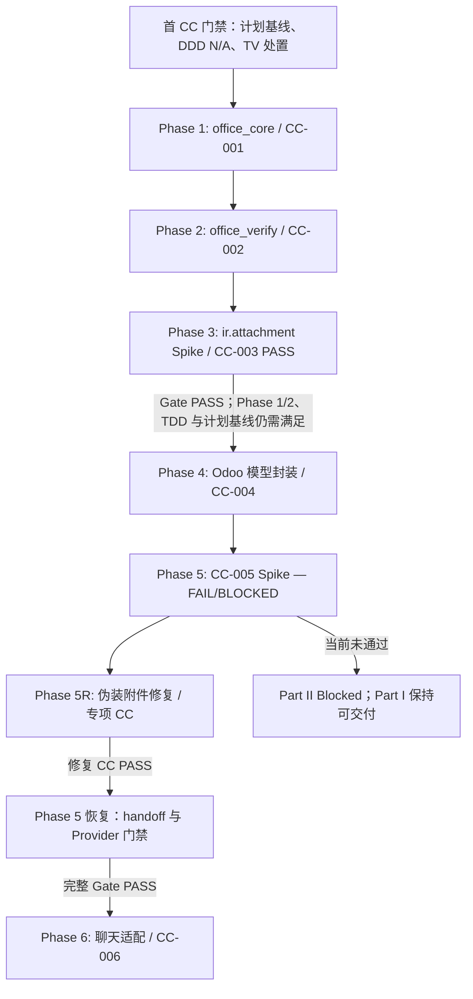

<!-- Skill bundle metadata
Source template: docs/skill/odoo-project-workflow/references/templates/Planning/IMPLEMENTATION_PLAN_TEMPLATE.md
Source version/status: v0.1; Draft
Template synchronization check: PASS, 2026-10-20
-->

# Odoo 通用 Office 文档自动化引擎 M1 实施计划

## Document Information

| Item | Value |
|---|---|
| Document | `IMPLEMENTATION_PLAN_office_engine_m1` |
| Version | V0.4 |
| Status | **Frozen — approved by business/technical owner** |
| Baseline validity | **VALID** |
| Project / Module | Odoo 通用 Office 文档自动化引擎 M1 |
| Plan owner | 项目技术负责人 |
| Created | 2026-10-21 |
| Baseline date | 2026-10-21 |
| Approval / baseline record | 负责人于 2026-10-21 明确批准冻结 V0.4；本修复专项同时引用 TDD 补充 V1.0.0 Frozen |

### Freeze Gate

本文件为 Implementation Plan V0.4 Frozen 当前计划。它在保留 V0.3 Phase 3/4 状态的基础上，记录 CC-005 Provider 前 Spike 的实际结果：`CC-TEST-006 FAIL`（`ISSUE-005-01`）；CC-005 `CC-TEST-005/008` handoff 验证仍为 `BLOCKED/INCONCLUSIVE`；CC-004 FR 仍为 `NOT SATISFIED`。新增 `CC-OFFICE-M1-PRE-ROUTE-FIX` 修复阶段，作为恢复 Provider 前安全门禁的前置工作。计划及 TDD 补充冻结均不授权修复 CC 实施；该 CC 仍须单独冻结并获明确授权。V0.3 保留为历史计划版本。

本计划安排的顺序是：纯 Python `office_core` 同步文件读写及容器安全校验 → 独立回读校验引擎 → `ir.attachment` 事务 Spike → Odoo 模型封装。聊天适配作为独立第二部分：CC-005 已记录的伪装附件漏洞先由 Phase 5R 修复；随后仍须完成 Provider 前 handoff/隔离恢复 Gate，完整通过后才能建立和实施适配 CC。

#### First CC Gate Checklist

- [x] SRS V1.0.0 Frozen。
- [x] DDD 适用性：业务负责人确认 N/A。理由：M1 的 `office_core` 是无状态文件处理技术引擎，不引入业务聚合根或复杂领域流转；Odoo 请求/附件封装按 TDD 直接使用 Odoo ORM，不单独建立领域模型。
- [x] TV Plan 已执行，原始 TV 与 P0-A/B/C 结果保留原态；TDD V0.4 已冻结逐格式 fail-closed 处置。Partial 项不阻止纯核心设计/实施，但逐项格式能力开放仍须通过该格式 Gate；CC 必须明确实际范围，不得声称未验证能力通过。
- [x] TDD-OFFICE-ENGINE-M1 V0.4 Frozen；SRS / TDD 版本与本计划引用一致。
- [x] CC-001 运行时库存已记录；业务负责人批准在 CC-001 中选择、安装并锁定所需依赖。精确包版本须在 CC-001 冻结前确定，且在代码变更前完成兼容性核验。
- [x] 本计划 V0.4 已获负责人明确批准并建立 Frozen 基线；本次新增专项 TDD 补充 V1.0.0 Frozen；后续变化按 §11 变更控制。
- [x] 已为每个实施阶段列出拟建 CC ID 和范围；实际 CC 创建后须回填路径/ID。

**Gate result:** 首 CC Gate 已通过，不重新打开 Phase 1。V0.4 记录 Phase 3 PASS、Phase 4 基线及 Phase 5 当前失败/阻塞状态，并将本修复 CC 映射到恢复聊天安全门禁的专项阶段。修复 CC 单独冻结和授权之前不得实施；其通过也不代表 CC-005 handoff 或 Phase 5 整体 PASS。

**Evidence / approval reference:** SRS、TDD、TV 及 P0 报告路径见 §1；业务负责人于 2026-10-20 在本会话确认 DDD N/A、批准 CC-001 依赖选择/安装/锁定并批准计划冻结。CC-001 仍须定义精确依赖版本和执行范围。

## 1. Upstream Baselines

| Authority / Input | Version / ID | Status | Location |
|---|---|---|---|
| SRS | V1.0.0 | Frozen | `docs/requirement/SRS_office_document_automation.md` |
| DDD | N/A | 业务负责人已确认不适用，2026-10-20 | M1 核心是无状态文件技术服务，不包含需独立 DDD 建模的业务聚合或领域流转 |
| TV Plan | V1.0.0 | Frozen | `docs/verification/TV_Office_Engine_M1_Plan.md` |
| 原始 TV 报告 | V0.1 | Partial | `docs/verification/TV_Office_Engine_M1_Report.md` |
| P0 补验报告 | V0.2 / V0.3 / V0.4 | 最新状态见 V0.4；原件保留 | `docs/verification/evidence/TV_Office_Engine_M1/P0_Followup/` |
| TDD 当前基线 | TDD-OFFICE-ENGINE-M1 V0.4 | Frozen，2026-10-21 | `docs/design/TDD_office_engine_m1_v0.4.md`；V0.3、V0.2、V0.1 历史版另存 |
| Provider 前伪装拦截补充 | TDD 补充 V1.0.0 | Frozen，2026-10-21 | `docs/design/TDD_office_engine_m1_pre_route_fix_addendum_v1.0.0.md`；仅适用于本修复 CC |
| 源码调查 | 当前 Draft | 调查输入，不覆盖 TDD | `docs/analysis/office_automation_source_review.md` |

TV 状态按原报告保留：P0-A DOCX `PARTIAL`；P0-B XLSX `PARTIAL`；P0-C 本机 Queue Job 链路 `PASS`、生产资源预算 `INCONCLUSIVE`；M1 TV 总体 `Partial`。P0-C 的生产异步容量缺口不阻塞同步核心。若上游基线变更，须先评估受影响阶段、验收和 CC 映射。

## 2. Objective and Scope

### 2.1 Objective

按冻结 SRS 和 TDD 交付 M1 Office 同步底座：以无状态纯 Python 核心安全检查 Office 容器、读取声明范围内结构并按显式 Mapping Plan 写出候选文件；使用独立回读引擎验证候选；再由 Odoo 模型封装处理用户/附件权限、请求状态及结果附件。聊天适配作为第二部分，在独立 Provider 前路由 Spike 通过后推进。

本计划不承诺任意 Office 文件无损兼容。每种格式仅开放已有目标运行时证据支持的结构能力；未知、损坏、超预算或无保真证据的输入必须受控拒绝。若 SRS 的格式验收要求不能在声明能力范围满足，须走 SRS 变更，不得由实现缩小需求。

### 2.2 In Scope

- Part I：纯 Python `office_core`，容器/格式/资源校验、结构读取、受限映射写入及隔离候选输出。
- Part I：与写入服务分离的 `office_verify` 回读校验，校验格式、Mapping 目标值、公式文本和已声明结构。
- Part I：在 `ir.attachment` Spike 通过后，最后实现最小 Odoo 请求/附件模型封装；M1 Mapping Plan 由 Python 单元测试或内部服务调用提供。
- Part II：Provider 前聊天安全门禁；CC-005 已发现身份伪装漏洞，须先完成专项修复 CC，再分别解决 handoff 与 CC-004 路径门禁，不能将拒绝性修复等同于内部路由通过。
- 四种扩展名 `.xlsx`、`.docx`、`.xls`、`.doc` 的分格式准入、支持范围、拒绝行为和验收证据。
- 同步资源限制、无长业务锁、失败清理、附件权限、错误脱敏和回归追溯。

### 2.3 Out of Scope

- M1 映射编辑器、聊天中的 Mapping Plan 编辑/确认 UI、AI 语义推断、Odoo 业务记录/字段查询和 Skill；映射前端交互属于 M2。
- Queue Job 核心依赖、通用异步任务系统、自动重试、取消、断点恢复、生产队列容量建设；异步增强在同步核心验收后另行设计。
- PDF、图片、PPT/PPTX、宏执行、业务数据导入，以及未通过格式门禁的 Office 高级对象。
- 修改 Odoo 官方源码或官方 Addon；安装/升级依赖、启用模块、修改环境配置或实现代码不属于本次文档任务。
- 当前任务中创建实际 CC、启动编码或声称 TV/功能验收通过。

### 2.4 Constraints

- 纯 Python 核心不导入 Odoo，不接收 `env`、uid、附件 ID、服务器路径、命令行、动态代码或 Provider 对象；只处理有界输入和受控输出。
- 先完成核心读写与安全校验，再完成回读引擎；持久化模型最后实施，且不得早于附件事务 Spike 通过。
- `office_core` 与 `office_verify` 不绑定 HTTP/浏览器生命周期；同步超预算时拒绝或受控终止，不无限占用 Worker。
- Mapping Plan 只允许 TDD 定义的结构和操作白名单；缺失、显式 null、空字符串、类型错误、未知键及不可写目标均按契约区分。
- 结果附件只有经过后端回读校验和交付前权限重验后才可下载；失败输出不可见、不可下载。
- M1 不提供 Mapping UI。SRS AC-05 保持 Frozen 语义；Phase 6 退出前须由业务负责人批准阶段追溯备忘录，区分 M1 内部服务验证与 M2 最终用户确认验收。该备忘录不将内部调用记作用户确认通过；若改变验收含义，先履行 SRS 变更流程。
- 不依赖 Queue Job；P0-C 生产预算 INCONCLUSIVE 不作为同步核心阻塞项。
- 遵从用户已给出的开发环境约束：使用项目 `venv` 和 `odoo.conf`、现有 `odoo18ce` 开发库；未经另行批准不建立隔离数据库。实际执行前仍要记录目标 Odoo/Python/PostgreSQL/依赖版本和资源限制；不从 TV 环境推定生产环境。

## 3. Readiness Prerequisites

| Prerequisite | Required state / evidence | Owner | Priority | Status |
|---|---|---|---|---|
| SRS / DDD / TDD baselines | SRS V1.0.0 Frozen、TDD V0.4 Frozen；DDD 适用性有明确结论 | 业务/技术负责人 | P0 | SRS/TDD 就绪；DDD N/A 已由业务负责人确认 |
| 按 CC 范围执行 TV 处置 | CC 明确引用 TDD 的逐格式拒绝/启用策略；未验证能力不在该 CC 中开放；发现已存在 Failed/Skipped/Blocked/Missing 证据时按工作流取得逐项处置/授权 | 技术负责人 | P0（按能力） | TDD 已有 fail-closed 处置；P0-A/B 仍 Partial，分别阻塞其未验证能力，不笼统阻塞纯核心 |
| 开发运行时基线 | 确认 `venv`、`odoo.conf`、现有 DB `odoo18ce`、Odoo/Python/PostgreSQL 版本、addons 路径与当前进程配置 | Odoo 技术负责人 | P0 | 用户给出环境位置/使用约束；精确版本快照待执行阶段记录 |
| 文件引擎依赖 | CC-001 内评估候选 Python 库/LibreOffice 的精确版本、许可和目标 venv 兼容性；在代码实现前安装并锁定。业务负责人已批准该 CC 范围内的依赖选择/安装/锁定 | Office 技术负责人 | P0（CC-001 实现前及各格式启用前） | 尚未选择或锁定；不阻塞 CC-001 起草/冻结，未锁定前不得开始依赖相关代码或开放格式 capability |
| 代表性样本与期望结构 | 对每个要开放的格式提供授权样本、哈希、对象清单和可核验预期结果 | 业务样本负责人 | P0（按格式） | 有 `销售管理模板.xlsx`、`TARGET.docx` 的已有证据；不代表全部格式/结构 |
| 同步资源预算 | 明确输入/展开/结构规模、时限、内存、临时盘、同步并发上限及测量方法 | 部署负责人 | P0（生产启用） | OPEN-OFFICE-05 未关闭；生产处理不得开放 |
| 附件事务 Spike | 通过 Odoo shell / ORM 验证附件创建、回滚、清理、filestore 副作用、授权读取；形成报告 | Odoo Runtime 验证人 | P0（模型封装前） | **PASS — CC-003 FR SATISFIED**；证据与限制见 §4 Phase 3 |
| 聊天路由 Spike | Provider 前身份拒绝、各 Provider payload 隔离与授权 handoff 分开验证 | Odoo-LLM 技术负责人 | P0（聊天适配前） | CC-005 已执行：CC-TEST-006 FAIL；CC-TEST-005/008 handoff BLOCKED/INCONCLUSIVE；Phase 5R 修复 CC 尚为 Draft；只阻塞 Part II |
| CI / 自动化执行方案 | 记录可重复的纯 Python 单元测试、Odoo 模块测试及命令；测试隔离于业务模型的核心契约明确 | 技术负责人 | P1 | 待 CC/实施阶段确认 |
| 输出附件留存 | 确定临时文件/结果附件保留和清理策略 | 数据/隐私负责人 | P0（生产附件交付前） | OPEN-OFFICE-12 未关闭 |

任一 P0 前置条件未满足时，只能继续不依赖该条件的文档/纯 Python 边界工作；不得完成受影响阶段或宣称 M1 已交付。

## 4. Implementation Phases

### Phase 1: `office_core` 无状态文件读写与容器安全

**Objective**

建立不依赖 Odoo 的同步 Python 核心。第一阶段包括输入容器与资源校验、结构读取，以及只按白名单写入模板副本并生成隔离候选输出；候选文件不作为成功或可交付结果。

**Inputs and dependencies**

- 冻结 SRS V1.0.0、TDD V0.4；首 CC Gate 已解除。
- 已知项目运行时：Odoo 18 开发环境、项目 `venv` Python 3.11.9。当前依赖只读库存为 `openpyxl 3.0.9`、`xlrd 1.2.0`、`xlwt 1.3.0`、`lxml 4.9.3`；`python-docx` 未安装。这些是库存事实，不是采用批准或兼容性结论。
- 业务负责人已批准在 CC-001 中评估、安装并锁定所需依赖。CC-001 必须先列出精确候选版本、许可、运行时兼容性和验证方法并冻结；获得 CC 后才能安装，代码实现前必须完成锁定。
- 按格式列出的能力声明和 TV 适用性；P0-A/B Partial 项不得写成已通过。

**Deliverables**

- 纯 Python `office_core` 接口：有界输入、格式/容器识别、安全校验、结构读取、Mapping schema 校验、受限写入、隔离候选结果及稳定错误类别。
- CC-001 包含依赖选择、安装和版本锁定；提交锁文件/依赖变更前记录候选理由、兼容性证据和批准范围，不能把当前库存直接升级为目标版本。
- 容器校验覆盖 ZIP/OLE 识别、文件签名/扩展/MIME 一致性、加密/损坏/格式伪装、条目和展开限制、路径安全、硬超时/资源边界。
- 分格式能力表与拒绝清单；只有经验证能力可进入 enabled capability 集合。
- 单元测试和 ATR 证据；不得依赖 Odoo ORM、Provider 或 HTTP。

**Acceptance gate**

- 对所有输入，核心服务只接受有界字节/流和服务端策略，不接受路径或可执行参数；静态依赖检查证明 `office_core` 不依赖 Odoo。
- 空文件、伪装/损坏/加密容器、展开超限、未知结构、错误类型及不支持格式均稳定拒绝；无无界解压、无宏/脚本执行、无部分成功文件。
- 结构输出含稳定元素 ID、未知对象标记和格式指纹；不声称读取未识别结构。
- Mapping Plan 严格按 schema/操作白名单拒绝未知键、错误目标、公式目标和非法 null；空字符串、缺失值和类型错误可区分。
- 写入只产生候选文件；源文件不变。对没有通过真实运行时验证的格式/结构关闭写入能力并明确拒绝。
- 解析器警告不得用全局 `warnings.simplefilter("ignore")` 隐去；必须捕获并分类。任何可能表示扩展结构被丢弃或降级的警告均触发失败关闭或明确拒绝。
- `.xlsm` 必须在进入 Office 解析器前拒绝；`keep_vba=False` 不作为清洗或支持宏文件的手段。处理 `.xlsx` 公式表达式时，读取策略必须保留公式文本，不能以 `data_only=True` 读取结果代替表达式。
- 未完成目标格式验证时，阶段可交付通用安全底座，但不能据此宣称 `.xlsx/.docx/.xls/.doc` 均满足 SRS。

**Verification evidence**

- 纯 Python 单元测试、容器恶意/畸形样本测试和资源边界测试，记录库版本、样本哈希、耗时、内存与输出指纹。
- `TEST-OFFICE-002/003/004/005/011` 对本阶段适用部分的 ATR；未适用格式须标记 N/A 并说明，不能把未测写成通过。
- Evidence 放入项目按 CC 建立的 `docs/implementation/.../` 记录目录；正式路径在 CC 中确定。

**CC mapping**

- **实际 CC：** [CC-OFFICE-M1-001](../context/intent/CC-OFFICE-M1-001.md)（Frozen；[FR SATISFIED](office-engine-m1/CC-OFFICE-M1-001/FR-OFFICE-ENGINE-M1-CORE-FOUNDATION.md)）。该关闭仅限 CC 声明范围，不表示 Phase 2 或 M1 全部完成。

### Phase 2: 独立 Office 回读校验引擎

**Objective**

在核心能够生成隔离候选后，实现独立 `office_verify`，使每个候选输出都必须通过完整性校验才可能进入后续 Odoo 交付。

**Inputs and dependencies**

- Phase 1 的冻结服务契约、格式能力声明和候选输出。
- 目标格式的基线样本/结构指纹；验证不足的格式保持拒绝。

**Deliverables**

- 独立回读组件：重新打开候选输出，校验输出可解析性、输入/输出格式一致或获准升级、Mapping 目标值、公式文本、合并/结构及声明能力内需保留的对象。
- `office_verify` 必须是独立 Python 模块；不得导入 `office_core` 的私有函数或解析器状态。双方只依赖公开、版本化的数据契约。对 `.xlsx/.docx` 优先使用独立 ZIP/XML 检查路径核对关键结构；旧格式使用单独验证过的读取/转换策略，不能仅因模块分离就声称验证独立。
- `.xlsx` 公式表达式与公式缓存分别记录；不承诺公式重算。对未知 OOXML part、外部链接、条件格式、图像、页眉页脚等仅按逐项验证结果作承诺。
- 四格式 read/write/readback capability matrix 和失败关闭策略。

**Acceptance gate**

- 任一回读解析失败、目标值不一致、公式被覆盖/丢失、必检结构差异或格式错误均产生失败结果；不得预览/交付候选。
- `.xlsx` 回读能区分公式文本与缓存；缓存是否存在/刷新按基线说明报告，不把 `None` 当公式值通过。
- 测试证明 `office_verify` 不依赖 `office_core` 私有 API；对可行格式，至少一项关键完整性检查使用不同于写入引擎的解析路径，并用故意破坏的公式/结构样本证明能检测差异。
- `.docx`、`.xls`、`.doc` 只有在各自样本和目标依赖验证通过后才开放能力；单个样本结果不得泛化为全格式保真。
- 所有转换子进程均设置硬超时并隔离进程组；超时先终止进程组，宽限期后仍未退出才强制结束，避免挂住 Odoo Worker。
- 通过与失败结果均能以稳定摘要复核，核心服务不创建 Odoo 附件。

**Verification evidence**

- 针对公式/样式/合并/图片/外部关系/Word 表格和页面元素的 before-after 结构比对及重开验证。
- P0-A/P0-B 对应缺口的目标运行时补证按其事实单独记录；不得覆盖原始 TV 报告或把 Partial 改写为 Pass。
- `TEST-OFFICE-006/007/008/010` 及 `AC-06/08/23/29/30/31` 的适用 ATR/报告，记录未测能力。

**CC mapping**

- **已关闭 CC：** [CC-OFFICE-M1-002](../context/intent/CC-OFFICE-M1-002.md)（v1.0.0 Frozen；[FR SATISFIED](office-engine-m1/CC-OFFICE-M1-002/FR-OFFICE-ENGINE-M1-READBACK-VERIFICATION.md)）。范围为独立回读校验引擎；关闭仅限纯 Python 回读包，不表示真实复杂模板或附件交付已验证。

### Phase 3: `ir.attachment` 事务与清理 Spike — PASS

**Objective**

验证 Odoo 18 `ir.attachment` API 的读取、创建、回滚、清理和 filestore 副作用，为后续持久化模型提供边界证据。

**状态：PASS（仅限 CC-003 声明的开发环境 Spike 范围）。** CC-003 已于 2026-10-21 依据 FR `SATISFIED` 关闭；执行基线为 Odoo runtime `ab89f54727807a25b16f3ad7e699fd05c782f3d9`。证据见 [CC-003 FR](office-engine-m1/CC-OFFICE-M1-003/FR-OFFICE-ENGINE-M1-ATTACHMENT-SPIKE.md)、[Spike 报告](office-engine-m1/CC-OFFICE-M1-003/OFFICE-ENGINE-M1-ATTACHMENT-SPIKE-REPORT.md)、IHR、ATR 和环境快照。该结论不外推到生产容量、大文件或即时物理擦除。

**已验证范围与剩余边界**

- 已观察合成附件 ORM 创建、读取、提交、回滚、ORM 删除、用户权限拒绝和 filestore/GC 标记；无产品代码或数据库 schema 变更。
- 回滚/ORM 删除后物理对象不会同步删除；残留对象可按 Odoo GC 标记识别。全局 GC 未运行，未直接删除文件；这不是物理擦除能力的 PASS。
- 负责人已确认本期产品语义：失败/回滚时数据库附件记录和下载授权立即失效，物理文件由 Odoo 原生 GC 延迟回收，不承诺即时物理擦除。请求失败路径不得调用全局 GC 或直接删除 filestore 文件。
- 本 Spike 未证明大文件、长时间渲染、生产负载或附件创建的普遍事务预算；Phase 4 仍需运行针对产品模型的事务、竞态和失败清理测试。

**交付与 Gate 结果**

- Spike 记录已形成并由负责人关闭；结果表明数据库记录/引用失效后，Odoo 原生 GC 延迟回收是本期获接受的补偿路径。
- 物理对象没有被删除，且本次没有执行 GC；计划不要求 CC-004 实现即时物理清除或自定义清理任务。
- Phase 3 Gate **PASS** 只解除“必须先完成附件事务 Spike”这一模型封装前置，不代表 Phase 4 产品实现已通过，也不免除其 ORM/权限/事务验证。

**CC mapping**

- **已关闭 `CC-OFFICE-M1-003`**：[FR SATISFIED](office-engine-m1/CC-OFFICE-M1-003/FR-OFFICE-ENGINE-M1-ATTACHMENT-SPIKE.md)。本计划记录 Phase 3 PASS；此状态仅是前置证据，不代替 Phase 4 产品验收。

### Phase 4: Odoo 请求模型与附件封装（Part I 最后）

**Objective**

Spike 通过后再实现最小 Odoo 模型封装，将当前用户可访问的附件字节与 `office_core`/`office_verify` 组合，并以短事务持久化状态和已校验结果。

**Inputs and dependencies — Phase 4 Gate**

- Phase 1 CC-001、Phase 2 CC-002 均已关闭且 FR SATISFIED；Phase 3 CC-003 FR SATISFIED。Phase 1—3 的 CC 关闭只证明各自契约范围，不替代 Phase 4 产品模型验收。
- Phase 3 的延迟 GC 产品语义已由负责人于 2026-10-21 确认：数据库记录/下载授权即时失效，物理文件依 Odoo 原生 GC 延迟回收，不承诺即时擦除；实现和测试不得调用请求内全局 GC 或直接删除文件。
- `request_uuid` 按冻结 TDD V0.4 §5.1 由调用方生成并传入，数据库唯一约束负责并发兜底；唯一冲突时回滚当前事务并以新 cursor/env 在当前用户权限下读取现有请求。
- Phase 4 模型封装 Addon 路径确定为 `mymodules/office_engine_odoo/`；此路径不预先决定后续聊天适配 Addon 的物理拆分。CC-004 冻结前仍须明确该 Addon 的依赖、升级步骤和本地运行阈值；生产容量不属于同步核心阻塞项。

**Deliverables**

- 最小请求模型/服务封装，仅保留 TDD 需要的 owner、thread/message（若适用）、source/output attachment、状态、错误阶段和文件指纹。
- 按冻结 TDD V0.4 为调用方生成的 `request_uuid` 建立数据库层 `UNIQUE` 约束，使用 Odoo 18 支持的 SQL constraint 声明方式；不得仅依靠 Python 前置查询实现幂等。唯一冲突后回滚旧事务、以新 cursor/env 在当前用户权限下读取既有请求；不得顺带增加其他无依据索引。
- Odoo 模型封装放入 `mymodules/office_engine_odoo/`；不据此开放聊天适配，不修改官方源码/Addon。
- 当前用户 ACL/Record Rule、附件/线程归属校验；短事务创建 request、交付前重验和关联唯一输出；失败时清理候选资源并确保不可下载。
- 同步状态查询与幂等行为；不添加 Queue Job 字段、retry/cancel/progress 或聊天 UI。

**Acceptance gate**

- ORM 调用只将授权附件内容交给纯 Python 核心；核心不触碰数据库。
- 验证处理阶段无长时间业务记录锁；交付前重新验证用户、线程、源附件与快照；权限或输入失效时不交付。
- 附件创建/事务失败、回读失败和重复调用均没有伪成功、越权链接、重复结果或不可清理临时资源。
- 数据库 schema 中存在 `request_uuid` 唯一约束；调用方重试复用相同 UUID，并发同 UUID 仅一条请求插入成功，竞争方回滚后以新 cursor/env 在当前用户权限下读取同一请求；对已生成请求重放返回相同 `output_attachment_id`，不重复渲染，严格遵循 TDD V0.4 §5.1。
- 附件事务耗时从调用 `ir.attachment.create` 前开始，以同一数据库事务的 `commit` 成功返回为结束点；ATR 记录起止时间戳和总耗时。若超过 1 秒，只标记 `Warning — TDD §6.1 长事务风险` 并记录风险审计，不导致测试失败。1 秒是审查阈值，不是 SRS 性能 SLA。
- AC-10/17、T-TRX-002、`TEST-OFFICE-001/009/012/013/014` 的适用测试通过；跨用户下载拒绝有 ACL 证据。
- Spike 结论或实现行为若与 TDD 不一致，暂停受影响 CC，先走 TDD 变更流程。

**Verification evidence**

- Odoo ORM 测试/集成测试、当前用户与无权用户场景、失败注入、事务/filestore 前后盘点、幂等和清理 ATR。
- 仅在已有开发库 `odoo18ce` 上按批准步骤运行；数据库状态需留有可审计清理记录。是否允许执行具体安装/升级另按 CC 和环境权限处理。

**CC mapping**

- **待评审 `CC-OFFICE-M1-004`**：Odoo 最小请求模型、权限边界、状态/错误与已验证结果附件持久化；前置包括 CC-003 FR SATISFIED、Phase 1/2 适用验收，以及有效冻结 TDD/计划。当前 CC 仍为 Draft。

### Phase 5: Provider 前聊天拦截 Spike（CC-OFFICE-M1-005；当前未通过）

**Objective**

验证独立 Addon 是否能在 Provider 请求前安全识别 Office 附件、阻止内容外发，并验证授权 handoff 到内部服务。阶段结论必须区分安全拒绝、路由与 handoff，不得以任一单项通过替代整阶段通过。

**Inputs and dependencies**

- Part I 模型封装已通过阶段验收；静态源码调查作为导航材料，不替代运行时证据。
- 已有 CC-005 ATR-RUN-001：CC-TEST-006 FAIL，Office 扩展名 + `text/plain` 伪装附件未被拒绝且本地 Provider mock dispatch=1；CC-TEST-005/008 handoff 为 BLOCKED/INCONCLUSIVE。
- 已知 Provider/模型配置和可执行的脱敏/Mock 捕获方式；真实凭据不写入证据。

**Deliverables**

- CC-005 原始报告和 ATR 保留为 append-only；当前结果不覆盖：CC-TEST-006 FAIL；CC-TEST-005/008 BLOCKED/INCONCLUSIVE；CC-004 FR NOT SATISFIED。
- 当前 Gate 未通过，Phase 6 保持关闭。修复 CC 仅解决伪装附件 Provider 前拒绝和普通附件/跨轮次回归，不负责内部 handoff。

**Acceptance gate**

- CC-005 的 Provider payload 安全和授权 handoff 必须各有可复现证据；Office 内容不得以二进制、Base64 或派生文本进入不应接收的 Provider 路径。
- 当前状态：`CC-TEST-006 FAIL`；`CC-TEST-005/008 BLOCKED/INCONCLUSIVE`。在修复 CC 通过且 handoff/CC-004 门禁关闭前，Phase 5 不得判 PASS。
- 未通过时仅 Part II Blocked，不影响 Part I。

**Verification evidence**

- 脱敏请求捕获、各目标 Provider/配置组合的路径结果、失败注入日志；报告标记 PASS/FAIL/INCONCLUSIVE，不记录 API Key。

**CC mapping**

- **CC-OFFICE-M1-005（已执行 Spike）**：原始结果为 FAIL/BLOCKED，证据位于 `docs/implementation/office-engine-m1/CC-OFFICE-M1-005/`；不得改写历史状态。

### Phase 5R: Provider 前类型伪装漏洞修复（CC-OFFICE-M1-PRE-ROUTE-FIX）

**Objective**

按专项 TDD 补充 V1.0.0，在现有 `office_engine_odoo` 独立 Addon 中加入 MIME/扩展名/签名一致性拒绝闸门，修复 CC-005 `ISSUE-005-01`。

**Inputs and dependencies**

- SRS V1.0.0、TDD V0.4 与专项 TDD 补充 V1.0.0 均为 Frozen；Implementation Plan V0.4 Frozen。
- 修复 CC 必须单独 Frozen 并获授权后才能实施。使用 `venv`、`odoo.conf`、现有 `odoo18ce`，不建立隔离数据库、不调用真实 Provider。

**Deliverables**

- 仅在独立 Addon 使用标准 `_inherit = "llm.thread"`；不修改 `mymodules/odoo-llm/`、官方 Odoo 代码或 Addon。
- 重跑 CC-005 原始 CC-TEST-006；测试普通 `.txt`/`.png` 回归及同线程跨轮次上下文隔离。
- 魔数仅读取 2048 字节；不得完整物化附件；如进行 OOXML 初步解析，单条解压不超过 1 MiB、总解压不超过 5 MiB。
- 输出新 IHR/ATR/HVR/FR，不改写 CC-005 原始证据。

**Acceptance gate**

- 伪装/冲突/不确定 Office 候选在 Provider dispatch 前受控拒绝，mock dispatch=0；拒绝后的第二轮普通消息历史不含第一轮附件或错误提示。
- 正常 `.txt`/`.png` 维持既有本地 mock 透传；真实外发 HTTP=0；临时 hook 清理。
- 修复 CC 的通过只关闭 `ISSUE-005-01`，不将 CC-005 handoff 测试或 Phase 5 整体标为 PASS。

**CC mapping**

- **`CC-OFFICE-M1-PRE-ROUTE-FIX`（Draft，待负责人单独批准冻结和授权）**：Provider 前伪装附件拒绝修复。

### Phase 5 Resume Gate: 恢复 Provider 路由验证

修复 CC 通过后，仍须按原 CC-005 契约补齐被阻塞的 handoff 验证；CC-004 spawn/import 缺陷和 FR `NOT SATISFIED` 需另按 CC-004 证据闭环。CC-005 `CC-TEST-005/008` 只有在内部路由服务可用、授权边界和 Provider payload 检查均通过后才能更新。CC-006 仍须等待 Phase 5 完整 Gate PASS。

### Phase 6: 聊天适配器实现与用户场景验证（Part II）

**Objective**

仅在 Phase 5 Spike 通过后，将聊天附件/命令适配到 Odoo 模型封装；适配层不得读取/渲染 Office 二进制本身，也不得把它交给 Provider。

**Inputs and dependencies**

- Phase 5 完整 Gate PASS；专项修复 CC 关闭；CC-005 handoff 阻塞关闭；CC-004 spawn/import 与 FR 状态有合格证据。Addon 物理边界及方法扩展点经批准。
- Part I 核心、回读、模型封装已验收；AC-05 阶段追溯备忘录须在 Phase 6 退出前由业务负责人批准，作为 M1 关闭的强制门禁。

**Deliverables**

- 独立聊天适配层：接收上传附件上下文、触发结构读取、显示处理状态/错误；只有内部受控调用已提供合法 Mapping Plan 并生成通过回读的结果时，才显示本次授权结果链接。
- 不添加 M1 Mapping 编辑 UI、AI 语义映射、业务模型查询或 Provider 文件工具。
- 在映射前端交互进入 M2 前，普通聊天用户不能在本 Phase 中自行编辑/确认 Mapping Plan 并发起完整渲染；此范围限制须与 AC-05 追溯决议一致。
- 标准浏览器（Chrome 或 Safari）人工验证记录；自动化 UI 回归使用 Playwright。不得以 API/ORM 调用冒充 E2E，也不将特定 IDE 内置浏览器作为验收前提。

**Acceptance gate**

- 有效受支持附件关联正确用户/线程/消息并可读取结构；格式伪装、无权附件和不支持结构被安全拒绝；有结果时链接只对应本次请求。
- Provider 调用日志/payload 验证 Office 文件二进制未外发；异常不显示伪成功或部分文件。
- 标准浏览器人工场景验证上传、读取/状态、失败显示及获准结果链接；所有结果均来自通过回读的模型封装。Playwright 自动化覆盖可稳定自动化的 UI 回归场景。
- 对 AC-01—AC-04、AC-07、AC-10、AC-17、AC-23 中适用于聊天路径的项形成 HVR/ATR。AC-05/06/08/09 和 AC-29/30/31 还须按对应核心/格式 gate 验证。
- Phase 6 退出前必须取得业务负责人批准的 AC-05 阶段追溯备忘录，内容至少包括：“M1 的 AC-05 核心服务行为由内部集成调用验证；面向最终用户的 Mapping 确认交互安排在 M2 验收。”该备忘录只记录阶段责任与追溯，不得把内部测试记作最终用户确认已通过，也不得静默修改/豁免冻结 SRS。未取得备忘录，整体 M1 关闭保持 Blocked；若评审认定该阶段安排改变 SRS 验收语义，先走正式 SRS 变更。

**Verification evidence**

- Chrome/Safari 人工 HVR 与 Playwright UI 回归报告（用户、页面、步骤、结果、附件链接和截图/日志按证据规范留存），Provider payload 脱敏 ATR，权限和失败场景。
- Odoo 页面/会话必须使用获准开发环境；不将真实业务内容或凭据写入报告。

**CC mapping**

- **拟建 `CC-OFFICE-M1-006`**：在 Spike 批准边界内实现聊天附件/状态适配与浏览器验证；不修改官方 Addon，不加入 AI Mapping UI。

### CC 阶段计划与当前状态

| CC ID / 状态 | 阶段 | 边界 | 前置门禁 |
|---|---|---|---|
| [CC-OFFICE-M1-001](../context/intent/CC-OFFICE-M1-001.md) — Frozen / 已批准关闭 | Phase 1 | 纯 Python `office_core` 容器安全、结构读取、Mapping 校验、受限候选写入；无 ORM/附件/回读交付/聊天 | 首 CC Gate 和本 CC 均已通过；[FR](office-engine-m1/CC-OFFICE-M1-001/FR-OFFICE-ENGINE-M1-CORE-FOUNDATION.md) SATISFIED |
| [CC-OFFICE-M1-002](../context/intent/CC-OFFICE-M1-002.md) — Frozen / 已批准关闭 | Phase 2 | 独立 `office_verify` 模块；不依赖 `office_core` 私有 API；结构、目标值、公式与格式回读；失败关闭 | [FR SATISFIED](office-engine-m1/CC-OFFICE-M1-002/FR-OFFICE-ENGINE-M1-READBACK-VERIFICATION.md)，限纯 Python 回读契约 |
| [CC-OFFICE-M1-003](../context/intent/CC-OFFICE-M1-003.md) — Frozen / 已批准关闭 | Phase 3 | `ir.attachment` 事务与清理验证 Spike；只产出证据，不写产品持久化代码 | [FR SATISFIED](office-engine-m1/CC-OFFICE-M1-003/FR-OFFICE-ENGINE-M1-ATTACHMENT-SPIKE.md)；Phase 4 产品验收仍独立 |
| [CC-OFFICE-M1-004](../context/intent/CC-OFFICE-M1-004.md) — Draft | Phase 4 | Odoo 最小请求模型、附件权限、状态、事务、数据库层 `request_uuid` 唯一约束、幂等和结果持久化，Addon 路径 `mymodules/office_engine_odoo/` | CC-003 FR SATISFIED；CC-001/002 验收；本 CC 须独立冻结并获授权 |
| `CC-OFFICE-M1-005` — 已执行，FAIL/BLOCKED | Phase 5 | Provider 前 Office 附件识别、payload 隔离与内部 handoff Spike | CC-TEST-006 FAIL；CC-TEST-005/008 BLOCKED/INCONCLUSIVE；不得建立 CC-006 |
| [CC-OFFICE-M1-PRE-ROUTE-FIX](../context/intent/CC-OFFICE-M1-PRE-ROUTE-FIX.md) — Draft | Phase 5R | 修复 `ISSUE-005-01`，重跑伪装文件拒绝、普通附件及跨轮次上下文测试 | TDD 补充 V1.0.0 Frozen；本 CC 单独冻结授权；仅此 CC 通过不代表 handoff/Phase 5 PASS |
| `CC-OFFICE-M1-006`（拟建） | Phase 6 | 独立聊天适配、状态/结果入口、Chrome/Safari 人工验证和 Playwright UI 回归；无 Mapping UI/官方源码修改 | Phase 5 完整 PASS；CC-004 与 handoff 门禁关闭；AC-05 阶段追溯备忘录获批 |

CC-001、CC-002、CC-003 均已关闭且 FR SATISFIED；CC-004 的 FR 为 NOT SATISFIED；CC-005 的 CC-TEST-006 为 FAIL、CC-TEST-005/008 为 BLOCKED/INCONCLUSIVE；专项修复 CC 为 Draft；CC-006 不可建立/实施。Implementation Plan V0.4 为有效 Frozen 计划，但不单独授权编码；每个 CC 仍须单独冻结和授权。

## 5. Phase Order and Dependencies

**Critical path:** Phase 1（PASS）→ Phase 2（PASS）→ Phase 3（PASS）→ Phase 4 → Phase 5（当前 FAIL/BLOCKED）→ Phase 5R 专项修复 CC → Phase 5 handoff 恢复门禁 → Phase 6。Phase 1—3 状态不变；Phase 5R 只修复伪装文件在 Provider 前被拒绝的问题，不关闭 CC-004 的 NOT SATISFIED，也不关闭 CC-005 handoff 的 BLOCKED/INCONCLUSIVE。Part II 在全部门禁通过前保持 Blocked。

**Parallel work and constraints:**

- 已确认 DDD N/A；目标运行时快照、代表性样本与 TV 处置可在计划评审阶段并行准备，但必须在相关 CC 创建/阶段开始前满足对应 Gate。
- 旧格式/复杂对象的样本补验可并行于通用核心实现的设计准备；未验证格式不能在 Phase 1/2 的实现中默认开启。
- 任何格式扩展、聊天适配和 Odoo 持久化均不可越过各自 Spike/格式 gate。
- Phase 5 可在 Phase 1–4 期间进行独立只读源码分析，但正式 Spike 及聊天适配须在 Part I 结果接口稳定后执行。

Parallel work does not waive dependencies or approval gates.

## 6. Milestones

| Milestone | Included phases / deliverables | Exit criteria and evidence | Target / status |
|---|---|---|---|
| MS0 — 实施就绪 | DDD 判断、首 CC TV 处置、计划评审/基线、版本与样本确认 | First CC Gate checklist 全通过；有可核验批准记录 | 2026-10-20；READY，可起草 CC-001 |
| MS1 — 纯 Python Office 引擎 | Phase 1 `office_core` + Phase 2 `office_verify` | 候选输出及回读规则通过；适用 ATR 通过；未验证格式保留明确拒绝 | Phase 1/2 CC-001/002 已关闭；具体能力仍按各自 FR/TV 限定 |
| MS2 — Odoo 同步封装 | Phase 3 附件 Spike + Phase 4 最小请求/附件模型 | Phase 3 已 PASS；Phase 4 CC 仍须有效 TDD/计划基线及 CC-001/002 门禁；ORM/权限/事务/幂等/失败清理证据齐全；无 Queue Job 前置 | Phase 3 PASS；Phase 4 未开始 |
| MS3 — Provider 前修复与聊天适配 | Phase 5、5R、恢复 handoff Gate + Phase 6 adapter/HVR | 修复 CC 通过；CC-004 与 handoff 阻塞有独立闭环；Phase 5 完整 PASS；无 Office payload 外发；UI/权限场景通过；AC-05 阶段追溯备忘录获批 | 当前 Phase 5 FAIL/BLOCKED；修复 CC Draft；未开始实施 |
| M1 阶段关闭 | MS1—MS3、四格式验收、资源与留存门禁 | 满足 SRS M1 AC-01—10、AC-17、AC-23、AC-29—31；AC-05 备忘录已批准且不冒充用户确认通过；OPEN 项按 SRS 阶段关闭；FR/PVR 证据完整 | 不能仅凭实现阶段结束判通过；未开始；AC-05 备忘录未批准时保持 Blocked |

## 7. Acceptance and Verification Matrix

表内状态按完整阶段验收义务判断；Phase 1 的 CC-001 已有关闭证据，但不代表其余 M1 验收项完成。TV 原生汇总状态保留原文；新的测试只有在实际运行后才能更新状态。

| Requirement / design obligation / TV item | Plan phase | Acceptance criterion | Verification method and evidence | CC / FR | Status |
|---|---|---|---|---|---|
| FR-M1-002 / AC-02、AC-07 / TEST-OFFICE-002、011 | 1 | 伪装、损坏、加密、超限和不支持活动结构拒绝；不执行宏、不进入 Provider | 纯 Python 畸形/恶意容器 ATR；样本哈希、错误码、资源记录 | [CC-001 FR](office-engine-m1/CC-OFFICE-M1-001/FR-OFFICE-ENGINE-M1-CORE-FOUNDATION.md) SATISFIED（CC 范围） | Phase 1 有证据；整体 M1 和端到端 Provider 隔离仍未完成 |
| FR-M1-003 / AC-03、AC-04 / TEST-OFFICE-003、004 | 1 | 结构元素稳定、关系/层级可辨；未识别元素显式标记 | XLSX/DOCX 样本单元测试与结构快照 | [CC-001 FR](office-engine-m1/CC-OFFICE-M1-001/FR-OFFICE-ENGINE-M1-CORE-FOUNDATION.md) SATISFIED（仅已启用结构） | Phase 1 有限结构已验证；未知真实结构保持拒绝 |
| FR-M1-004/007 / AC-05、AC-09 / TEST-OFFICE-005 | 1、6 | Mapping 目标、类型、操作与 null/空字符串/缺失边界可验证；按白名单写候选 | schema 单元测试；AC-05 内部服务证据与用户确认 UI 追溯分别记录 | [CC-001 FR](office-engine-m1/CC-OFFICE-M1-001/FR-OFFICE-ENGINE-M1-CORE-FOUNDATION.md) SATISFIED（内部契约范围） | M1 关闭前须批准阶段追溯备忘录；原 AC-05 不得标记为用户确认已通过 |
| FR-M1-005 / AC-06、AC-23 / TEST-OFFICE-006、010 | 1、2 | 公式格不可写；回读公式文本、目标值及声明结构一致；缓存状态独立说明 | 真实模板/结构化 XML before-after、重新打开验证、ATR | [CC-001/002 FR](office-engine-m1/CC-OFFICE-M1-002/FR-OFFICE-ENGINE-M1-READBACK-VERIFICATION.md) SATISFIED（限 CC 声明结构）；真实复杂样本仍有限 | P0-B 原生 PARTIAL；不外推为全面 XLSX 保真 |
| FR-M1-005 / AC-29 | 1、2 | 声明支持范围内 `.xls` 的公式/样式/合并和回读通过；其余明确拒绝 | 真实 `.xls` 样本、稳定引擎和回读报告 | CC-001/002 已关闭；对应旧格式能力证据尚缺 | Missing；目前无真实 XLS 写回证据 |
| FR-M1-006 / AC-08、AC-30 / TEST-OFFICE-008 | 1、2 | 声明支持范围内 `.docx/.doc` 结构/版式验证通过；高级对象未验证则拒绝 | 目标 venv 版本、DOC/DOCX 样本、结构及视觉复核报告 | CC-001/002 FR SATISFIED（仅各自声明范围） | P0-A 原生 PARTIAL；高级对象与整体格式能力未关闭 |
| FR-M1-008/009 / AC-10、AC-17、AC-23、AC-31 / TEST-OFFICE-009/010/013 | 2–4 | 只创建本请求新结果；默认原格式；升级须确认；失败无可下载附件 | 回读引擎测试、CC-003 附件 Spike、ORM/ACL/跨用户验证 | CC-002 FR SATISFIED（纯 Python回读）；CC-003 FR SATISFIED（Spike）；CC-004 Draft | Phase 4 产品行为 Missing |
| NFR-OFFICE-01/02/03/04/06/08 / TEST-OFFICE-001/002/011/014 | 1、4、6 | 权限、最小数据、完整性、资源限制、脱敏错误和失败清理成立 | 安全单元测试、ACL 测试、失败注入、错误输出审查 | CC-001/004/006 / FR 待建 | Missing |
| NFR-OFFICE-11 / T-TRX-002 / TEST-OFFICE-012 | 3、4 | 无长业务锁；附件读取/创建/回滚/清理及交付前重验符合约束 | CC-003 Spike 报告已验证其有限范围；Phase 4 继续执行 ORM/并发及结果交付验证，记录 filestore 结果 | [CC-003 FR](office-engine-m1/CC-OFFICE-M1-003/FR-OFFICE-ENGINE-M1-ATTACHMENT-SPIKE.md) SATISFIED（Spike范围）；CC-004 Draft | Phase 3 Spike PASS；Phase 4 产品行为 Missing |
| 聊天 Provider 隔离 / TEST-OFFICE-015 | 5、5R、恢复 Gate、6 | Office 伪装候选 fail closed；正常文本/图像保留；handoff 和 Provider payload 另行通过 | 修复 CC 的 mock/跨轮次 ATR；handoff Spike ATR；聊天集成 HVR | CC-005 已执行；修复 CC Draft；CC-006 未授权 | CC-TEST-006 FAIL；005/008 BLOCKED/INCONCLUSIVE；不得宣称 Phase 5 PASS |
| SRS AC-01—04、AC-07、AC-10、AC-17 / 聊天接入 | 6 | 用户上传/读取/状态/拒绝/链接在聊天可见且只属于当前请求 | Chrome/Safari 人工 HVR + Playwright UI 回归；同时检查 Provider 脱敏 payload | CC-006 / FR 待建 | Missing |
| AC-05 与内部 Mapping 调用的分阶段对应 | 1、6、M1 Close | M1 内部服务行为由集成测试验证；最终用户 Mapping 确认安排到 M2；备忘录仅作阶段追溯，不改写 AC-05 通过状态 | 业务负责人在 Phase 6 退出前批准备忘录；若改变验收语义，先走 SRS 变更 | CC-001/006 / FR 待建 | Blocked for overall M1 closure until approved memo |
| OPEN-OFFICE-03/04/06/14；P0-A/P0-B | 1、2（按格式） | 每种拟开放格式/结构通过对应能力测试；不能通过则拒绝并按要求评估 SRS 变更 | 保留原 TV 报告，另出目标运行时补验结果；结构和视觉证据分开 | CC-001/002 / FR 待建 | P0-A/P0-B 原生 PARTIAL；闭环证据 Missing |
| OPEN-OFFICE-05/12 | 1、4；生产上线门 | 确定并测量大小/结构/时限/内存/临时文件与附件留存限制 | 目标部署资源基准、清理/留存政策批准记录 | CC-001/004 / FR 待建 | Missing；生产开放阻塞 |
| NFR-OFFICE-12 / AC-28 / TEST-OFFICE-016（M2） | 后续 M2 | 连接超时/刷新后状态和唯一附件可恢复；M1 同步拒绝不冒充满足 | M2 单独 TDD/CC/容量/交互验证 | 后续 M2 CC | Deferred to M2；P0-C 生产预算仍 INCONCLUSIVE |
| SRS M1 gate AC-01—10、AC-17、AC-23、AC-29—31 | M1 Close | 所有适用项有证据；AC-05 阶段追溯备忘录已批准，但内部测试不得冒充最终用户确认；能力缺口不得由计划完成状态代替 | 完成 FR、PVR 与必要 HVR/ATR，绑定代码基线并审查 AC-05 备忘录 | 各 CC / FR 待建 | Missing / 阶段未开始；AC-05 备忘录为关闭强阻塞 |

## 8. Quality and Verification Strategy

| Verification area | Applicable scope | Required evidence / gate |
|---|---|---|
| Automated / unit / ORM | `office_core`、`office_verify` 和 Odoo wrapper | 纯 Python 核心不依赖 Odoo 的测试；ORM 权限/事务/附件测试；ATR 记录命令、运行时、基线与原生状态 |
| Permissions and security | 附件、请求、线程、结果和 Provider 路由 | 用户 A/B、无权附件、跨线程、伪装/恶意/压缩展开和 payload 检查；任一越权/二进制外发为失败门禁 |
| Browser / E2E / human | Part II 聊天 UI | 通过 Chat Spike 后用 Chrome/Safari 执行人工场景，Playwright 执行可自动化 UI 回归；HVR 记录真实 UI 状态、步骤和结果。核心单元测试不代替浏览器场景 |
| Performance / capacity | 同步 `office_core` / verify / wrapper | 针对代表性真实样本及上限样本测 wall-clock、RSS、CPU、展开量、磁盘和 worker 时限；生产上线阈值依 OPEN-OFFICE-05，未测不得开放 |
| Upgrade / migration / rollback | 新 Addon、依赖和附件/模型变更 | CC 明确安装/升级命令；在用户批准的开发环境验证模块升级/回滚及附件残留，不修改官方源码；依赖选择/安装/锁定仅在已批准的 CC-001 范围内执行，后续新增或升级依赖须另行审批 |
| Final baseline regression | 完成的 M1 代码基线 | 全部适用 ATR/HVR、权限/安全、格式、事务和资源限制回归；FR/PVR 逐项核对，不以 TV Partial 改成 PASS |

不适用的异步生产容量/队列测试属于后续异步阶段；理由是 M1 同步实现不依赖 Queue Job。若之后选择 Queue Job，须重新触发生产拓扑和容量验证。

## 9. Risks and Contingencies

| Risk | Probability / impact | Mitigation | Fallback / decision owner | Status |
|---|---|---|---|---|
| P0-A/B Partial 导致目标格式能力承诺超出证据 | 高 / 高 | 按结构类型逐项启用；未知格式/对象 fail closed；目标 venv 和真实样本补验 | 保持该 capability 关闭；若 SRS 格式验收无法满足，业务负责人发起 SRS 变更 | Open |
| `.xlsx` 保存破坏公式缓存或未知 OOXML 部件 | 高 / 高 | 在 Phase 2 逐 part/公式/目标值回读；不将公式计算或缓存刷新作为默认能力 | 换经验证引擎或拒绝该模板；Office 技术负责人决策 | Open |
| `.docx/.doc` 高级对象、CJK 字体或布局被静默改变 | 中高 / 高 | 样本结构/关系和视觉比对；严格限定支持元素 | 对该结构拒绝；业务负责人提供替代模板或启动需求变更 | Open |
| Odoo filestore 延迟 GC；不提供即时物理擦除 | 中 / 高 | CC-003 已证实回滚/ORM unlink 的物理清理延迟；负责人接受本期语义：DB 记录/下载授权即时失效、物理文件由原生 GC 延迟回收 | 不直接删除文件、不在失败路径运行全局 GC；Phase 4 验证失败时停止交付；Odoo Runtime / 业务负责人 | 已处置产品语义；即时擦除仍不支持 |
| Provider 前身份伪装已被实测：`.xlsx` + `text/plain` 进入 mock payload | 高 / 高 | 新冻结 TDD 补充及 Phase 5R 修复 CC；2048 字节签名读取；跨轮次测试和 dispatch=0 证据 | 修复未通过前 Office 聊天路径保持关闭；修复通过也不关闭 handoff/CC-004 门禁 | Open — 修复 CC 待单独冻结授权 |
| 同步耗时/内存超预算占用 Worker | 中 / 高 | 预检上限、子进程硬超时、有限并发、超限拒绝 | 不生产启用该 capability；异步方案另阶段设计 | Open |
| SRS AC-05 用户确认与 M1 内部 Mapping API 阶段安排需要明确追溯 | 中 / 高 | Phase 6 退出前批准阶段追溯备忘录；保持 SRS 不变并分别记录内部服务证据和用户验收状态 | 未取得备忘录则阻断 M1 关闭；如需改变 SRS 验收语义，按正式变更流程；业务负责人 | Open — closure gate |
| 临时/结果附件留存政策未定 | 中 / 高 | 生产前确认 OPEN-OFFICE-12，验证清理和权限 | 不以真实业务数据生产启用；数据/隐私负责人 | Open |
| `request_uuid` 仅做应用层去重，数据库并发仍可产生重复请求 | 中 / 高 | Phase 4 采用 Odoo 18 支持的数据库 SQL 唯一约束，并测试并发冲突路径 | 不满足唯一约束时不得通过幂等验收；Odoo 技术负责人 | Open |
| DDD 适用性被误设为实施阻塞 | 低 / 低 | 已记录 N/A 理由及业务负责人确认，不再作为未决事项 | 若范围新增领域流转再重新判断；项目负责人 | Closed — N/A confirmed 2026-10-20 |
| Queue Job 生产预算 INCONCLUSIVE 被误认为同步阻塞 | 低 / 中 | 清楚区分本机队列证据与 M1 同步路径 | 不在 M1 引入队列；异步阶段重新验证 | Tracked; not a sync-core blocker |

## 10. Resources and Environments

| Resource / environment | Requirement | Owner | Availability / status |
|---|---|---|---|
| Odoo 18 开发环境 | 使用项目 `venv`、`odoo.conf`、现有数据库 `odoo18ce`；不得未经批准建立隔离 DB；具体版本和参数在 CC 中记录 | Odoo 技术负责人 | 路径/约束已给；版本快照待执行阶段记录 |
| 纯 Python 核心运行时 | 与 Odoo 业务模型分离的测试入口；版本固定后再决定库 | Office 技术负责人 | Python 3.11.9 是 TV 记录的项目 venv 版本，不代表实施期仍相同；待重核 |
| Office 依赖 | 经批准并锁定的候选库版本；LibreOffice 仅按验证场景引入 | 技术负责人 | 尚未选型/安装；不得假定文档工作区版本等于 Odoo venv |
| Office 样本 | `mymodules/odoo-llm/docs/tv_docs/销售管理模板.xlsx`、`TARGET.docx`，另需真实 `.xls/.doc` 样本及对象清单 | 业务样本负责人 | 两个样本已有证据；授权/版本/未来测试范围 CC 前核实；旧格式样本缺失 |
| `ir.attachment` Spike 环境 | 开发 DB 中合成、唯一标记附件；执行前后清理审计；不触碰真实业务附件 | Odoo Runtime 验证人 | Phase 3 已完成；证据目录见 §4 |
| UI E2E 环境 | Part II 用户模拟登录后的 Odoo 开发 UI；人工验收使用 Chrome/Safari，自动化 UI 回归使用 Playwright | E2E 验证人 | Phase 6 前确认环境及可重复测试数据 |
| CI/测试资源 | 单元测试与可选 Odoo 测试执行环境；容器/样本资源受限 | 技术负责人 | 待 CC 规定；依赖仅按 CC-001 已批准范围安装/锁定 |
| 队列/生产容量 | M1 不需要；若异步增强选用 Queue Job，另行验证 prefork、代理、Office 负载和全进程 RSS | 平台负责人 | P0-C 本机链路 PASS、生产预算 INCONCLUSIVE；只作为后续阶段资源 |

## 11. Change Control

- **SRS / DDD / TDD change:** 回到权威文档完成其变更评审；评估受影响阶段、AC、格式能力、Spike 与 CC 映射后更新计划。SRS AC-05 如需改义不得在本计划中解决。
- **Plan-only sequencing or estimate change:** 记录原因、影响阶段/门禁、验收证据及批准状态；不更改上游技术/业务契约。
- **Implementation discovery conflicting with TDD:** 暂停受影响 CC；按 TDD 偏移流程授权并生成、评审、冻结递增 TDD 版本；同步计划基线与 CC 映射后才能继续。
- **TV evidence change:** 更新独立 TV 报告/证据，不覆盖历史报告；重新评估 capability gates 和首 CC 处置。
- **Chat Spike failure:** 只将 Part II 标为 Blocked；不绕开 Provider 前拦截、不修改官方源码；Part I 可按自身证据关闭。
- **Attachment Spike failure:** 停止模型封装和附件交付实施；回到 TDD/TV 解决事务/回滚问题，不能以 Queue Job 代替。
- **Dependency/runtime change:** 未经批准不得安装/升级；变更依赖时重新验证相应格式、运行时和基线。

## 12. Deliverables and Project Handoff

| Deliverable | Planned phase | Acceptance evidence | Final location / status |
|---|---|---|---|
| M1 Implementation Plan | 计划评审 | 经批准的基线记录及 Phase 5/5R 状态映射 | `docs/implementation/IMPLEMENTATION_PLAN_office_engine_m1_v0.4.md` — V0.4 Frozen |
| `office_core` 无状态服务 | 1 | 纯 Python ATR、安全容器与格式能力证据 | [CC-OFFICE-M1-001](../context/intent/CC-OFFICE-M1-001.md) Frozen；[IHR](office-engine-m1/CC-OFFICE-M1-001/IHR-OFFICE-ENGINE-M1-CORE-FOUNDATION.md)、[ATR](office-engine-m1/CC-OFFICE-M1-001/ATR-OFFICE-ENGINE-M1-CORE-FOUNDATION.md)、[HVR](office-engine-m1/CC-OFFICE-M1-001/HVR-OFFICE-ENGINE-M1-CORE-FOUNDATION.md)、[FR](office-engine-m1/CC-OFFICE-M1-001/FR-OFFICE-ENGINE-M1-CORE-FOUNDATION.md)；FR SATISFIED，限 CC 声明范围 |
| `office_verify` 回读引擎 | 2 | 独立模块验证；结构/公式/Mapping 对比、各格式结果 | [CC-OFFICE-M1-002](../context/intent/CC-OFFICE-M1-002.md) Frozen；[FR SATISFIED](office-engine-m1/CC-OFFICE-M1-002/FR-OFFICE-ENGINE-M1-READBACK-VERIFICATION.md)，限声明范围 |
| `ir.attachment` 事务 Spike | 3 | Spike 报告、创建/回滚/清理/filestore 证据及延迟 GC 处置结论 | [CC-003 FR](office-engine-m1/CC-OFFICE-M1-003/FR-OFFICE-ENGINE-M1-ATTACHMENT-SPIKE.md) SATISFIED；物理 GC 未执行 |
| Odoo 最小请求/附件模型封装 | 4 | ORM/ACL/事务/数据库 UUID 唯一约束/幂等/失败清理 ATR | [CC-OFFICE-M1-004](../context/intent/CC-OFFICE-M1-004.md) Draft；未冻结、未授权实施 |
| Provider 前聊天拦截 Spike | 5 | Provider 安全与内部 handoff 证据 | CC-005 原始 FAIL/BLOCKED 报告，append-only |
| Provider 前伪装附件修复 | 5R | MIME/扩展/签名拒绝、2048 字节头部限制、跨轮次排除和普通附件回归 | 修复 CC Draft；TDD 补充 V1.0.0 Frozen；实施后建立新 ATR/HVR/FR |
| Odoo-LLM 聊天适配 | 6 | Chrome/Safari 人工 HVR、Playwright UI 回归、Provider payload ATR、错误/权限场景 | CC-006 实际路径待建 |
| M1 关闭证据包 | M1 Close | 各 M1 AC、FR、PVR；TV 原态和剩余格式限制保留 | 计划冻结后按项目文档目录创建 |

项目收尾逐阶段核对 CC、IHR、ATR、HVR、FR 与 PVR，验证证据绑定实际代码基线。计划阶段完成本身不证明需求通过；TV Partial 只能按证据原态记录，不能改写成通过。

## 13. Open Decisions and Follow-up

| ID | Question / TODO | Blocking phases | Owner | Due / status |
|---|---|---|---|---|
| OIP-01 | DDD 是否适用；若 N/A，记录领域复杂度/流程依据 | 无；除非未来范围引入复杂业务聚合/流转 | 项目/技术负责人 | CLOSED — 业务负责人于 2026-10-20 确认 N/A；理由见 §0 与 §1 |
| OIP-02 | P0-A/B Partial 对各格式/结构能力的影响和拒绝策略；保持原生状态 | 对应格式/结构能力开放；不阻塞采取 fail-closed 的纯核心 CC | 技术负责人 | 每项 capability 开放前；OPEN |
| OIP-03 | 冻结 SRS AC-05 用户确认渲染与 M1 内部 Mapping API、M2 前端交互之间的阶段追溯 | M1 总体关闭 | 业务负责人 | Phase 6 退出前批准阶段追溯备忘录；OPEN，不能将内部验证写成用户确认已通过；如改变验收语义走正式 SRS 变更 |
| OIP-04 | Office Python 库、LibreOffice 版本、许可及 Odoo venv 兼容性 | Phase 1/2 对应格式 | 技术负责人 | 格式 capability 开启前；OPEN |
| OIP-05 | `.xls`、`.doc` 真实样本和目标结构对象 | Phase 1/2 的旧格式写入 | 业务样本负责人 | 旧格式 capability 开启前；OPEN |
| OIP-06 | Phase 4 产品模型内的附件状态、失败清理及授权交付验证（不含即时物理擦除） | Phase 4 | Odoo Runtime 验证人 | CC-003 Spike 已完成；延迟 GC 产品语义于 2026-10-21 获负责人确认；Phase 4 产品路径仍待 ATR |
| OIP-07 | Provider 前拒绝修复、handoff 与各 Provider payload 隔离需分开关闭 | Phase 5R / Phase 5 Resume / Phase 6 | Odoo-LLM 技术负责人 | 修复 CC 通过后仍需关闭 CC-004 与 handoff BLOCKED/INCONCLUSIVE；CC-006 创建前必须有 Phase 5 完整 PASS |
| OIP-08 | 输入/展开规模、耗时、内存、磁盘、同步并发门槛 | 生产启用 | 部署负责人 | OPEN-OFFICE-05；OPEN |
| OIP-09 | 临时文件和结果附件保留/删除政策 | 生产附件交付 | 数据/隐私负责人 | OPEN-OFFICE-12；OPEN |
| OIP-10 | Queue Job 生产容量与 Office 负载是否需要评估 | M1 不阻塞；异步增强 | 平台负责人 | 若决定 Queue Job，在异步设计前；INCONCLUSIVE |

## 14. Traceability

### 14.1 Authority to Plan

| SRS / DDD / TDD / TV reference | Plan phase | Planned acceptance / evidence |
|---|---|---|
| SRS FR-M1-002、FR-M1-003；AC-02—04、AC-07 | 1 | 容器真实性、安全拒绝、结构读取、未知对象标记 |
| SRS FR-M1-004、FR-M1-007；AC-05、AC-09；TDD §3.3 | 1、6 | 内部 Mapping Plan schema/写白名单；AC-05 用户确认追溯单独处置 |
| SRS FR-M1-005、FR-M1-006；AC-06—08、AC-29、AC-30；TDD §4 | 1、2 | 四格式逐项能力矩阵；公式/结构回读；无证据结构拒绝 |
| SRS FR-M1-008/009；AC-10、AC-17、AC-23、AC-31；TDD §§5—7 | 2—4、6 | 仅成功校验后交付；附件权限、格式规则、数据库 request_uuid 唯一约束、失败清理 |
| SRS NFR-OFFICE-01/02/03/04/06/08；TDD §7 | 1、4—6 | 权限/最小化/恶意输入/资源边界/脱敏错误证据 |
| SRS NFR-OFFICE-11、T-TRX-002；TDD §6 | 3、4 | 附件事务 Spike、短事务、无长业务锁、交付前重验 |
| SRS NFR-OFFICE-12、AC-28；TDD TD-008 | 后续 M2 | M1 同步实现不宣称满足；M2 单独验证连接恢复和唯一结果 |
| TV Plan V1.0.0 / 原始 TV V0.1 | 1—3 | 按样本、工具和环境重现；保留 Partial/局部结论 |
| P0-A V0.4、P0-B V0.2/V0.3/V0.4 | 1、2 | DOCX/XLSX 目标运行时/高级对象/公式缓存等缺口逐项闭环 |
| P0-C V0.3/V0.4 | 异步增强 | 本机链路 PASS、生产预算 INCONCLUSIVE；不作同步阻塞 |
| TDD V0.4 Frozen TD-001—TD-015 / TEST-OFFICE-001—016；Provider 前专项 TDD 补充 V1.0.0 Frozen | 1—6、5R | 原 M1 层次与接口保持；专项补充规定附件身份判定、固定头部读取及 ZIP 解压上限 |

### 14.2 Plan to Coding Closure

| Plan phase / deliverable | CC | IHR / ATR / HVR | FR | PVR evidence |
|---|---|---|---|---|
| Phase 1 — `office_core` | [CC-OFFICE-M1-001](../context/intent/CC-OFFICE-M1-001.md)（Frozen） | [IHR](office-engine-m1/CC-OFFICE-M1-001/IHR-OFFICE-ENGINE-M1-CORE-FOUNDATION.md) / [ATR](office-engine-m1/CC-OFFICE-M1-001/ATR-OFFICE-ENGINE-M1-CORE-FOUNDATION.md) / [HVR](office-engine-m1/CC-OFFICE-M1-001/HVR-OFFICE-ENGINE-M1-CORE-FOUNDATION.md) | [FR](office-engine-m1/CC-OFFICE-M1-001/FR-OFFICE-ENGINE-M1-CORE-FOUNDATION.md) — SATISFIED | 17/17 tests pass; FR closure limited to CC scope; M1 as a whole remains open |
| Phase 2 — `office_verify` | [CC-OFFICE-M1-002](../context/intent/CC-OFFICE-M1-002.md) Frozen / Closed | [IHR](office-engine-m1/CC-OFFICE-M1-002/IHR-OFFICE-ENGINE-M1-READBACK-VERIFICATION.md) / [ATR](office-engine-m1/CC-OFFICE-M1-002/ATR-OFFICE-ENGINE-M1-READBACK-VERIFICATION.md) / HVR | [FR SATISFIED](office-engine-m1/CC-OFFICE-M1-002/FR-OFFICE-ENGINE-M1-READBACK-VERIFICATION.md) | 仅证明独立纯 Python 回读模块范围；不表示完整 Office 格式或 Odoo 交付通过 |
| Phase 3 — 附件事务 Spike | [CC-OFFICE-M1-003](../context/intent/CC-OFFICE-M1-003.md) Frozen / Closed | [IHR](office-engine-m1/CC-OFFICE-M1-003/IHR-OFFICE-ENGINE-M1-ATTACHMENT-SPIKE.md) / [ATR](office-engine-m1/CC-OFFICE-M1-003/ATR-OFFICE-ENGINE-M1-ATTACHMENT-SPIKE.md) / Spike Report | [FR SATISFIED](office-engine-m1/CC-OFFICE-M1-003/FR-OFFICE-ENGINE-M1-ATTACHMENT-SPIKE.md) | 只满足前置 Spike，不代替附件交付验收；GC 未运行且物理对象仍待原生延迟回收 |
| Phase 4 — Odoo 模型封装 | [CC-OFFICE-M1-004](../context/intent/CC-OFFICE-M1-004.md) Draft | 待冻结/实施后建立 | 待实现后评估 | M1 PVR 覆盖 ACL/事务/数据库 UUID 唯一约束/并发恢复/失败清理 |
| Phase 5 — Provider 路由 Spike | CC-OFFICE-M1-005（已执行） | 原始 ATR / FR 保留 | CC-TEST-006 FAIL；CC-TEST-005/008 BLOCKED/INCONCLUSIVE | Phase 5 不通过，Part II Blocked |
| Phase 5R — Provider 前伪装拦截修复 | [CC-OFFICE-M1-PRE-ROUTE-FIX](../context/intent/CC-OFFICE-M1-PRE-ROUTE-FIX.md) Draft | 新 IHR/ATR/HVR/FR（实施后） | 仅关闭 ISSUE-005-01，不改写 CC-005 历史 | 等待 CC 单独冻结与授权 |
| Phase 6 — 聊天适配 | CC-OFFICE-M1-006（拟建） | 待 CC 创建；HVR 必需 | 待创建 | M1 PVR 覆盖聊天场景与 Provider payload 隔离 |

Phase 1—3 状态和实际证据路径保持原样；Phase 4 CC-004 的 FR 仍为 NOT SATISFIED。Phase 5 的 CC-005 实际失败/阻塞状态已纳入计划；Phase 5R 修复 CC 尚未冻结或授权。任何 FR/PVR 状态变更必须由对应 CC 的新运行证据支持，禁止把计划更新当成测试通过。

## 15. Change History

| Version | Date | Status | Change and reason | Affected phases / baselines |
|---|---|---|---|---|
| V0.1 | 2026-10-20 | Draft — not approved for implementation | 基于冻结 SRS V1.0.0、TDD V0.3 Frozen 和现有 TV 证据起草；按用户批准的分层与 Spike 决策安排里程碑、Gate 和拟建 CC | 全部阶段；不修改 SRS/TV/TDD |
| V0.2 | 2026-10-20 | Frozen — approved by business owner | 采纳评审：DDD N/A；`office_verify` 独立模块；Spike 增加孤儿 filestore 补偿方案；`request_uuid` 数据库唯一约束；AC-05 追溯备忘录作为 M1 关闭强门禁；依赖选择/安装/锁定纳入 CC-001；UI 验收改为标准浏览器人工 + Playwright 自动化 | 全部阶段；SRS、TDD、TV 基线不变 |
| V0.3 | 2026-10-21 | Frozen — approved by business/technical owner | 记录 CC-003 FR SATISFIED 与 Phase 3 PASS；将 Odoo 原生延迟 GC 记录为业务确认的失败/回滚物理清理语义；更新 Phase 4 基线为 TDD V0.4，确定 Odoo 模型封装 Addon 路径 `mymodules/office_engine_odoo/`、调用方 UUID 幂等契约及附件 create-to-commit 风险测量；本计划经负责人批准冻结 | Phase 3—4；原始 TV 状态保留，不将未验证能力改写为通过 |
| V0.4 | 2026-10-21 | Frozen — approved by business/technical owner | 将 CC-005 的实际 CC-TEST-006 FAIL 与 CC-TEST-005/008 BLOCKED/INCONCLUSIVE 纳入有效计划；新增 Phase 5R 伪装附件修复映射，引用 TDD 补充 V1.0.0 Frozen；明确修复 CC 通过不等于 handoff/Phase 5 整体通过，CC-004 FR NOT SATISFIED 保持原态 | Phase 5、5R、恢复 handoff Gate、Phase 6；不改写历史报告与 FR 状态 |
