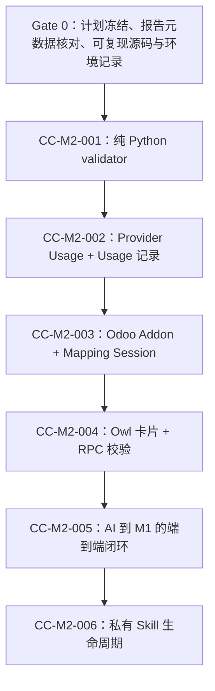

<!-- Skill bundle metadata
Source template: docs/skill/odoo-project-workflow/references/templates/Planning/IMPLEMENTATION_PLAN_TEMPLATE.md
Source version/status: v0.1; Draft
Template synchronization check: PASS, 2026-10-22
-->

# Odoo Office Engine M2 实施计划

## 文档信息

| 项目 | 内容 |
|---|---|
| 文档 | `IMPLEMENTATION_PLAN_office_engine_m2` |
| 版本 | V1.0.0 |
| 状态 | FROZEN V1.0.0 |
| 基线有效性 | VALID |
| 项目 / 模块 | Office Engine M2：AI 映射与私有导出 Skill |
| 计划负责人 | 项目技术负责人（待登记） |
| 创建日期 | 2026-10-22 |
| 基线日期 | 2026-10-22 |
| 批准 / 基线记录 | 负责人于 2026-10-22 批准并冻结本计划为 V1.0.0；同时批准解除首个 CC Gate 并起草 CC-M2-001（本轮审批记录） |

### 冻结门禁

本计划依据已冻结的 M2 SRS、M2 TDD 和负责人已批准冻结的 M2 TV 报告建立基线。负责人于 2026-10-22 批准本计划冻结为 V1.0.0，并明确授权解除首个 CC Gate、起草 CC-M2-001。CC-M2-001 仍须单独评审与冻结后方可实施。计划定义阶段、依赖、交付物和验收门禁，不替代或修改 SRS、TDD、TV。

### 首个 CC Gate 检查表

- [x] M2 SRS V1.0.0 Frozen，适用范围与功能需求已建立。
- [x] DDD 适用性由负责人判定为 N/A，理由已写入 TDD V1.0.0。
- [x] 适用 TV 结果保持真实状态；负责人批准按本计划限制范围推进：TV-M2-001 FAIL 作为 CC-M2-001 必测回归，TV-M2-004 INCONCLUSIVE 不得解释为模型免疫证明；对应功能仍须通过服务端确定性校验门禁。
- [x] M2 TDD V1.0.0 Frozen，且与本计划引用的 SRS / TV 基线一致。
- [x] 本计划获负责人批准冻结为 V1.0.0，基线有效性 VALID。
- [x] 六个计划阶段均映射到至少一个拟议 CC；每个拟议 CC 均映射回一个阶段。
- [x] Odoo-LLM clean commit / patch 门禁已限定为 CC-M2-002 前置，不属于纯 Python CC-M2-001 的依赖。

**Gate 结果：READY（仅授权创建并评审 CC-M2-001；不代表其余阶段门禁通过）**  
**证据 / 批准记录：** 本轮负责人批准（2026-10-22）；TV 与 OIP 处置见 §1、§13。

## 1. 上游基线

| 基线 / 输入 | 版本 / ID | 状态 | 位置 / 使用方式 |
|---|---|---|---|
| M2 SRS | V1.0.0 | FROZEN | `docs/requirement/SRS_office_engine_m2_ai_mapping.md`；唯一业务需求基线 |
| DDD | N/A | 已批准 | 依据见 `docs/design/TDD_office_engine_m2.md` 文件头；无独立 DDD 交付物 |
| M2 TV Plan | V0.2 | 已批准冻结 | `docs/verification/TV_office_engine_m2_plan.md`；验证方法与唯一模型范围 |
| M2 TV Report | V1.1 | 负责人已批准冻结；报告内结果按原状态保留 | `docs/verification/TV_office_engine_m2_report.md`；已按负责人批准同步为 FROZEN，实际 Spike 结果保持原状态 |
| M2 TDD | V1.0.0 | FROZEN | `docs/design/TDD_office_engine_m2.md`；技术设计唯一基线 |
| M1 TDD / 交付基线 | TDD V0.4；交付 PARTIAL | Frozen / 部分交付 | `docs/design/TDD_office_engine_m1_v0.4.md` 与 `docs/implementation/` 下 M1 最终交付记录；只能使用逐项已验证的能力 |
| Odoo-LLM 源码 | TV 记录的 commit `609ec6dda3645165f6a4a843d7af5d286081a29d` | 测试时 dirty；不可直接视为实施基线 | CC-M2-002 前须重新记录 clean commit 和必要补丁；不覆盖上游源码；不阻塞纯 Python CC-M2-001 |

若上游基线变化，先评估受影响阶段、验收项与 CC，再按对应基线的变更流程更新本计划。M2 TV 报告中的 FAIL、INCONCLUSIVE 和未运行项均维持报告原结论；计划验收不得改写历史 TV 结果。

## 2. 目标与范围

### 2.1 目标

交付 M2 自然语言到 Mapping Proposal 的受控编排：由当前获准的 OpenAI `gpt-5.6-luna` 生成不可信映射提案，经纯 Python 校验、服务端授权和完整性检查、用户确认后，编译为 M1 Mapping Plan 并调用 M1 同步渲染；在生成成功后支持保存、匹配和复用用户私有 Skill。

### 2.2 范围内

- 新建纯 Python `office_mapping_verify` 包，完成严格 JSON、字段与目标白名单、类型、完整性及一致性校验。
- 在自有 `llm_openai` 代码路径中向后兼容地保留非流式响应 Usage，并以最小化计量信息记录 Token 使用。
- 建立 `office_engine_m2` Odoo 编排 Addon、Mapping Session、所有权/公司隔离和服务端状态管理。
- 在 `llm.thread` 消息流显示映射确认 / 澄清卡片，提供经服务端校验的 RPC 更新和确认操作。
- 连接授权 Retriever、唯一获准 Provider、校验器与 M1 渲染/回读服务。
- 支持私有 Skill 的保存、精确匹配和复用；每次仍实时取数、验证权限并执行 M1 回读校验。

### 2.3 范围外

- 修改 M1 文件引擎、支持通用导入、公共 Skill 发布/审核、任意业务分析或任意 Provider 启用。
- 把模型输出直接作为事实、直接写文件、执行模型生成的代码，或绕过 Odoo 用户权限。
- 对未获准的业务数据调用 Provider，或在 Usage / Skill 中保存提示词、响应正文、业务值、样例、附件内容。
- 将 M1 的 PARTIAL 状态概括为所有格式和对象均已支持。

### 2.4 约束

- 首期 Provider / 模型严格限定为当前 OpenAI Provider 的 `gpt-5.6-luna`；不测试、不启用其他模型。
- 首期 UI / E2E 仅开放已通过 M1 端到端验证的 `.xlsx` 范围。`.docx` 聊天界面路径在其 M1 HVR 完成前保持禁用；`.xls`、`.doc` 及未知高级对象拒绝处理。
- 未关闭 SRS `OPEN-M2-002`（安全字段基线）和 `OPEN-M2-003`（Provider 数据处理政策）前，Provider 请求只可使用合成数据或另有批准的数据；不得把普通业务数据送往模型。
- AI 初次提案加最多一次修复请求。JSON、授权字段、目标目录或完整性任一失败时必须 fail-closed，转澄清 / 人工补全，不调用 M1。
- Chat 中的自然语言、模板文本、字段值、统计数值都必须按不可信数据处理。真实数据和执行权限由 Odoo 服务端建立。
- 环境验证使用项目 `venv` 和 `odoo.conf` 中的配置，目标数据库沿用既有开发库 `odoo18ce`；不创建隔离数据库。不得让测试写入真实业务对象；使用合成夹具、事务回滚或明确可清理的测试记录。

## 3. 就绪前置条件

| 前置项 | 所需状态 / 证据 | 责任方 | 优先级 | 状态 |
|---|---|---|---|---|
| SRS / DDD / TDD | SRS V1.0.0 Frozen；DDD N/A；TDD V1.0.0 Frozen | 需求 / 技术负责人 | P0 | 已满足 |
| TV 结果与处置 | 保留 TV-M2-001 `FAIL`、TV-M2-002 `INCONCLUSIVE`、TV-M2-003 Spike `PASS`、TV-M2-004 `INCONCLUSIVE`；负责人批准按范围推进，不视为结果通过 | 技术负责人 | P0 | 已处置；不改写原始结果 |
| 报告元数据 | M2 TV V1.1 负责人已批准并同步冻结状态/变更记录 | 文档负责人 | P0 | 已满足（本轮同步） |
| Odoo / Python 环境 | Odoo 18、项目 `venv`、项目 `odoo.conf`、数据库 `odoo18ce`；执行前 ATR 记录准确版本、端口和 commit | 实施负责人 | P0 | 开发环境已指定；版本快照待执行时记录 |
| 测试数据与权限 | 合成记录/文件；使用真实 ACL / Record Rules 的测试用户；测试后 ORM 清理并留下证据 | 实施 / QA | P0 | 待每 CC 准备 |
| 测试命令与覆盖工具 | `pytest` / Odoo `TransactionCase` / 前端 Owl 测试的可复现命令；Coverage 版本与配置写入 CC | 技术负责人 | P0 | CC-M2-001 冻结前确定；不以未测覆盖率作通过声明 |
| Odoo-LLM 基线 | clean commit、改动补丁、目标模块版本和 Provider 路径检查记录 | 技术负责人 | P0（CC-002 前） | CC-M2-002 前置；不阻塞 CC-M2-001 |
| 安全字段与 Provider 政策 | `OPEN-M2-002/003` 有正式处置；真实业务数据调用前须审批允许字段、目的和留存 | 业务 / 隐私负责人 | P0（真实数据） | OPEN；合成数据开发不受阻 |
| DOCX UI 证据 | M1 `.docx` 聊天 UI 上传/下载 HVR 通过，或该能力保持关闭 | QA / 业务负责人 | P1（DOCX 开放前） | 未满足 / 不阻塞 XLSX 范围 |

任何 P0 未满足时，只能推进不依赖该项的阶段。具体阶段 Gate 不得因计划排期而豁免。

## 4. 实施阶段

### 阶段 1：纯 Python 映射校验器底座

**目标**  
实现与 Odoo、Provider、文件引擎解耦的 `office_mapping_verify`，把 TV-M2-001 暴露的映射遗漏转为确定性拒绝与可诊断澄清。

**输入与依赖**

- M2 TDD V1.0.0 §§4–5、§14；SRS 映射和防幻觉规则。
- TV-M2-001 的原始失败案例作为回归夹具；不得将 5/20 的实际结果改标为成功。

**交付物**

- 独立 Python 包及版本化 Proposal / TargetManifest 数据契约。
- 严格 JSON 解析、结构与字段白名单、目标唯一性、类型兼容、必填完整性、错误分类及稳定错误对象。
- 静态依赖检查脚本与覆盖率报告。

**验收 Gate**

- 所有合法样例通过；非法 JSON、Markdown 包裹、重复键、额外字段、模型伪造目标/required/值、未授权来源字段、类型错误、重复映射和缺目标均确定性拒绝或进入澄清状态。
- 对 `office_mapping_verify` 所有包自有可执行语句及分支达到 **100% statement coverage 与 100% branch coverage**；不得通过忽略文件、排除分支或仅报告行覆盖规避。若某分支确实不可达，须先修正设计或给出评审批准的证据，不得静默排除。
- 自动静态检查确认包内无 `odoo` / ORM、`office_core`、`office_verify`、LLM SDK、HTTP、数据库导入。
- 包在项目 `venv` 外的受控 Python 单测环境可独立运行，测试结果确定且无网络依赖。

**验证证据**

- `pytest` 命令、JUnit XML、覆盖率 HTML/XML、禁止依赖扫描结果，均记入 ATR。
- 负向样例与 TV-M2-001 失败样例的逐项判定输出。

**CC 映射**  
拟议 **CC-M2-001**：`office_mapping_verify` 纯 Python 包和单测。

### 阶段 2：Provider Usage 兼容与计量记录

**目标**  
在自有 `llm_openai` 非流式响应标准化路径保留真实 `response.usage`，并将最小化计量元数据记录到 Usage 表。

**输入与依赖**

- 阶段 1 的字段/结果契约已冻结。
- `mymodules/odoo-llm` clean commit 和补丁基线已经登记；禁止修改官方 Odoo / 官方 Addon。
- 若本阶段需创建 `office_engine_m2` 最小 Addon 壳以承载 Usage 表，文件范围在 CC 中明确；阶段 3 再完成该 Addon 的编排基础与 Mapping Session。

**交付物**

- `llm_openai` 自有代码对非流式响应追加可选 Usage / response ID，保留旧 `content` / `tool_calls` 语义。
- 最小 Usage ORM 表：只存 token 数、耗时、模型标识、关联 ID、结果状态及必要时间信息；不存 prompt、completion、密钥、模板内容、样例或业务值。
- Usage ACL、公司/用户可见性及留存配置边界；留存未批准时不得扩展为原文审计。

**验收 Gate**

- Mock 响应覆盖 usage 正常、usage 缺失、字段非法、Provider 错误和工具调用回归；缺失 usage 必须记录为缺失而非伪造 0。
- 所有现有响应消费者对新增可选键兼容；既有 `content`、`tool_calls`、streaming 路径无回归。
- ORM 测试证明普通用户仅能查看其授权范围的计量元数据；无 Prompt/Completion/API key 内容落库。
- 在 `OPEN-M2-003` 未关闭时只用合成数据进行真实调用；仅使用 OpenAI `gpt-5.6-luna`，记录响应 Usage 和耗时，不能测试其他 Provider。
- `llm_openai` 相关改动通过针对性自动化回归；关键 Usage 标准化分支全覆盖，结果记录于 ATR。

**验证证据**

- SDK mock 回归、ORM 权限测试、迁移/升级记录、脱敏的真实模型 Usage 记录及 `git diff` / clean baseline 对照。

**CC 映射**  
拟议 **CC-M2-002**：Provider Usage 兼容、自有 `llm_openai` 扩展与最小 Usage 表。该 CC 需与阶段 3 的 Addon 文件白名单明确接口边界。

### 阶段 3：Odoo 编排层基础与 Mapping Session

**目标**  
安装 `office_engine_m2` Addon，建立最小会话持久化、状态转换、拥有者/公司隔离和服务端生成的映射上下文。

**输入与依赖**

- 阶段 1 Proposal / validator API 已稳定。
- 阶段 2 Usage 记录契约和 Addon 的最小技术骨架已确定。
- 使用 `odoo.conf` 指向的 Odoo 18 开发环境与 `odoo18ce`；不创建隔离数据库。

**交付物**

- `office_engine_m2` Addon manifest、依赖声明、ACL、Record Rules 和 Mapping Session 模型。
- 会话的 owner、company、thread/message、source attachment、model/record 引用、state、revision 和错误类别等 TDD 必需字段；字段清单以 TDD / CC 为准，不额外堆积未来字段。
- 服务层骨架：授权上下文绑定、用户环境取数接口、状态迁移入口；本阶段不公开用户映射 UI。

**验收 Gate**

- 在既有 `odoo18ce` 环境中通过 Odoo XML-RPC 安装/升级门禁；记录模块状态、Odoo/Python/PostgreSQL 版本和 server log。不得把仅在本地 Python import 成功算作安装通过。
- Odoo `TransactionCase` 覆盖创建、合法/非法状态迁移、过期 revision、缺失/伪造 owner/company/thread/attachment、跨用户和跨公司访问拒绝。
- owner/company 从当前 `env` 生成；不得接收客户端 UID、权限结论或任意模型/domain；不使用 `sudo()` 访问业务记录。
- 测试使用合成 fixture；每次运行可回滚或通过 ORM 精确清理，测试后无残留记录。
- Usage 表与 Session 的模型 ACL 不泄漏其他用户的日志或会话。

**验证证据**

- XML-RPC 安装/升级结果、Odoo 模块状态、`TransactionCase` 日志、跨用户拒绝断言和清理确认，记录于 ATR。

**CC 映射**  
拟议 **CC-M2-003**：`office_engine_m2` Addon 编排基础、Mapping Session 与权限边界。

### 阶段 4：Owl 映射卡片与 RPC 服务端校验

**目标**  
将 TV-M2-003 的最小技术路径产品化为待确认 / 需澄清 / 修改中的映射卡片，并由 RPC 服务端再次校验所有状态变更。

**输入与依赖**

- 阶段 3 Session API、权限规则和消息类型稳定。
- 复用已验证实现方向：`@web/core/network/rpc` 的 `rpc`，通过 `Message.components` 注册；资产通过 Addon 的 backend bundle 加载。

**交付物**

- Owl/QWeb 卡片组件及受控 message payload / message type 关联。
- 映射行展示目标、候选字段、受控样例/说明、校验状态；用户可改字段、请求澄清、确认或取消。
- RPC 更新/确认端点：校验当前用户、线程、Session 所有权、company、状态、revision、目标白名单、字段授权和类型；客户端传入身份/权限参数一律拒绝。

**验收 Gate**

- Owl 单测验证各卡片状态、空值/错误呈现、用户编辑和提交行为。
- Odoo HTTP/RPC 测试验证合法值可更新、未授权字段/目标/伪造 ID/错误状态/过期 revision 均拒绝；拒绝不会改变 Session 或确认状态。
- Playwright 自动化通过真实浏览器页面完成卡片渲染、选择一项、提交 RPC，并断言服务端记录变更；页面刷新后状态与服务端一致。
- HVR 在项目约定的 Codex 内置浏览器进行人工可视确认；保存卡片截图、浏览器错误/控制台观察、RPC 与服务端 ATR 关联证据。若内置浏览器不可用，须记录具体限制并按项目工作流重新安排 HVR，不得声称人工验收通过。
- 无客户端 JS 错误、卡片仅对 M2 专用消息出现，不依赖自由文本 marker 或模型 HTML。

**验证证据**

- Owl / RPC 自动化报告、Playwright trace/screenshot、HVR 记录和 Odoo 服务端请求日志。

**CC 映射**  
拟议 **CC-M2-004**：Owl 映射卡片与 RPC 后端校验。

### 阶段 5：AI 编排、确定性校验与 M1 渲染端到端

**目标**  
串联模板结构、意图、授权 Retriever、Provider、纯 Python validator、用户确认及 M1 渲染，验证成功和失败的完整路径。

**输入与依赖**

- 阶段 1–4 全部通过；M1 服务的实际可调用接口和 ACL 经过实现级验证。
- `OPEN-M2-002/003` 未关闭前只允许合成或已批准数据；真实业务字段不得进入 Provider。
- `.xlsx` 为首期 UI 格式；`.docx` 只有在 M1 UI HVR 的真实上传/下载门禁满足后才开放。

**交付物**

- 编排服务：从受限消息意图建 Session，调用 Retriever 建立当前用户授权的来源字段目录；从 M1 inspection 建立服务端 TargetManifest。
- 初次 Proposal 调用、严格解析、字段/目标/完整性校验、最多一次修复调用、失败转澄清/人工补全。
- 用户确认后重查当前权限与业务值，编译成 M1 Mapping Plan，调用 M1 同步渲染/回读服务；只将回读通过的结果附件交付到对应聊天线程。
- 计量/脱敏日志、错误分类、失败附件不交付及清理路径。

**验收 Gate**

- 全链路成功场景用合成订单/模板，通过 `gpt-5.6-luna` 生成可校验映射，经卡片确认后调用 M1；输出附件能下载且独立回读数据正确。
- TV-M2-001 的 5/20 遗漏案例作为负向回归：Validator 拒绝缺失必填目标；一次修复仍不完整时停止自动流程并要求用户补全，不得进入 M1。
- 伪造字段、越权模型/记录、恶意模板指令、超时、非法 JSON、重试耗尽、M1 错误、权限在确认后撤销均 fail-closed；无未验证输出可下载。
- 明确区分无命中/澄清/Provider 失败/M1 失败；模型不得伪造命中、Usage、结果链接或文件状态。
- Retriever 使用当前用户真实 `env`，通过其既有工具实现与字段白名单读取；权限测试不得用 `sudo()` 代替。
- Playwright 对 XLSX 完成上传、卡片确认、生成、下载并校验文件；HVR 在 Codex 内置浏览器确认真实交互和附件链接。`.docx` 未达前置门禁时仍拒绝或隐藏，不能由测试夹具推定开放。
- Injection 安全通过取决于服务端确定性校验及权限测试，不以模型某次未遵从恶意提示作为单独 PASS。TV-M2-004 结论保持 INCONCLUSIVE，直至补齐本阶段批准的安全验证证据。
- 所有关键 Odoo/Python/JS 测试通过，无已知安全级失败；ATR/HVR/PVR 对应每个适用 AC 与 TDD 安全不变量。

**验证证据**

- 集成测试日志、Provider 模型/Usage/延迟（仅脱敏计量）、Retriever 权限断言、M1 回读报告、Playwright 下载校验、截图/HVR、失败附件清理记录。

**CC 映射**  
拟议 **CC-M2-005**：AI → validator → 确认卡片 → 当前用户 Retriever → M1 render/verify → 聊天附件交付完整链路。

### 阶段 6：私有 Skill 保存、匹配与复用

**目标**  
用户在成功生成后保存自身私有 Skill，后续仅在模板结构、绑定模型及用户/公司上下文精确匹配时复用规则。

**输入与依赖**

- 阶段 1–5 Gate 通过，已有稳定的 Proposal、Session、TargetManifest、确认和 M1 交付闭环。
- SRS `OPEN-M2-006` 对删除/历史保留行为有正式处置；未决的行为保持关闭，不由实现自行扩展。

**交付物**

- 私有 Skill 数据模型、保存成功动作、指纹计算/匹配服务及状态/修订管理。
- 只存规则、模板结构指纹和绑定模型，不存业务数据、样例、附件或生成文件。
- Skill 命中仍做当前用户权限校验、Retriever 实时取数、目标完整性校验、用户确认及 M1 回读；不得将 Skill 当作权限凭据。

**验收 Gate**

- 只有 M1 生成与回读验证成功后，允许用户保存私有 Skill；失败/取消/未确认的 Session 不能保存为可执行 Skill。
- 用户 A 的 Skill 对用户 B 不可发现/使用；跨公司、模型变化、指纹变化、Skill 失效或字段授权变化必须拒绝匹配或回落到新映射。
- 命中 Skill 时跳过 Provider 推理，但仍实时读取数据和权限、呈现 SRS 要求的确认信息，并通过 M1 验证；用调用计数证明命中路径未调用 LLM。
- ORM/Record Rule、指纹边界、并发 revision、失效/撤销和数据最小化测试通过；无业务样例、实际值、附件内容入库。
- Playwright/HVR 验证保存提示、Skill 匹配和结果交付；证据关联到 SRS Skill AC、ATR/HVR/PVR。
- SRS `OPEN-M2-006` 未关闭的删除/历史语义不得被标记已验收；对应行为保持不可用并登记。

**验证证据**

- ORM 权限矩阵、服务单测、调用次数记录、跨用户/跨公司测试、浏览器截图及成功生成回读证据。

**CC 映射**  
拟议 **CC-M2-006**：私有 Skill 保存、精确匹配、复用、隔离及撤销边界。

## 5. 阶段顺序与依赖

**关键路径：** Gate 0 → CC-M2-001 → CC-M2-002 → CC-M2-003 → CC-M2-004 → CC-M2-005 → CC-M2-006。

**并行工作与限制：**

- 计划评审和报告元数据核对可并行；CC 只能在计划冻结后创建并各自冻结。
- CC-M2-001 与 Provider 兼容在纯技术上可并行，但本计划按负责人要求的依赖顺序串行；不得绕过中间验收。
- 合成夹具、Coverage 命令准备可在不触碰业务数据的前提下提前完成；真实 Provider 业务内容调用仍受 `OPEN-M2-002/003` 门禁约束。
- CC-M2-006 不得并行于 CC-M2-005；Skill 只能建立在已成功验证的端到端生成闭环上。

并行任务不豁免依赖、权限、安全、验收或审批门禁。

## 6. 里程碑

| 里程碑 | 包含阶段 / 交付物 | 退出条件与证据 | 目标 / 状态 |
|---|---|---|---|
| M2-A — 确定性校验底座 | 阶段 1 / CC-M2-001 | 100% statement + branch coverage、静态隔离扫描、ATR | 日期 TBD / 未开始 |
| M2-B — Provider 计量与会话基础 | 阶段 2–3 / CC-M2-002、003 | Provider 兼容、Usage 最小化与 ACL、Addon 安装及 Session 隔离测试通过 | 日期 TBD / 未开始 |
| M2-C — 用户映射确认 | 阶段 4 / CC-M2-004 | Owl/RPC 自动测试、Playwright trace、HVR 截图通过 | 日期 TBD / 未开始 |
| M2-D — 映射到文件交付 | 阶段 5 / CC-M2-005 | 合成数据端到端生成与下载、负向 fail-closed、M1 回读/HVR 通过 | 日期 TBD / 未开始 |
| M2-E — 私有规则复用 | 阶段 6 / CC-M2-006 | Skill 跨用户/公司隔离、实时取数、命中不调用 LLM、E2E 通过 | 日期 TBD / 未开始 |

无可靠依据时不填目标日期，不承诺秒级、吞吐或产能 SLO；性能目标需按 SRS `OPEN-M2-005` 单独决定。

## 7. 需求与验证矩阵

| 需求 / 设计义务 / TV 项 | 阶段 | 验收标准 | 验证方式与证据 | CC / FR | 状态 |
|---|---|---|---|---|---|
| M2 SRS 映射 schema、字段/目标白名单与完整性 | 1、5 | 非法或不完整 Proposal 永不进入 M1；失败有稳定错误类别 | 纯 Python 100% statement/branch coverage；ATR | CC-M2-001 / FR-M2-004–007 | 计划中 |
| TV-M2-001 解析 4/4、映射完整性失败 5/20 | 1、5 | 不改写 TV 结果；缺失目标确定性拒绝，修复耗尽转人工补全 | 保留原始失败 fixture；validator 回归与 ATR | CC-M2-001/005 / FR-M2-006 | 计划中 |
| TV-M2-002 合成 50 行 Usage/延迟快照 | 2、5 | 保留真实快照，Usage 缺失时不伪造；不声称真实订单验证 | SDK/Provider 测试、Usage 表记录、ATR | CC-M2-002/005 / NFR-M2 | 计划中 |
| Provider Usage 向后兼容 | 2 | 新增可选 Usage 不破坏 `content` / `tool_calls` / 既有行为 | Mock SDK 响应与调用方回归 | CC-M2-002 / TDD §§3、6 | 计划中 |
| Usage 隐私与读取权限 | 2、3 | 无 prompt/response/key/业务值；用户/公司隔离生效 | ORM ACL/Record Rule 与落库检查 | CC-M2-002/003 / NFR、BR | 计划中 |
| Session 所有权和状态机 | 3、4 | 伪造 owner/company、跨用户/公司访问、过期 revision 被拒绝 | TransactionCase/HTTP 测试 | CC-M2-003/004 / FR-M2-001、权限规则 | 计划中 |
| TV-M2-003 Owl Spike PASS | 4 | 产品卡片按受控消息显示；编辑经 RPC 服务端复验 | Owl + RPC + Playwright + HVR | CC-M2-004 / FR-M2-005–008 | 计划中 |
| TV-M2-004 Prompt Injection INCONCLUSIVE | 1、4、5 | 不依赖模型行为证明安全；模型文本不能扩大字段、目标、工具或权限 | 恶意模板回归 + Odoo 授权测试 + 真实模型观察（仅获批数据） | CC-M2-001/004/005 / NFR-M2-001 | 计划中 |
| Retriever 当前用户授权与实时数据 | 5、6 | 调用当前 `env`；撤权后确认/执行失败；不使用 sudo | 合成业务夹具、非管理员用户 TransactionCase | CC-M2-005/006 / FR-M2-001、NFR | 计划中 |
| M1 生成/回读与聊天附件交付 | 5、6 | 仅回读 PASS 的输出可下载；失败无附件交付 | M1 服务集成、下载内容检查、清理验证、HVR | CC-M2-005/006 / FR-M2-008 | 计划中 |
| 私有 Skill 生命周期和隔离 | 6 | 用户/公司/模型/指纹准确匹配；每次实时取数和确认 | ORM、权限矩阵、无 Provider 调用计数、E2E | CC-M2-006 / FR-M2-009–011 | 计划中 |
| `.xlsx` / `.docx` / `.xls` / `.doc` 准入 | 4–5 | 首期仅开放已验证 `.xlsx`；`.docx` 受 M1 UI HVR 门禁；旧格式拒绝 | 格式门禁测试与 UI 检查 | CC-M2-004/005 / SRS 范围 | 计划中 |
| SRS `OPEN-M2-002/003/005/006` | 对应阶段 | 未关闭的决策不得由实现猜测；仅在影响范围开放前关闭 | 决策记录、阶段 Gate | CC-M2-002/005/006 | OPEN |

## 8. 质量与验证策略

| 验证领域 | 适用范围 | 必需证据 / Gate |
|---|---|---|
| 自动化 / 单元 / ORM | 六个 CC | pytest、Owl、Odoo `TransactionCase` / HTTP RPC 报告；覆盖率如阶段定义；全部结果进入 ATR |
| 纯 Python 隔离 | CC-M2-001 | 100% statement + branch coverage；静态禁止导入扫描通过；无 Odoo、LLM、网络或数据库运行依赖 |
| 权限与安全 | CC-M2-001、003–006 | 当前用户/公司隔离、ACL/Record Rules、恶意字段/目标/ID、Prompt Injection、确认后撤权、附件不交付等负向证据；不得以 `sudo()` 代替测试 |
| 浏览器 / E2E / 人工 | CC-M2-004–006 | Playwright 自动化覆盖关键业务 journey；按项目 E2E skill 使用语义选择器、等待业务状态、保留 trace/screenshot；Codex 内置浏览器 HVR 记录真实 UI 人工确认 |
| Provider | CC-M2-002、005 | 只使用 OpenAI `gpt-5.6-luna`；默认用 SDK mock；真实调用仅用合成/已批准数据，保存脱敏 Usage/延迟和原始响应摘要，不记录密钥或业务内容 |
| 性能 / 容量 | CC-M2-002、005 | 只记录实际单次调用的 token / latency 快照；没有批准阈值前不宣称通过性能 SLO；生产容量评估单独立项 |
| 升级 / 迁移 / 回滚 | CC-M2-002、003、006 | XML-RPC 安装/升级、模型字段/ACL 检查、回滚或 ORM 清理证据；不以单元测试替代模块升级验证 |
| 最终回归 | CC-M2-006 | 重跑各 CC 关键安全与功能回归；状态如实记录 PASS/FAIL/BLOCKED/INCONCLUSIVE/NOT RUN，不抹除失败证据 |

**开发环境纪律：** 采用项目 `venv` 与 `odoo.conf`；使用已指定的 `odoo18ce` 开发数据库，不创建隔离数据库。测试必须使用合成数据和可回滚/可清理夹具，不更新、删除或审批真实业务记录。模块升级按项目工作流经 XML-RPC 执行并检查 Odoo 日志；测试前记录端口、数据库、Odoo/Python/PostgreSQL、模块版本及源码 commit。

## 9. 风险与应对

| 风险 | 概率 / 影响 | 缓解 | 退路 / 决策方 | 状态 |
|---|---|---|---|---|
| TV-M2-001 映射遗漏率高，Provider 修复不能补全 | 高 / 高 | 完整性由 validator 判断；缺项转人工，不自动渲染 | 允许手工补齐；不得降低必填集合 | 已知 / 需实现验证 |
| TV-M2-004 注入防御证据不足 | 中 / 高 | 服务端字段/目标白名单、目标 manifest、Retriever 权限确定性校验；模型输出不可信 | 未通过安全 Gate 时关闭 AI 映射入口 | INCONCLUSIVE |
| TV 报告文件状态元数据与负责人批准不一致 | 中 / 中 | 计划冻结前同步报告头/变更记录，不改结果 | 基线无效时暂停建立 CC | OPEN |
| `odoo-llm` 工作树 dirty，Provider 修改不可复现 | 高 / 高 | CC-M2-002 前生成 clean commit 基线、补丁清单与上游 diff | 无法形成可复现基线则仅做不依赖其的工作，不进入 CC-002 | OPEN |
| 业务字段/样例数据未经批准外发 | 中 / 极高 | `OPEN-M2-002/003` 关闭前只发合成数据；Provider 输入数据最小化 | 暂停真实数据映射 | OPEN / 阻断真实业务数据调用 |
| M1 `.docx` 聊天 HVR 未闭环 | 中 / 中 | 首期仅开放 XLSX；DOCX 维持拒绝 | HVR 通过后做范围变更/准入复核 | OPEN gate |
| Owl Message 扩展与上游版本漂移 | 中 / 中 | 锁定 Odoo-LLM commit，扩展点兼容测试，assets 回归 | 上游不兼容时保持 M2 UI 禁用，重新设计并评审 | OPEN |
| Usage/Skill 过度留存 | 中 / 高 | 仅记必要计量/规则；不持久化 prompt、响应、值和文件；按批准 ACL | 未批准留存期时不记录超出最小计量字段 | OPEN |
| 同步全链路超出 Worker 预算 | 中 / 高 | 控制输入大小、单次修复次数、超时与资源预算；记录真实耗时 | 超预算时明确拒绝/转后续异步阶段，不无限占用 worker | OPEN / 性能目标待决 |

## 10. 资源与环境

| 资源 / 环境 | 要求 | 责任方 | 可用性 / 状态 |
|---|---|---|---|
| Odoo 应用 | 项目本地 Odoo 18；实际 commit 与 addon 路径每次记录 | 实施负责人 | 已配置；执行时核对 |
| Python | 项目 `venv`；禁止误用 `.venv` 或系统 Python | 实施负责人 | 已指定 |
| 配置 / 数据库 | `odoo.conf`；现有 `odoo18ce` 开发库 | 实施负责人 | 已指定；不新建隔离库 |
| Odoo-LLM | `llm_openai`、`llm_thread`、`llm_assistant`、`llm_tool` 对应 clean 源码基线 | 技术负责人 | dirty 风险待关闭 |
| Provider | OpenAI Provider + `gpt-5.6-luna` | Provider 管理员 | 已配置；真实模板内容与业务字段外发仍受 OPEN 约束 |
| M1 | `office_engine_odoo` 的已验证同步服务；首期 XLSX 准入 | 实施负责人 | M1 PARTIAL；须核对实际接口/能力 |
| Retriever | `odoo_record_retriever`，当前用户权限与安全字段白名单 | 实施 / QA | 实际工具链需阶段 5 验证 |
| 测试用户 | 至少一名受限业务用户和可验证跨用户/公司隔离的主体 | Odoo 管理员 / QA | 待准备；不能用 sudo 模拟 |
| 浏览器 | Playwright 自动化；Codex 内置浏览器用于人工 HVR | QA | 阶段 4 前核对可用性 |
| 合成模板 / 订单 | 可回滚或 ORM 清理的 `.xlsx` 和模拟记录，覆盖完整/缺失/恶意结构 | QA | CC 前准备 |

## 11. 变更控制

- **SRS / TDD / TV 变更：** 返回对应权威文档流程，审批后重新分析受影响阶段、AC、验收矩阵和 CC；不得借实施计划修改产品要求。
- **计划顺序 / 范围变化：** 记录原因、受影响阶段、依赖、测试门槛与批准状态；不得静默改动拟议 CC 边界。
- **实现与基线冲突：** 停止受影响路径，记录证据并提交变更；不得降低安全、完整性或回读验收标准来追求进度。
- **TV 结果：** 新证据追加到报告或 ATR；原始 FAIL / INCONCLUSIVE 证据保留，不得覆盖原报告或重新标记成 PASS。
- **Provider / 模型变更：** 任何非 `gpt-5.6-luna` 的模型都需独立 TV 和授权；不得自动 fallback。
- **环境数据：** 所有测试写入必须可回滚或 ORM 精确清理；若执行期间可能影响真实业务记录，停止并先调整夹具/测试方法。

## 12. 交付物与移交

| 交付物 | 计划阶段 | 验收证据 | 最终位置 / 状态 |
|---|---|---|---|
| `office_mapping_verify` 包及覆盖率报告 | 1 | 100% statement/branch、静态隔离扫描、ATR | `mymodules/office_mapping_verify/` / 待实现 |
| Provider Usage 增量和 Usage 记录 | 2 | 真实模型合成调用、mock 回归、ACL/脱敏检查 | 自有 `mymodules/odoo-llm/llm_openai/` + `office_engine_m2` Usage model / 待实现 |
| `office_engine_m2` Addon / Mapping Session | 3 | 安装升级、TransactionCase、权限检查 | `mymodules/office_engine_m2/` / 待实现 |
| Owl 映射卡片与 RPC | 4 | Owl/RPC、Playwright、HVR | `mymodules/office_engine_m2/static/` 等 CC 白名单路径 / 待实现 |
| AI→M1 生成端到端闭环 | 5 | 集成、文件回读、下载、HVR、ATR/PVR | Addon 与 `docs/implementation/` 记录 / 待实现 |
| 私有 Skill 保存/复用 | 6 | 用户/公司隔离、实时取数、跳过 LLM 证据 | Addon 与 `docs/implementation/` 记录 / 待实现 |
| 每 CC IHR / ATR / HVR / FR / PVR | 1–6 | 与每个 CC 的范围和 AC 对应 | `docs/implementation/` 下按项目规范归档 |

阶段代码路径和模型字段为计划意图，最终允许修改文件、模型/字段白名单必须在各 CC 冻结时再次锁定；本计划不提前授权改动路径。

## 13. 开放决策与后续

| ID | 问题 / 待办 | 阻塞阶段 | 责任方 | 截止 / 状态 |
|---|---|---|---|---|
| OIP-M2-001 | 已将 M2 TV Report V1.1 状态和变更记录同步为 FROZEN；原始 Spike 结论未改写 | 计划基线 | 文档负责人 | RESOLVED — 负责人本轮批准，2026-10-22 |
| OIP-M2-002 | TV-M2-001 `FAIL` 作为 CC-M2-001 的 5/20 缺项拒绝回归；TV-M2-004 `INCONCLUSIVE` 不构成模型免疫证明，后续依赖确定性校验和安全 Gate | CC-M2-001 可起草/评审；映射功能开放仍受 CC-M2-004/005 安全验收约束 | 技术负责人 / 审批者 | RESOLVED — 负责人本轮明确批准解除首 CC Gate；不改变 TV 原状态 |
| OIP-M2-003 | Odoo-LLM clean commit 与补丁尚待建立；与纯 Python CC-M2-001 无依赖 | CC-M2-002 | 技术负责人 | N/A — 对 CC-M2-001（负责人本轮批准的范围）；CC-M2-002 前仍须满足 |
| OIP-M2-004 | 安全字段基线和 Provider 数据政策沿用 SRS OPEN-M2-002/003；CC-M2-001 不调用 Provider、不处理业务数据 | CC-M2-001 | 业务/隐私负责人 | N/A — 对 CC-M2-001（负责人本轮批准的范围）；真实业务字段/模板外发前仍须批准 |
| OIP-M2-005 | M1 `.docx` 聊天 UI HVR 不影响纯 Python 校验器；`.docx` UI 仍按 TDD/SRS 门禁关闭 | CC-M2-001 | QA / 业务负责人 | N/A — 对 CC-M2-001（负责人本轮批准的范围）；DOCX UI 开放前仍须 HVR |
| OIP-M2-006 | 决定性能目标、观测点及同步超预算处理边界（SRS OPEN-M2-005） | 任何性能承诺/超预算场景 | 产品/部署负责人 | CC-M2-005 前确认范围 / OPEN |
| OIP-M2-007 | 决定私有 Skill 删除/历史保留策略（SRS OPEN-M2-006） | 对应删除/历史行为实现 | 业务负责人 | CC-M2-006 前 / OPEN |
| OIP-M2-008 | CC-M2-002 / 003 Usage 表的 addon 文件边界和依赖先后，确保符合 TDD | CC-M2-002 冻结 | 技术负责人 | CC-M2-002 前 / OPEN |

## 14. 追溯

### 14.1 权威基线到计划

| SRS / TDD / TV 引用 | 计划阶段 | 计划验收 / 证据 |
|---|---|---|
| SRS FR-M2-001–003、权限与数据隔离 | 3、5、6 | 当前用户 env、Session/Skill owner/company 隔离、Retriever 权限测试 |
| SRS FR-M2-004–007、BR / 不猜测规则 | 1、5 | 严格 Proposal 校验、TargetManifest 完整性、澄清/人工补全、非法输入不调用 M1 |
| SRS FR-M2-005–008、AC-06–11 映射澄清/确认 | 4、5 | Owl 状态、RPC 校验、Playwright 与 HVR |
| SRS FR-M2-008、AC-10/11/21 M1 输出与交付 | 5 | M1 render/verify、附件关联、可下载内容回读 |
| SRS FR-M2-009–011、AC-12–17/22/24 私有 Skill | 6 | 保存条件、精确匹配、隔离、实时取数与复用 |
| SRS NFR 安全、注入、容错、隐私 | 1–6 | 静态/单元/ORM/E2E 负向证据；无外发敏感数据和伪造结果 |
| TDD §§4–7 / `office_mapping_verify` | 1、5 | 纯 Python 独立包、strict schema、coverage 与静态导入门禁 |
| TDD Provider Usage 设计 | 2 | `llm_openai` 兼容响应、Usage ORM 最小化、消费者回归 |
| TDD Session / Owl / RPC / Skill | 3、4、6 | 状态/权限、受控 message type、RPC revision、私有资产隔离 |
| TV-M2-001 FAIL | 1、5 | 缺项 fail-closed；复修一次后仍不完整则人工补齐 |
| TV-M2-002 合成 50 行快照 | 2、5 | 仅作为单次合成 Usage/延迟证据，不推论真实订单 |
| TV-M2-003 Spike PASS | 4 | 重做产品级组件与 RPC 验收，不继承 Spike 为产品 PASS |
| TV-M2-004 INCONCLUSIVE | 1、4、5 | 通过服务端确定性约束验收；模型行为观察仅为补充证据 |
| M1 V0.4 / M1 PARTIAL | 5 | 严格按已验证能力开放 `.xlsx`；DOCX UI 受专门门禁；旧格式拒绝 |

### 14.2 计划到编码闭环

| 计划阶段 / 交付物 | CC | IHR / ATR / HVR | FR | PVR 证据 |
|---|---|---|---|---|
| 阶段 1：纯 Python validator | CC-M2-001 | `IHR/ATR-CC-M2-001`；不适用 UI 的 HVR 标 N/A 并说明 | 从 SRS/TDD 派生，CC 内建立 | Coverage、静态扫描、负向 fixtures |
| 阶段 2：Provider Usage | CC-M2-002 | `IHR/ATR-CC-M2-002` | Provider/Usage FR | 模型 mock/真实合成响应、权限与脱敏 |
| 阶段 3：Addon / Session | CC-M2-003 | `IHR/ATR-CC-M2-003` | Odoo Session/ACL FR | XML-RPC 安装升级、ORM 隔离测试 |
| 阶段 4：Owl / RPC | CC-M2-004 | `IHR/ATR/HVR-CC-M2-004` | UI/RPC FR | Owl、RPC、Playwright、人工截图 |
| 阶段 5：端到端 M1 交付 | CC-M2-005 | `IHR/ATR/HVR-CC-M2-005` | AI→M1 FR | 文件内容回读、下载、错误路径证据 |
| 阶段 6：私有 Skill | CC-M2-006 | `IHR/ATR/HVR-CC-M2-006` | Skill FR | owner/company 匹配、实时取数、无 LLM 命中证据 |

每个 CC 还须按项目流程完成 PVR / 关闭审查。测试计划或 HVR 请求本身不构成通过证据。

## 15. 变更历史

| 版本 | 日期 | 状态 | 变更与原因 | 受影响阶段 / 基线 |
|---|---|---|---|---|
| V0.1 | 2026-10-22 | Draft | 基于 M2 SRS V1.0.0、负责人批准冻结的 M2 TDD V1.0.0、TV Plan V0.2 与 TV Report V1.1 起草；按依赖拆分六个 CC 并定义阶段门禁 | 阶段 1–6；历史草稿 |
| V1.0.0 | 2026-10-22 | FROZEN | 负责人批准冻结计划并授权解除首个 CC Gate；OIP-M2-001/002 RESOLVED，OIP-M2-003/004/005 对 CC-M2-001 标记 N/A，保留后续阶段门禁 | 计划全阶段；TV 原始状态不变 |
