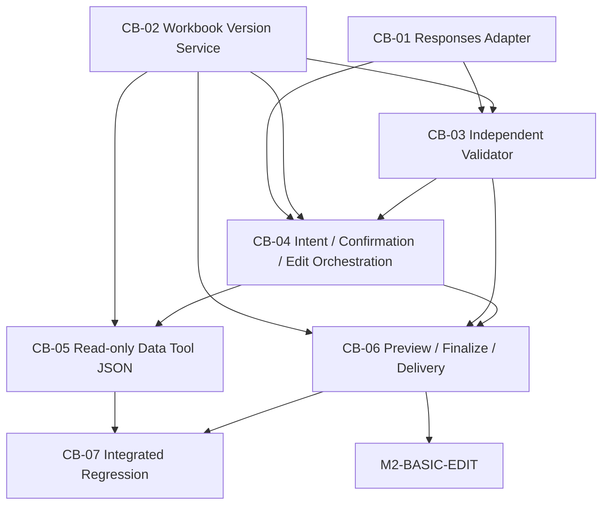

# Office Engine M2 — Candidate B 实施计划

## 文档信息

| 项目 | 内容 |
|---|---|
| 文档 | `IMPLEMENTATION_PLAN_office_engine_m2_v2.0.2` |
| 版本 | V2.0.2 |
| 状态 | **FROZEN V2.0.2 — PLAN BASELINE ONLY — NOT AUTHORIZED FOR IMPLEMENTATION** |
| 计划类型 | 冻结技术路线的版本化实施计划基线 |
| 项目 | Odoo 18 CE / Office Engine M2 |
| 设计基线 | `docs/design/TDD_office_engine_m2_v2.0.3.md` — FROZEN，设计基线；不授权实现 |
| 起草日期 | 2026-11-06 |
| 批准记录 | 2026-11-06：负责人批准冻结 V2.0.1；仅冻结阶段编排基线，不构成 Coding Authorization、Runtime Validation 或 Production Release |
| 范围 | 保留 M1/M2 首轮 Excel 填充；规划首轮后的 Candidate B 文件编辑、数据刷新、验证、版本与交付 |
| Git 操作 | 不暂存、提交、推送、清理或重置 |

> 本计划依据当前仓库中的源码、CC、IHR、ATR、HVR、TV 报告和冻结 TDD 起草，并已于 2026-11-06 经负责人批准冻结为实施编排基线。Plan Approval 不等于 Coding Authorization；此文件不授权任何 CC 实施、Provider 调用、服务重启、模块升级、数据库变更或生产发布。每个 CC 必须单独形成、评审、冻结并取得 Coding Authorization。

## 0. 治理与门禁

### 0.1 门禁必须分离

| 门禁 | 目的 | 允许事项 | 不代表 |
|---|---|---|---|
| Plan Approval | 批准本实施计划作为阶段编排基线 | 后续起草/评审独立 CC；按已批准范围开展只读核查 | 不授权编码、测试副作用、Provider 请求或发布 |
| CC-01 / G2 只读核查 | 按已冻结 `CC-M2-B-01 v0.2` 记录工作区来源、基线及历史证据 | 仅限该 CC 授权的只读证据检查和 IHR/ATR | 不授权访问数据库、服务、额外日志或实施；本计划不扩大 CC-01 |
| Coding Authorization | 对一个已冻结 CC 明确授权实施 | 仅该 CC 文件范围和行为 | 不授权其他 CC、Provider 外发、数据类别或生产发布 |
| Runtime Validation | 验证特定实现与 Odoo/Provider/Browser 的运行行为 | 仅该 CC 及验证门明确许可的环境、数据、费用和请求 | 不由单元测试或模拟测试替代；不自动构成发布许可 |
| Production Release | 批准部署、启用功能和处理获准数据 | 仅负责人明确批准的版本、用户范围和数据策略 | 不由计划、CC 关闭、测试通过或 Candidate B TV 结果代替 |

Plan 获批后，可以创建和执行计划范围内独立授权的只读 CC-01；不要求 CC-01 的所有历史问题先被解决才可创建。CC-01 已有记录为 `COMPLETE WITH OPEN / UNVERIFIED ITEMS`。其审计交付完成、历史问题解决、受影响编码 CC 放行是三个不同决定：Thread 12063 历史根因、8091 Loaded Module 身份等仍按现有 ATR 的 `OPEN/UNVERIFIED` 保留，不因审计关闭而自动放行。

### 0.2 实施前强制上游门

在本计划任何受影响编码 CC 获得 Coding Authorization 前，至少满足：

1. 负责人通过独立版本化 SRS 变更，正式处理 V1.0.0/V1.1.0 中“AI 不直接读写文件/执行代码、只提交受约束 Mapping Proposal”与 Candidate B 后续托管编辑路线的规范冲突。TDD §0.4 是变更提案，不是已批准的 SRS 修订。
2. 安全/数据负责人明确 Responses/Code Interpreter 的数据分类、可发送数据、处理目的、留存/删除要求、容器网络与供应商政策。合成 TV 已获批不等于真实 Odoo 数据已获准外发。
3. 产品/安全负责人裁定 TDD V2.0.2 §12.3 中会影响首期范围的 OPEN 项，至少包括首期 XLSX 特性支持矩阵、部分验证候选的处理、费用/资源硬限制和版本/附件留存。某个 CC 不涉及的 OPEN 可延期，但必须在该 CC Gate 明确说明。
4. 记录实施时 Git/Addon/依赖/测试基线。CC-01 的运行代码身份若仍为 UNVERIFIED，影响当前运行环境的验收须先由对应 Runtime Validation Gate 确认目标代码版本；不得拿旧运行实例的证据替代。
5. 各 CC 单独冻结并获得 Coding Authorization。对真实 Provider 请求，除 CC 授权外仍需满足适用数据政策及费用/请求批准；不从历史 TV 的一次性授权推导持续授权。

未满足的事项只能阻止其依赖项，不得以排期或“测试环境”名义绕过。不得重开 Candidate C，也不要求为本路线再次独立执行 TV Phase 1；此前 TV 夹具和历史结论按本计划 §2.3 使用。

### 0.3 计划版本与既有计划关系

- `IMPLEMENTATION_PLAN_office_engine_m2.md` V1.0.0 为 FROZEN，继续作为既有首轮 AI Mapping→M1、映射卡片及私有 Skill 工作的历史实施基线。已完成成果不回写、不删除。
- `IMPLEMENTATION_PLAN_office_engine_m2_state-continuity_v0.2.md` 为 FROZEN 但标注 `IMPACT REVIEW REQUIRED`。其 CC-M2-B-02 至 B-06 是待建阶段建议，不是已冻结的独立 CC；其基于本地后续表达式/Proposal 重编译的路线与当前 TDD V2.0.2 不一致，后续由本计划建议替代，不覆盖原文件。
- `CC-M2-B-01_Runtime_Baseline_Alignment_v0.2.md` 和 IHR/ATR 保持原只读范围及状态；本计划不将历史 UNVERIFIED 改写为当前事实。
- Candidate B 是当前冻结 TDD 的目标路线；Candidate A 仅作为既有 M1/M2 初始填充能力和既有链路的对照基线；Candidate C 不在计划中。

## 1. 当前代码与交付基线盘点

本节是计划输入盘点，不是新的代码审计或运行验证。状态引用现有仓库材料，未在本轮执行测试、Provider 调用、服务操作或数据库访问。

### 1.1 需求、设计与运行证据

| 项目 | 当前证据与状态 | 处置 |
|---|---|---|
| M2 SRS V1.0.0 / V1.1.0 | 冻结；SRS §1.3 与 §5 等保持 AI 只建议受约束映射、不得直接读写/执行代码的规定 | `MODIFY — PRECONDITION`：必须独立审批版本化变更，计划本身不修改 SRS |
| M2 TDD V2.0.2 | FROZEN 设计基线；Candidate B 后续编辑、当前 XLSX 为内容权威、版本链、本地验证及交付责任已明确；TDD 不授权实现 | `KEEP`：本计划按 V2.0.2 分解，不重开架构 |
| DDD | 既有 N/A 决议；未发现独立 DDD | `KEEP` |
| M1 Office Engine | M1 最终交付总体结论 PARTIAL；已有特定 XLSX 初始生成/回读/浏览器下载证据，不代表所有格式/结构能力 | `REUSE WITH CHANGE`：只复用有证据的首轮 XLSX 路径；逐项引用其覆盖边界 |
| TV Phase 1A-2 | `TV_LLM_OFFICE_EDITING_PHASE1A2_REPORT_v0.2.md`：三次实际 Responses 请求；第 3 次产生真实 XLSX，下载后独立 `openpyxl` 回读通过简单修改、公式文本、非目标和 ZIP 断言；不是 Odoo UI/多轮/交付验收 | `KEEP AS SCOPED EVIDENCE`：证明简单单轮文件闭环可行，不扩大成完整能力 |
| TV Phase 1B–1D | `TV_LLM_OFFICE_EDITING_PHASE1B_1C_1D_REPORT_v0.2.md`：两次 APIConnectionError，未收到 Response/候选文件；1B 为 BLOCKED/UNVERIFIED，1C/1D NOT RUN；不是模型能力 FAIL；重试预算偏差及准确账单仍未核实 | `KEEP AS BLOCKED HISTORY`：不得覆盖旧失败；CC 中可复用夹具/场景，不要求先单独重跑 TV |
| Runtime 证据 | CC-M2-B-01 IHR/ATR：Workspace/Process 有限证据；Loaded Module 与当前代码身份 `UNVERIFIED`；Thread 12063 原 pending payload 不可恢复，历史根因 `UNVERIFIED` | `UNVERIFIED`：不猜测、不扩大只读范围；相关运行验收须以当次明确代码指纹和 Runtime Validation 证明 |
| 历史测试统计差异 | CC-M2-B-01 ATR 记录测试发现/汇总差异 `OPEN`，现有证据未解释 | `OPEN`：只有当它影响具体 CC 统计解释时才作为该 CC 的阻塞项，不伪造原因 |

### 1.2 已有组件与成果处置矩阵

| 组件 / 当前实现 | 实际位置与可引用证据 | 状态 | 本计划处置和边界 |
|---|---|---|---|
| Chat Completions Provider | `mymodules/odoo-llm/llm_openai/models/openai_provider.py`：`LLMProvider.openai_chat()` 通过 `client.chat.completions.create()`；`openai_upload_file()` 是现有上传/训练相关能力，不是 Responses 编辑输出接口 | 已有、正常聊天路径存在；Responses Adapter 未见于该调用路径 | `KEEP` 原聊天路径；新增独立 Responses Adapter，不替换、不破坏 Chat Completions |
| Provider Usage 计量 | `office_engine_m2/models/office_llm_usage.py`、`ATR-M2-002.md`；CC-M2-002 CLOSED，Mock/ORM/ACL 测试记录 PASS，未发真实 API | 已有计量模型与受限权限 | `REUSE WITH CHANGE`：核实 Responses usage、容器成本、request/response/artifact/cleanup 元数据如何兼容；不得把缺失 usage 记为零或持久化 Prompt/业务内容 |
| Mapping Session / revision | `office_engine_m2/models/office_mapping_session.py`；`services/mapping_service.py` 的 Session、revision、Proposal revision、restore 与状态转换；CC-M2-003 CLOSED，TransactionCase 证据 PASS | 已有首轮 Mapping 生命周期，不等于 Workbook 文件版本链 | `REUSE WITH CHANGE`：首轮 Proposal revision 与后续工作簿 `Version` 分开；仅经审计确认后采用最小新增字段/模型，不重用 Proposal revision 冒充文件版本 |
| 初始 Mapping / repeat-row | `office_engine_m2/models/office_mapping_tools.py`、`services/render_bridge.py`、`office_mapping_verify`；`ATR-M2-005.md` 与 `ATR-M2-005_dynamic_rows.md` 有定向真实 office_core/office_verify 回读证据 | 条件关闭/PARTIAL；全 Addon 有一项历史共享库全表计数断言 FAIL | `KEEP FOR INITIAL FILL`：Mapping、repeat-row 和 M1 只服务首轮填充；不作为后续开放式编辑入口。全量失败保持原状态，不能通过删测试或放宽断言清除 |
| M1 渲染与验证桥接 | `office_engine_m2/services/render_bridge.py` 中 `render_preview()`、`render_confirmed_mapping()` 等调用 M1；M1 `office_core` / `office_verify` 用于当前受控初始生成 | 对报告定义样本有证据；通用格式保真仍受 M1 PARTIAL 限制 | `KEEP FOR INITIAL FILL`；只复用现有经验证的初始生成能力。Candidate B 候选需要针对其字节输入/输出建立 TDD 所述独立候选验证，不能假定 M1 validator 足以覆盖 |
| M2 Tool/Orchestrator | `office_engine_m2/models/llm_thread.py`：Thread 工具绑定、`office_prepare_context`、`office_save_mapping_preview`、`office_finalize`、`odoo_record_retriever_execute`；`services/ai_orchestrator.py` | 初始 Mapping→M1 工具链存在；不含已证实的 Responses 文件编辑端到端 | `REUSE WITH CHANGE`：保留首轮路由；新增后续编辑路由、Data Tool JSON 输出和真实结果投影，不能将 Chat Completions 文本伪作文件编辑产物 |
| Retriever / ORM 权限 | `llm_thread.py:LLMTool.odoo_record_retriever_execute()` 及现有 `odoo_record_retriever` 工具；当前会话用 ORM/用户上下文执行 | 初始读取链已覆盖；Data Tool Refresh 完整快照协议未验证 | `REUSE WITH CHANGE`：受当前用户 ACL/Record Rules 约束；新增返回完整性/身份/分页语义 JSON，不指定坐标、不写 XLSX |
| 确认 / 安全 Gate | `office_mapping_tools.py` 的 `_cell_override_confirmation_gate()` 及 Session pending override 方法；`render_bridge.py` 预览、确认、Finalize 重新检查路径 | 有 Mapping/坐标写入相关确认实现；不等于新 LLM 编辑计划与 Effect 确认已验收 | `REUSE WITH CHANGE`：按 TDD 适配计划/确认收据、源版本和 Effect；确认不能绕过 ACL、安全、资源及格式约束 |
| Thread 消息、附件和浏览器呈现 | `office_engine_m2/services/render_bridge.py` 的 `_post_preview_attachment()` / Finalize 消息；`office_engine_m2/models/llm_thread.py` 的 tool result/message store；Odoo `llm_thread` Owl message/composer patch | 首轮预览/正式附件有合成会话 HVR/运行证据；最终完整 Provider 编辑 UI 未验收 | `REUSE WITH CHANGE`：以真实 Thread/attachment 关联和下载字节验收 Candidate B；Owl Mapping Card 只保留对首轮映射必要部分 |
| Owl Mapping Card | `CC-M2-004_owl_mapping_card.md`、`ATR-M2-004.md`、HVR：后端自动化及人工 HVR 有通过项，browser_js 因依赖缺失跳过，ATR PARTIAL | 对原映射卡片范围部分验证 | `REUSE FOR INITIAL MAPPING / DEFER`：不迁移成文件编辑 UI；未证实内容不得移除或泛化 |
| 私有 Skill | `office_engine_m2` Skill 服务/模型；`CC-M2-006_private_skill.md`、ATR/HVR：12 项定向测试和 HVR PASS；全量历史 Session 断言 1 FAIL | 首轮 mapping rule reuse 范围有证据 | `KEEP FOR INITIAL MAPPING`；文件编辑偏好/模型文件编辑 Skill 的语义 DEFER，需单独业务决策 |
| Workbook Version/Artifact lineage | 当前 Session/Preview/Finalize 附件字段及 `office.document.request` 记录，不等于 TDD 所要求完整 V1→Vn 文件 lineage | Candidate B 版本服务 `UNVERIFIED / 未实现` | `ADD`：最小不可变版本链、current/last-valid 指针和哈希；采用加法迁移，不删除既有 Session/附件历史 |
| Candidate output Validator | 当前 M1 `office_verify` 与 `office_core` 保存后验证用于 M1 能力范围 | 对 Responses 返回字节的结构 diff、非目标 Effect、支持矩阵尚未验收 | `ADD/REUSE AFTER AUDIT`：一个权威本地候选接受门；若可复用部分 `office_verify`，必须有等价证据，不并行保留两个可接受候选的生产入口 |
| Data Tool JSON refresh | 当前 Retriever 有 ORM 读取能力，但本次结构化快照协议尚无经验证实现 | `UNVERIFIED / 未实现` | `ADD`：只读、类型化、身份/范围/分页完整性 JSON；禁止位置和 Excel 操作语义 |

### 1.3 当前自动化资产（只列已有资产，不表示本轮执行）

- `mymodules/office_engine_m2/tests/` 包含 `test_ai_orchestrator.py`、`test_chat_entrypoint.py`、`test_conversational_preview.py`、`test_mapping_rpc.py`、`test_mapping_session.py`、`test_native_chat_integration.py`、`test_office_core_integration.py`、`test_office_llm_usage.py`、`test_private_skill.py`、`test_provider_usage.py`、`test_render_bridge.py`、`test_response_compatibility.py` 和 `test_xlsx_row_expansion.py`。
- M1 独立 Python 包 / `office_core` 测试和 `office_verify` 回读能力在现有 M1/M2 ATR 中有证据；其适用范围须按原报告，不扩张为 Candidate B 输出验证已通过。
- `docs/verification/evidence/TV_LLM_OFFICE_EDITING_PHASE1B_1C_1D/` 保留三个合成夹具、准备/验证脚本及两个真实连接失败请求的脱敏 ledger；`...PHASE1A2/` 保留简单单轮成功及早期失败记录。
- 新 CC 应针对真实实现接口增补/调整测试，不把纯 Python、SDK Mock、TransactionCase、Provider 和浏览器证据混为一个“测试通过”。

## 2. 冻结目标架构与范围

### 2.1 职责不变量

1. **本地 Office Engine**：只负责首轮 Odoo 数据 Mapping 和经批准 M1 文件填充；后续 Odoo 补充/刷新使用 Data Tool 按当前用户 ORM 权限查询并返回 JSON。
2. **首轮之后的文件内容编辑**：Responses API + Code Interpreter 主导读取当前有效工作簿、按本轮指令编辑并返回真实 XLSX 候选。Odoo 服务进程不得执行模型生成的 Python/任意代码。
3. **Data Tool**：只提供受当前用户 ACL/Record Rules 限制的结构化 JSON 快照，包括业务身份、查询范围、时间、分页及完整性；不得指定 Excel 坐标、生成编辑操作或写入文件。
4. **Odoo 权威层**：保留权限、确认、版本、预算/资源、独立验证、Preview/Finalize、附件消息关系、错误与恢复状态。Provider 声称成功不等于版本接受。
5. **多轮**：每轮输入必须是当前 `accepted_current` XLSX；候选未独立验证并接受前不改变 last-valid；聊天/Response 历史不能代替文件字节。
6. **用户决策权**：可确认业务风险须展示范围、Effect 和风险并在执行前取得与当前版本绑定的确认；确认不能绕过权限、安全、文件完整性或技术阻断。
7. **本地编辑 DSL**：不为后续开放式修改新增通用 Excel 操作/表达式语言。首轮 Mapping/Canonical Operations 按现有职责保留。

### 2.2 范围内与范围外

**范围内**：Responses Adapter；Workbook Version/Artifact lineage；意图/风险计划与确认；独立候选验证及版本接受；只读 JSON Data Tool refresh；现有 Thread、附件、预览和 Finalize 的最小衔接；候选失败/Provider 超时/附件失败恢复；跨层测试。

**范围外**：Candidate C；换 Provider/模型；Odoo 进程内执行生成代码；通过本地 DSL 实现开放式编辑；通用自然语言语义验证器；Data Tool 写业务记录或 Excel；业务专用模板/模型/坐标特判；重写 M1；删除历史 CC/字段/附件/测试；将计划批准视为部署/发布许可。

### 2.3 TV 结果使用规则

| 已有 TV 证据 | 可用于何处 | 不可据此声称 |
|---|---|---|
| TV Phase 1A-2：Responses + Code Interpreter 对合成 XLSX 简单修改并返回文件，独立回读通过 | 证明路线有一次简单单轮可行性证据；作为 Provider Adapter/最小真实文件集成的输入 | 多轮、复杂公式/结构、Odoo 确认、长期稳定、浏览器交付、数据刷新已通过 |
| TV Phase 1B–1D：两次 APIConnectionError、零候选、下游未运行 | 保留连接/预算失败历史；将合成夹具和断言场景复用到获准 CC | 不能声称模型不支持，也不能声称单轮复杂/多轮/结构保真通过或失败 |
| TV 计划中的 TV-LE-01..11 和报告 | 复用适用场景做 CC 级验收，按 CC 实际范围记录证据 | 不要求在 CC 前重新独立跑完 TV；不因已有计划把 TV NOT RUN 改 PASS |

任何后续 Provider 调用由对应冻结 CC 的范围、真实数据政策和执行时请求/费用批准共同决定。既有 TV 的单次预算授权已完成，不构成新请求授权。

## 3. 实施次序、Gate 与依赖

### 3.1 全局 Gate

```text
本计划人工评审/批准
    ↓（仅建立编排基线）
正式 SRS 变更 + 外部数据处理/留存政策 + 相关 OPEN 产品决策
    ↓
逐个 CC 起草、评审、冻结、独立 Coding Authorization
    ↓
CC 实施与分层验收（Contract Verified → Integration Pending → Final Accepted）
    ↓
独立 Production Release 授权与部署验收
```

Gate 之间不可折叠。CC-01 只读审计完成不替代 SRS/隐私授权或 Coding Authorization。测试环境中通过也不构成生产发布许可。

### 3.2 新 CC 编号及依赖图

为避免覆盖旧 `CC-M2-001..006`、旧 `CC-M2-B-01` 及尚存草案中的 `CC-M2-B-02..06` 编号，本计划使用独立的 `CC-M2-CB-01..07` 命名空间。命名不改变任何历史 CC 身份或状态。



实际依赖：CB-03 需要 CB-02 版本/父子文件接口及候选文件格式约定；CB-04 依赖 CB-01、CB-02、CB-03；CB-06 只依赖 CB-02、CB-03、CB-04，**不依赖 CB-05**；CB-05 独立依赖 CB-02、CB-04，结果在 CB-07 汇合；CB-07 依赖 CB-01 至 CB-06 均已完成各自范围验收。CB-01 与 CB-02 可在各自授权下独立启动；CB-05 的延期不得阻断不使用 Odoo 刷新的 Excel 编辑/交付闭环。所有依赖仍受 SRS/数据门禁约束。

建议执行节奏：`CB-01 → CB-02 → CB-03 → CB-04 → CB-06（先完成 M2-BASIC-EDIT）→ CB-05 → CB-07`。该节奏是依赖排序，不把 Plan Approval 变成额外编码审批；每个 CC 仍依赖其自身 Coding Authorization。

### 3.3 单个 CC 的三层验收口径

| 层级 | 证据含义 | 允许结论 |
|---|---|---|
| `Contract Verified` | 该 CC 的接口/行为契约测试及其声明层次实际通过；纯 Python/Mock 只证明自身层 | 本地契约已验证；不得声称 Odoo、真实 Provider、浏览器或完整链路通过 |
| `Integration Pending` | 契约已通过但该 CC 适用的 Odoo TransactionCase、Provider 或 Browser/附件消费仍未提供 | 该 CC 仍未最终验收；可以记录未验证，不可把依赖失败改成 PASS |
| `Final Accepted` | 该 CC 范围内所有强制证据通过，失败/跳过有批准且不削弱验收的处置；IHR/ATR/HVR（适用时）完成并经负责人接受 | 仅接受该 CC 的范围，不代表 M2 全部阶段或生产已发布 |

每轮 CC 单独形成 IHR/ATR，需人操作的确认/聊天/下载再形成 HVR。完整 Provider/Browser E2E 只在所需最终 CC 完成后报告，不得以局部单元测试、模拟调用或接口存在冒充。

## 4. CC-M2-CB-01 — Responses Provider Adapter

**目标**：在不改变普通 Chat Completions 的前提下，为 Candidate B 建立隔离的 Responses + Code Interpreter 调用/文件返回接口。

**依赖/门禁**：本计划获批；相应 SRS 变更；文件外发/留存政策；独立 CC 冻结与 Coding Authorization。任何真实请求另须当次授权的模型、请求次数、预算、数据类别、超时和重试政策。

**范围内**：复用现有 Provider 凭据/SDK 客户端；新增 Responses 请求适配；当前有效工作簿以文件输入传递；收集 Response、工具、容器、文件、usage、耗时和 cleanup 的最小元数据；输出真实 XLSX bytes/引用；超时/连接错误、未返回文件、资源清理失败分类；SDK 隐式重试受控；对普通聊天和 Usage ORM 的向后兼容。

**范围外**：Session 版本库、文件接受决策、执行模型代码于 Odoo worker、业务模型数据查询、候选语义或 XLSX 差异验证、前端交付。

**优先影响面（实际文件白名单由未来 CC 冻结）**：`mymodules/odoo-llm/llm_openai/models/openai_provider.py` 或同 addon 的独立 service；`mymodules/office_engine_m2/models/office_llm_usage.py` 与 Usage service；新增 Adapter 层测试。不能以本计划直接修改这些文件。

**验证与交付**：SDK 形状测试覆盖请求、附件回传、token 缺失/非法和异常；响应契约保证 Chat Completions 现有 `content/tool_calls/streaming` 不变；合成 XLSX 的真实输入—工具调用—实际候选字节和独立回读；请求预算、资源/超时、远端 cleanup 记录。真实调用如未获或未满足独立授权，状态最多为 `Contract Verified / Integration Pending`。

| Adapter / Provider 结果 | 计划判定 |
|---|---|
| SDK/Adapter 契约测试通过，尚无有效真实 API 响应 | `Contract Verified`；Provider Integration 仍 `Integration Pending` |
| `APIConnectionError`，没有服务端 Response/Request ID 证据 | `Integration Blocked`；保留错误和耗时，不将其归因于 Adapter 实现或模型能力 |
| Provider 已返回响应，但实际文件下载失败、字节损坏或解析失败 | `Integration Failed`；按失败层定位，不得记文件编辑 PASS |
| 返回真实候选且下载/独立回读符合该次断言 | 仅对应集成用例 `Integration Passed`；不能外推到多轮、复杂工作簿或浏览器交付 |

上述分类结合已保存 TV Phase 1A-2 与 Phase 1B–1D 证据使用；后续 CC 不要求先重跑独立 TV。

**PASS**：合同正确、普通聊天兼容；真实 Provider 文件闭环仅在获准且真实字节/下载/哈希证据齐全时可记该子项通过。**FAIL**：合同/兼容性或返回字节断言失败。**BLOCKED**：SRS/数据政策/权限/网络/预算不满足；不得切换模型或回退为本地执行代码。**关闭**：本 CC 适用层级证据、差异和 IHR/ATR 完整，负责人独立接受。

## 5. CC-M2-CB-02 — Workbook Version & Artifact Service

**目标**：建立后续文件内容的权威版本/附件谱系；不替换 Mapping Proposal revision。

**依赖/门禁**：SRS 对后续编辑路线正式变更；CC 单独冻结/授权。模型/字段方案需先只读核实现有 `office.mapping.session`、`office.document.request` 和 `ir.attachment` 的足够性，再提出最小字段或独立 version model。

**范围内**：首轮 M1 生成并验证的文件可登记为 V1；V2…Vn 的父版本 ID、输入/输出 SHA-256、Session/thread/用户消息、Provider 调用引用、状态、验证报告引用、确认引用和 artifact/delivery 关联；原子 current/last-valid 更新；乐观并发；候选/被接受/被替代/正式化记录；所有权/公司隔离；版本读取权限与不变量。

**范围外**：编辑 XLSX 内容、Data Tool 查询、完整 validator、UI 交付、历史数据破坏性迁移、把聊天历史当作文件来源。

**优先影响面**：`office_engine_m2/models/office_mapping_session.py`、`services/mapping_service.py`、`models/office_document_request.py`（如存在且经审计）、Session/attachment 安全规则；未来方案必须明确旧 Session、Proposal revision、历史附件与新 Workbook version 的并存读取。

**验证与交付**：纯 Python 文件哈希/父子链契约；TransactionCase 覆盖当前用户 ACL、跨用户/公司拒绝、旧版本只读、candidate 失败不推进 last-valid、并发 revision 拒绝、Finalize 版本引用；升级前后既有数据可读性和不破坏性迁移证据。附件每个版本使用私有权限，禁止公开链接绕过现有权限。

**PASS**：版本身份及 current/last-valid 规则不变量通过，旧记录保持访问语义。**FAIL**：候选污染 current、版本/哈希错链或越权可读。**BLOCKED**：需要破坏性迁移或文件/附件访问规则无法安全确认。**关闭**：Contract 与适用 Odoo 集成证据分别标记，版本模型迁移及 IHR/ATR 被接受。

## 6. CC-M2-CB-03 — Independent Candidate Validator

**目标**：在文件成为 accepted current、Preview 或 Finalize 输入之前建立单一权威的保存后验证/接受门。

**依赖/门禁**：CC-M2-CB-02 的 parent/candidate/version 接口；TDD V2.0.2 §6.2 的首期支持矩阵中涉及的 OPEN 产品决策须已裁定；独立 CC 授权。

**范围内**：真实字节、非空、大小、ZIP/OOXML 完整性及 XLSX 可读性；输入/候选工作表与适用结构、值/类型、公式文本/引用、格式和非目标差异；Intent Plan/Expected Effect 的结构化目标、条件和允许范围比对；有确认时对照批准的实际 Effect；能力矩阵标记与 `VERIFIED / PARTIALLY_VERIFIED / FAILED`；验证失败不得 current、普通 Preview、Finalize 或成功声明。

**范围外**：公式重算（除非另有批准计算引擎及测试）；通用自然语言语义理解；将 `openpyxl` 可读等同全部结构保真；编辑操作执行。

文件特性能力和单个候选结果是两个独立维度：每种特性标记 `SUPPORTED / PARTIALLY_SUPPORTED / UNSUPPORTED`；每个候选标记 `VERIFIED / PARTIALLY_VERIFIED / FAILED`。安全地拒绝不支持的结构可以使安全拒绝结果为 PASS，但特性能力仍为 `UNSUPPORTED`，不得统计为编辑功能成功。公式文本/引用正确不等于公式重算结果正确；ZIP 有效或 openpyxl 可读取也不证明图表、透视表、外部链接等全部保真。

**优先影响面**：复用/组合 M1 `office_verify`、`office_core` 已有只读检查的可能性；计划要求后续 CC 做代码级调用链确认，禁止出现两个可独立接受候选的权威 Validator。模块/测试位置按未来 CC 白名单核实。

**验证与交付**：中性真实 XLSX fixtures；值/类型/零/False/空值；公式文本与引用不冒称重算；样式/非目标保护；损坏/越界/支持范围外候选分类；候选失败保持父版本；TDD capability matrix 每一支持项有对应原型/集成证据。损坏、差异和能力未覆盖不可用放宽断言解决。

**PASS**：文件及声明效果在已证实支持范围内，只有 VERIFIED 可晋升。**FAIL**：Validator 漏检测试中的损坏、越界变化或接受错误 Effect。**BLOCKED**：目标结构无法比较或首期支持矩阵尚未由负责人裁定。**关闭**：独立回读报告、失败门禁及唯一生产入口经代码/行为证据验证并由负责人接受。

## 7. CC-M2-CB-04 — Intent, Confirmation & Edit Orchestration

**目标**：将 Agent 的本轮用户意图/粗粒度计划、确认风险、Responses 编辑和 Validator 结果接入现有 Thread/Session，并保持权限和结果事实由服务端控制。

**依赖/门禁**：CB-01、CB-02、CB-03；SRS/外部数据/功能决策已解决；独立 CC 冻结及 Coding Authorization。

**范围内**：路由首轮填充和首轮后编辑；必要时只读计划/检查，再做风险评估；无确认风险的明确操作可直接编辑；目标歧义澄清；仅对需确认的业务风险提供明确影响与用户决策；确认绑定当前用户、Thread/Session、current version、文件 SHA、Session/document revision、计划/条件、预期 Effect/业务风险和影响范围；确认前不启动风险编辑；执行前重验权限、版本、数据快照、Effect/范围和资源策略；候选交 CB-03 验证；服务端记录 `execution_verified`、Agent `coverage_declared` 及版本 outcome 的区别；错误转换为安全用户结果。

**范围外**：要求 Agent 预先穷举所有单元格；所有普通单元格编辑都弹确认；LLM 自主授权/自行宣称 Validator PASS；任意 Python/本地后续编辑 DSL；确认越过 ACL/文件完整性/预算门。

**优先影响面**：`office_engine_m2/models/llm_thread.py` 中 Thread 路由、Prompt/tool consumer、`office_mapping_tools.py` 对工具及确认 gate 的扩展边界、Session service 与新 Version Service、Responses Adapter、独立 Validator。所有最终生产调用方必须汇总为唯一执行链。

**验证与交付**：Agent 意图不能结构化时不声称成功；明确操作直接执行不重复确认；高风险范围准确确认；未确认不发 edit request；确认后文件版本/范围/Effect 变化则失效；无关变化按 TDD 冻结 Effect 指纹契约测试；用户拒绝/确认过期；Provider 超时后从服务端版本状态恢复，不重复应用；Agent 不将内部错误码直接原样反馈；Coverage 有遗漏时报告未完成项。

另以 Mock Provider 配合实际 Version Service 验证本地多轮编排 `V1 → V2 → V3`：V2 是 V3 的父版本；V2 成功修改在 V3 后保留；第二轮故意失败时 current/last-valid 仍指向 V2；重复提交不重复应用。该项只证明编排、父版本传递和失败保护，不替代 CB-07 真实 Responses API 的多轮文件编辑验收。

**PASS**：确认、执行和结果契约实测一致；权限/技术门保持不可绕过。**FAIL**：未经确认发生风险编辑，旧确认用于新 Effect，或仅凭自由文本报告完成。**BLOCKED**：历史 12063 原始证据缺失并不阻止当前代码测试；若当前运行版本身份、SRS 或数据政策未满足，则阻止对应 Runtime/外发用例。**关闭**：Contract/TransactionCase/获准 Provider 集成证据和 IHR/ATR 齐全；实际用户交互另由相应 HVR 通过。

## 8. CC-M2-CB-05 — Read-only Data Tool JSON Refresh

**目标**：在用户明确补充/刷新 Odoo 数据时，通过当前用户 ORM 查询返回机器可验证 JSON；不指定 Excel 位置、不编辑当前工作簿。

**依赖/门禁**：CB-02 的 current workbook identity 与 CB-04 的授权查询边界；正式数据处理政策允许具体数据/Provider 流程；独立 CC 授权。不能用真实数据的用合成/权限夹具完成合同层，再把真实调用留作 BLOCKED/INTEGRATION PENDING。

**范围内**：用户 ORM/ACL/Record Rules；模型/字段合法性；稳定记录 ID 与可选业务键；明确查询域/范围/排序/时间；`full` 与 `incremental` 快照语义；分页和 completeness/truncation/error 信号；字段类型、空值、`false`、0/0.0/空文本保持；数据来源/快照指纹；禁止数据业务写入；Tool 输出不含 Excel 坐标、行号、Mapping DSL 或写文件命令。LLM 将返回 JSON 应用在当前 XLSX；文件操作仍走 CB-04/03/02。

**范围外**：仓库/采购/销售等业务模型特例；映射至 Excel 单元格；直接更新附件；代替 Retriever/M1 初始映射；通过 `sudo()`、SQL/cursor、管理员用户取数；自动推断 full snapshot 删除记录。

**优先影响面**：`office_engine_m2/models/llm_thread.py` 当前 `LLMTool.odoo_record_retriever_execute()` 及既有 Retriever；将实际允许的 schema/模型访问政策交由 ORM/当前用户服务端检查。未来 CC 再依据 `office_engine_m2/tests/` 增补 JSON 协议测试。

**验证与交付**：合法/非法模型字段；单多记录、分页、同业务键冲突；full 只对已声明范围完整，incremental 未返回不表示删除；失败/截断 full 不用于完整集合同步；`None/False/0/0.0/""`；无关联权限、撤权、Record Rules、跨公司；工具只读：before/after 业务值和 ORM 写入审计/测试事务证明没有写入。最后的 LLM 写文件作用只用合成/批准数据在 CB-07 验收。

**PASS**：返回范围/完整性可判定，权限遵守，未发生业务写入。**FAIL**：越权数据泄漏、误报完整或产生 Odoo 写入。**BLOCKED**：真实数据政策或字段访问授权不明。**关闭**：契约测试与真实用户权限集成证据满足；数据外发 Runtime/E2E 单独报告，不由 JSON 单元测试代替。

## 9. CC-M2-CB-06 — Preview, Finalize & Attachment Delivery

**目标**：将已接受版本接入现有 Thread Preview、Finalize、正式附件/消息关联、下载与 OnlyOffice 路径；保留首轮 M1 交付。

**依赖/门禁**：CB-02/03/04 Final Accepted；适用的附件留存/访问和 UI 决策；独立 CC 冻结、Coding Authorization 和真实浏览器验证授权。CB-05 Data Tool JSON Refresh **不是** Preview/Finalize 的前置依赖；不使用 Odoo 刷新的 Excel 编辑/交付链不得等待 CB-05。

**范围内**：预览仅引用 last-valid；Finalize 只指向当前 `accepted_current` + SHA + 已完成验证 + 有效业务确认；正式字节必须与被接受版本一致（默认 SHA 一致）；附件创建、消息关联、Thread 绑定、下载权限、onlyoffice 预览分别记录；Provider 后续超时不能抹除已持久化版本；附件发布失败保留 Preview/last-valid，只重试发布已验证同版本，不重跑编辑；浏览器可见/可下载证据；现有 Owl Mapping Card 继续服务首轮 Mapping，不强制重做。

**范围外**：把候选或 PARTIALLY_VERIFIED 当普通预览；公开附件链接；附件失败后从原模板重新编辑；用模型文本声称附件可见；移除成熟首轮路径。

### MILESTONE M2-BASIC-EDIT — 第一条可观察的 Candidate B 用户闭环

该里程碑属于 CB-06，须早于 CB-07 全面回归完成。使用获批的合成 XLSX 和当次批准的 Provider 预算；如需真实 Odoo Thread/浏览器操作，须满足对应 Runtime Validation 授权。

1. 用户在 Odoo Thread 选择已有且已登记为当前有效版本 V1 的 XLSX（正常主链路来自已验证的 M1 首轮输出）。
2. 用户输入：“将 Inventory!B2 改成 15”。该明确的单目标修改不因旧值存在而重复请求确认；若识别出其他可确认风险，仍遵循冻结确认门。
3. Responses + Code Interpreter 接收 V1 并返回真实 XLSX 候选，不得由本地编辑替代 Provider 执行，也不得用模型文本冒充文件。
4. Odoo 独立回读候选，验证 B2 是数值 15、保护性非目标内容不变、XLSX 可读且处于已验收的特性支持范围。
5. 仅 `VERIFIED` 候选成为 V2/current，V1 保留为父版本。
6. Thread 显示与 V2 绑定的预览/附件卡片。
7. 用户从真实界面下载；对下载字节独立计算 SHA-256 并回读，断言 `Inventory!B2 == 15` 且非目标保护断言通过。

**MILESTONE PASS** 必须有真实 Provider 请求/Response/文件引用（可取得时）、V1/V2 SHA、独立验证结果、accepted current 状态、正确 Thread/Message/Attachment 关联、浏览器附件可见和下载回读。纯 Python、Mock Provider、服务端附件记录或模型回复都不足以通过。失败时保留 V1 并定位阻断层，不把第一次完整用户闭环推迟到 CB-07。该里程碑只证明简单单轮闭环，不代表多轮、复杂结构或 Data Tool 刷新能力通过。

**优先影响面**：`office_engine_m2/services/render_bridge.py` 的 `render_preview()`、`render_confirmed_mapping()`、`_post_preview_attachment()` 和当前 `office_finalize` 工具/`llm_thread.py` result consumer；`ir.attachment`、mail.message、Thread Owl message/OnlyOffice 组件。未来 CC 需确认实际 attachment 发布机制，禁止预设 `message_post` 为唯一方式。

**验证与交付**：TransactionCase/HttpCase；错误字节、旧版本、无效确认不进入 Finalize；完整附件归属及 ACL；消息关联失败后状态重试不重复文件编辑；Provider 成功后 LLM 超时的恢复；浏览器卡片/下载真实文件回读；测试用户不能读他人版本；首轮 M1 既有路径回归。browser_js 缺依赖或人工 HVR 未执行须如实列出，不可记全 E2E PASS。

**PASS**：被确认/下载文件与 accepted current 字节一致，正确消息和 Thread 展示，权限有效，恢复不重复编辑。**FAIL**：不匹配文件交付、错误 Thread 关联、不可访问或访问泄漏。**BLOCKED**：运行实例身份/UI 环境或留存政策未达 Gate。**关闭**：服务端集成、真实 Browser 与独立下载回读证据完成，IHR/ATR/HVR（适用）经负责人接受。

## 10. CC-M2-CB-07 — Cross-layer Regression & Release Readiness

**目标**：在 CB-01 至 CB-06 各自接受后，证明首轮 M1 能力与后续 Candidate B 文件链共存；关闭技术验收证据，不进行生产发布。

**依赖/门禁**：CB-01..06 Final Accepted；SRS/数据处理正式决定及 Runtime Validation 完成；用于该轮的真实 API/业务数据/浏览器/费用另有有效授权。Coding Authorization 仅限 capstone tests/少量必要的集成胶水，不允许扩大产品范围。

**多轮验收分工**：CB-04 使用 Mock Provider 和实际 Version Service 验证 V1→V2→V3 的操作编排、父版本传递与失败不推进；CB-07 使用获准的真实 Responses API 验证 V1→V2→V3→V4 连续编辑。至少包含值修改、格式修改及排序或结构操作；每轮真实输入必须是前一轮已接受的文件，并进行版本 SHA、实际差异和独立回读。结构操作只有在 TDD 中对应特性能力允许后才可报告为支持；安全拒绝不算编辑成功。

**范围内**：A) 首轮上传→当前用户 ORM 取数→Mapping/动态行→M1 V1 预览；B) 回归 CB-06 已验收的单轮 V1→V2 用户闭环；C) 真实多轮连续编辑 V1→V2→V3→V4；D) Data Tool 返回授权 JSON，LLM 应用后继续编辑；E) 用户确认、验证门、Finalize 与下载；F) Provider timeout、候选损坏、验证失败、权限撤销、附件发布失败的 last-valid 保护和安全恢复；G) 首轮 Skills/Mappings/用户权限回归。

**范围外**：新增未在 TDD 中批准的编辑能力；Candidate C；发布到生产；将旧历史失败删除/豁免为全绿。

**测试层与证据**：分别列纯 Python contract、Odoo TransactionCase/HttpCase、真实 Responses API、浏览器 HVR、下载后独立文件回读；中性合成数据用于通用合同，真实数据仅在合规授权下用于 Odoo 权限集成。已有 TV 夹具可复用，不以模型单次成功、mock Provider 或 API 连接失败冒充真实端到端。

**PASS**：各依赖 CC 的 Gate 满足；场景的版本 SHA、Provider/Tool IDs、用户确认和附件/消息关联链完整；实际下载回读断言通过；原 M1 首轮回归通过。**FAIL**：任一被宣称通过层的必要断言失败。**BLOCKED**：上游 SRS/数据政策、运行身份、权限/环境或真实用户 HVR 未获授权。**关闭**：形成完整 IHR/ATR/HVR 与残余问题清单，负责人可单独审阅 Release Readiness；本 CC 关闭不自动批准生产发布。

## 11. 测试矩阵与证据要求

| 关注项 | 主要 CC | 纯 Python / SDK Contract | Odoo TransactionCase / HttpCase | Provider / Browser / Readback | 通过边界 |
|---|---|---|---|---|---|
| Chat Completions 不回归、Responses 文件输入/输出、Usage/清理 | CB-01 | 请求/响应/异常/隐式重试 Mock | Usage ACL/记录权限 | 获准合成真实文件调用和下载；真实调用未授权则 Integration Pending | SDK 方法存在不算模型/项目能力通过 |
| Version/hash/parent/current/last-valid | CB-02 | 哈希、版本谱系、乐观 revision | ACL、旧 Session/附件兼容、失败不推进 | 实际文件父子 SHA | 单测不代表 Odoo 数据迁移已通过 |
| 安全/结构/Effect diff | CB-03 | 中性文件差异、损坏/越界/类型/公式文本 | Validator 与 artifact 门禁被真实调用 | 实际 Provider 候选下载、独立回读 | 能力状态 `SUPPORTED/PARTIALLY_SUPPORTED/UNSUPPORTED` 与单文件结果 `VERIFIED/PARTIALLY_VERIFIED/FAILED` 分开；公式文本非计算结果 |
| Intent/风险确认/拒绝/过期 | CB-04 | 范围与确认指纹正反例 | 当前用户、Thread/Session/version/revision Gate | 若包含风险写入须真实用户先确认；输出读回 | 操作描述相同不代表实际 Effect 相同 |
| Data Tool JSON 完整性及 ORM 权限 | CB-05 | schema、full/incremental、类型/分页 | 当前用户 ACL/Record Rules、只读业务数据 | 合规情况下真实 JSON→当前 Workbook edits | Retriever 记录数、JSON 行数、最终 Excel 行数分别报告 |
| Preview/Finalize/附件卡片/超时恢复 | CB-06 | tool result 不虚报 | request/attachment/message/thread 关联 ACL 和幂等 | Provider timeout、真实浏览器下载和回读 | 工具函数 completed 不等于聊天用户已取到文件 |
| 整体闭环/首轮回归 | CB-07 | 中性多轮夹具 | Odoo 当前用户流程 | 真实 API/Browser/HVR 及实际下载断言 | 模拟与真实环境分表报告 |

每次验收保留执行命令、工作树/commit 指纹、Addon 版本、数据库是否涉及、真实测试摘要/完整必要日志路径、失败记录、输入输出 SHA-256、请求/Response/容器/file ID（若有且经允许）、用量/费用可核实边界、权限主体、清理记录。绝不记录密钥、Authorization/Cookie、提示词或业务值原文，除非已有明确批准的安全证据渠道。

历史共享开发库 Session 全表计数断言 FAIL、browser_js skip、全 Addon 的其他失败必须在新报告中保留其原语义并逐项做影响分析。只有证据表明问题影响当前 CC 的目标功能、测试可信度、权限/安全边界或验收范围时，才阻断该 CC 的 Final Accepted；与当前 CC 无关的历史问题保留为 OPEN/技术债，不自动阻断该 CC。不得通过排除用例、缩小输入或弱化断言清除失败；如需修复历史测试，应单独处理并保留旧报告。

## 12. IHR、ATR、HVR 和关闭标准

每一新 CC 至少交付：

1. **IHR**：开工基线、实际文件/调用方、相关现有失败/开放项、风险和范围差异。
2. **ATR**：逐条列出合同、静态检查、纯 Python、SDK Mock、TransactionCase、HttpCase、真实 Provider、浏览器和文件回读的命令/真实结果；未执行/失败/跳过分开记录。
3. **HVR**：需要人判断的自然语言理解、风险确认、聊天 UI、附件卡片、下载和业务可用性，由用户亲自验证；未执行时状态 `PENDING_MANUAL_VALIDATION`，Agent 不代填。
4. **差异/缺陷**：保留输入/输出版本、父子 SHA、Provider/tool IDs、Message/Attachment/Thread 关联和不成功的证据；不删除旧 ATR/HVR 记录。
5. **独立接受**：负责人接受当前 CC 的实现和所要求的测试层后，才可标 `Final Accepted`。阶段级 PASS 和生产发布仍各自评审。

不得将 Contract Verified 写为 Integration Accepted；不得把 Integration Pending 当作 Final Accepted；最终 CC 的 Provider/Browser E2E 不得从各个单元测试相加推导。

## 13. Schema、Proposal、Preview、Finalize 与回退

### 13.1 迁移与兼容

- M1 首轮数据 Mapping、TargetManifest、repeat-row、Canonical Operation 和 Proposal revision 保持原职责及访问规则。除非对应 CC 通过等价回归，不删除旧字段、服务、工具或测试。
- 新的后续 Workbook version 与 Proposal revision 分离。数据库变化优先 additive/non-destructive；版本创建与确认服务原子写入 current 指针；对已有 Session 允许明确的 legacy 状态读取，不把旧记录伪装为新版本。
- 工具 Schema 变更必须版本化并可被旧消费者安全处理。旧工具入口在其首轮 Mapping 功能中继续可用；新编辑入口关闭时，不能把候选重新路由到 M1 Mapping 写入，也不声称支持后续修改。
- 不做大规模 Attachment/Session 重写；先核实是否可复用现有 `office.document.request`、私有 Attachment 和 Thread 消息关联。对原有消息、附件和 OnlyOffice 预览保持可读。

### 13.2 两种不同的回退

| 场景 | 关闭新入口/功能开关 | 数据/版本回退实际要求 |
|---|---|---|
| 尚未产生 Candidate B 数据 | 禁止创建新 Candidate B 调用；原首轮路径继续 | 无 schema 回退动作；Chat Completions 保持正常 |
| 存在未接受候选 | 路由可关闭，禁止新请求 | 隔离/标记候选；last-valid 保持原父版本，不能删除审计 |
| Candidate 已 `accepted_current`，未 Finalize | 路由关闭不能回滚已写入的状态 | 必须通过显式受权版本恢复/新 current 指针，重验来源与哈希；旧确认不复活 |
| 已正式文件/附件交付 | 关闭功能不能撤回用户已获取文件 | 保留审计；按独立撤回/替换业务流程处理 |
| Schema 已升级 | 禁用入口只停止新业务流 | 不等于 schema down migration；任何数据库回退需独立兼容/备份/迁移批准，不删版本或降低 ACL |
| Provider 请求结果不确定/远端未清理 | 禁用新调用，不盲目重放 | 保留调用/预算/cleanup 状态；远端删除成功需单独证据 |

“关闭新入口”只是阻止后续流量，不是候选拒绝、版本恢复、附件撤回、远端资源删除或数据库回滚。

## 14. 风险、未决决策与阻塞

| 项目 | 当前状态 | 影响范围 | 责任/下一步 |
|---|---|---|---|
| SRS 与 Candidate B 路线冲突 | OPEN，实施前强制解决 | CB-01..07 所有受影响编码/外发 | 产品负责人版本化修订 SRS；本计划不代改 |
| 外部业务数据处理许可/留存 | OPEN/UNVERIFIED | 使用任何真实业务数据调用 Provider 的 CC | 安全/隐私负责人审批数据类别、目的、留存与删除 |
| 8091 Loaded Module 与 Workspace 同一性 | UNVERIFIED | 依赖常驻服务器/浏览器的 Runtime Validation | 当时通过可信证据核实；CC-01 不扩大既有权限 |
| 历史 Thread 12063 pending payload/失败根因 | UNVERIFIED | 历史事故归因不确定；不是当前代码行为的替代证据 | 不追溯猜因；用当前代码同类确认测试证明当前实现 |
| TV Phase 1B–1D 两次连接失败 | BLOCKED/UNVERIFIED | 当前不存在复杂/多轮 Provider 输出证据 | 不作模型 FAIL；复用夹具并由后续授权 CC 决定真实请求 |
| 确认 Effect 指纹中“无关数据变化”的冻结语义 | 依 TDD V2.0.2 已冻结的指纹契约 | CB-04 | 不由实施者自行扩大/缩小指纹；正反例测试若暴露设计矛盾，提交设计变更申请 |
| TDD §12.3 首期文件能力/部分验证/预算/留存 | 部分 OPEN | CB-01/03/06/07 对应能力 | 产品/安全负责人按 CC 范围裁决；不得把计划写成已通过 |
| 旧全 Addon Session 计数测试和统计差异 | FAIL/OPEN，如现有 ATR 所记 | 全量回归结果解释 | 维护原失败证据；仅经独立测试基建决定修复，不以降低断言替代 |
| HVR 人工交互 | 未执行的新路线验收 | CB-04/06/07 | 由用户实际操作；Agent 不模拟人工通过或编造截图 |
| 生产发布 | NOT AUTHORIZED | 全项目生产数据/服务 | 需独立 Production Release 决策 |

历史测试失败只有在影响当前 CC 功能、测试可信度、安全边界或验收范围时，才阻断该 CC；原始 FAIL/skip/OPEN 记录始终保留，不因不阻断当前 CC 而改写为 PASS。

### 14.1 评审决定状态与待决事项

1. **Plan Approval：已解决。** 负责人已批准冻结本计划为 Candidate B 版本化实施编排基线；该决定不授权实施。
2. SRS 版本化变更的具体文本与审批人/日期。
3. 哪些 Odoo 数据分类可发送给 Provider、保留多久、如何删除以及容器网络政策。
4. TDD V2.0.2 §12.3 中与第一批 CC 有关的 OPEN 项如何裁决。
5. 每个 CC 的独立实施人、Reviewer、Runtime Validation 环境、请求/费用限额和数据集批准。
6. `PARTIALLY_VERIFIED` 文件是否可作为仅内部隔离诊断产物展示；没有决定前按 TDD 不作为普通 Preview/Finalize。
7. 哪个 CC 的 HVR 需要业务用户亲自执行，以及最终生产发布的独立验收人。

本计划不重新评审已冻结 Candidate B 架构，不重新开启 Candidate C，也不将原始首轮填表/连续修改需求说成新增产品需求。

## 15. 新旧计划差异与追溯

| 主题 | V1.0.0 Frozen 计划 | State-continuity v0.2 Frozen 计划 | 本 V2.0.1 冻结计划基线 |
|---|---|---|---|
| 首轮业务填充 | AI Mapping Proposal→M1；包含 Usage、Session、Owl 卡、AI→M1、Skill | 仍继承旧映射架构并提出 Typed Expression/Proposal state 扩展 | 继续复用已实现首轮能力，映射与 repeat-row 只作用于首次填充 |
| 后续自然语言修改 | 以映射 Proposal/M1 为主要路线 | 提议本地表达式、完整 Proposal 重编译、Outcome 验收 | 按冻结 TDD V2.0.2 改由 Responses + Code Interpreter 编辑当前 accepted XLSX |
| Data Tool | Retriever 提供 Mapping 数据 | 计划扩展字段/表达式并与文件写入衔接 | 当前用户 ORM → 有身份/范围/分页完整性的 JSON；不带坐标，不写 Excel |
| 版本/确认/验证 | Session revision、Preview/Finalize、M1 verify | Proposal revision/patch 与 Effect 确认 | 独立 Workbook V1→Vn、确认绑定 Effect、Candidate Validator 权威接受门 |
| CC 关系 | CC-M2-001..006 已有历史文档和状态 | CC-M2-B-02..06 仅拟议；CC-M2-B-01 只读审计已关闭且保留 OPEN/UNVERIFIED | 新建不冲突的 CC-M2-CB-01..07 建议；CB-06 先完成 M2-BASIC-EDIT，不等待 CB-05；各需独立冻结与授权 |
| 验收状态 | 有 CC 独立关闭/PARTIAL/CONDITIONALLY CLOSED 记录 | FROZEN 但标 `IMPACT REVIEW REQUIRED` | FROZEN 计划基线；无新增代码/测试/运行/Provider 结果；CB-04 mock 多轮与 CB-07 真实多轮分层 |

旧计划仍保留为首轮已交付能力的历史治理基线；本计划冻结后，旧基线仍不回写或覆盖，其适用范围按各自冻结文本解释。

## 16. 本轮未实施与停止条件

- 本计划 V2.0.1 的冻结状态和批准记录已更新；V2.0.0 与其他冻结基线未覆盖。该冻结动作没有修改 SRS、TDD、生产 Python/JS/XML、测试、Provider 配置或数据库。
- 本轮没有运行测试、重启或升级 Odoo、访问业务记录、调用 Provider、操作浏览器或创建/修改附件。
- 本计划已获评审批准并冻结；开始任一编码 CC 前仍需正式 SRS 变更、相关数据/安全决策和该 CC 的独立 Coding Authorization。不得据此自动开始 CC-M2-CB-01。
- 任何 CC/阶段未满足 PASS 证据时，如实标记 FAIL、BLOCKED、PARTIAL、UNVERIFIED 或 NOT RUN；不自行宣布 M2、TV 或 Production Release 完成。

| 版本 | 日期 | 状态 | 说明 |
|---|---|---|---|
| V2.0.0 | 2026-11-06 | DRAFT — AUTHORIZED FOR REVIEW — NOT AUTHORIZED FOR IMPLEMENTATION | 首稿；保留在 `IMPLEMENTATION_PLAN_office_engine_m2_v2.0.0.md`，未覆盖 |
| V2.0.1 | 2026-11-06 | FROZEN V2.0.1 — PLAN BASELINE ONLY — NOT AUTHORIZED FOR IMPLEMENTATION | 按评审最小修订 CB-05/CB-06 依赖、M2-BASIC-EDIT、CB-04/CB-07 多轮验收分工、文件能力与单文件结果状态、历史失败影响分析及 Provider 错误分类；负责人批准冻结；未实施/测试/调用 Provider/操作服务或数据库 |


## 附录 A — 已批准的 V2.0.2 计划修订（规范性）

本附录纳入负责人 2026-11-08 批准的 `IMPLEMENTATION_PLAN_office_engine_m2_v2.0.2_Amendment_DRAFT.md`。如本附录与 V2.0.1 正文的对应计划条款冲突，以本附录为准；其余七轮 CC 分解和职责边界保持不变。

### A.1 变更范围

仅对齐 Candidate B 的条件式 Candidate 接受、每轮 Intent Binding、`office` Facade staged migration，以及 CB-04 与 CB-06 的接口边界。保留七轮 CC 分解、CB-01/02/03/04/05/06/07 的总体职责、线性流程、完整 Proposal 重编译/当前文件版本链原则、M1 初始填充、真实多轮 Provider 验收归 CB-07、CB-05 不阻断不使用 Odoo 刷新的编辑交付链。

### A.2 建议替换/补充原计划条款

#### A.2.1 §7 CB-04 — Intent / Confirmation / Edit Orchestration

在原 CB-04 范围上补充：

- Intent 绑定本轮真实用户 `mail.message`、Thread/Session 和 CB-02 当前父版本；每轮 Candidate 有受信 `intent_message_id`，保留现有 `source_message_id` 首轮上传语义。Intent/Effect digest 不替代 CB-02 hash/revision。
- 明确、低风险请求按当前用户原意图直接执行；如果 Candidate 经 CB-03 独立 `VERIFIED`，实际 Effect 完全匹配服务端绑定授权，且权限/版本/资源 Gate 重验通过，可调用 CB-02 自动接受，不额外重复确认。
- 需业务确认的风险只有在用户实际确认的范围覆盖真实 Candidate Effect 时才能条件式接受。范围不匹配/存在业务裁决/结果无法充分证明时，Candidate 保持已验证非 Current，交 CB-06 Review；安全/权限/验证失败不可由用户确认绕过。
- `VERIFIED`、`ACCEPTED`、`DELIVERED` 分别记录。CB-04 不生成 CB-06 Preview/正式附件，也不声称附件已可下载。
- 多轮编排仍使用 Mock Provider + 实际 CB-02/03 Service 验证 V1→V2→V3；后续轮次的父版本必须为前一轮已接受文件。
- 新增一个对 Agent 的 `office` Facade 承载 Candidate B 调用；Agent 不直接暴露 Validator、Version Service 或为 Candidate B 新建独立工具。保留 M1 旧工具兼容；本 CC 不做全量 M1 Tool Registry 迁移，执行报告不得声称全局已只剩一个 Office Tool。

#### A.2.2 §9 CB-06 — Preview / Review / Finalize / Delivery

保留 CB-06 负责 Preview、Finalize、附件和 Browser/下载。增加 Review handoff：

1. CB-04 把仅通过 CB-03 验证的 Candidate，以及验证/风险/模型声明/未验证事实传给 CB-06。
2. 对未被已存在授权覆盖的业务决定，CB-06 可向用户呈现私有非当前 Candidate 供 Review，并收集 Accept/Reject/Revise；该 Review 产物不等于 Current、Last Valid 或正式附件。
3. Accept/Reject 必须回到 CB-04/CB-02 的受控服务接口。CB-02 按当前用户、Thread/Session、parent、Candidate bytes/SHA、Document revision、Intent/Effect 和真实决策消息重验。拒绝不推进任何当前指针或 revision。
4. 对用户原始意图/有效确认已覆盖且效果严格匹配的 Candidate，CB-04 可自动接受，CB-06 仅处理后续 Preview/正式交付；不增加重复 Accept 操作。
5. 正式 Finalize 只引用已 `accepted_current` 版本。Preview/Finalize/Attachment/Browser/Delivery 分层报告，不把候选文件存在作为交付事实。

#### A.2.3 Candidate 生命周期及依赖关系

```text
User Intent → Intent Binding / Context / Confirmation Gate
  → CB-01 Candidate bytes → CB-02 Candidate registration
  → CB-03 ValidationReceipt → CB-04 authorization/effect assessment
      ├─ matching authorization → CB-02 atomic accept
      └─ unresolved business choice → CB-06 private Review → user decision → CB-02 accept/reject
  → CB-06 Preview / Finalize / Delivery
```

CB-02 保持版本与接受的唯一权威服务；CB-03 仅验证 Candidate 并登记 typed Receipt；CB-04 仅确定该验证事实是否被用户授权覆盖及是否发出接受请求；CB-06 管界面/正式附件/交付。任何 Agent/RPC 路径不得直写版本字段。

### A.3 `office` Facade 兼容迁移口径

- Candidate B 路由只向 Agent 暴露一个 `office` Tool，动作 schema 有限且版本化，当前仅承载批准的 Candidate B 编排操作。
- 复用 Odoo-LLM 的 `llm.tool` decorator registry 和 Thread `tool_ids` 机制；CB-04 以一个受装饰入口分派内部服务，不公开多个 Candidate 专用 Tool。
- M1 既有 Tool/函数和外部调用暂时保持兼容；M1 全量迁移至 Facade 单独安排，除非后续明确变更范围，不纳入 CB-04/CB-06 验收。
- 过渡期间对外必须如实说明：Candidate B 使用单一 Facade；全局 Tool Registry 仍含 M1 历史工具。不得宣称最终全系统已统一。

### A.4 验收和阶段边界

#### A.4.1 CB-04 Contract / Integration

按冻结 CC-M2-CB-04 v0.2 的测试矩阵验收：Explicit+effect match 自动接受、不重复确认；授权外 Effect/不充分验证不自动接受；歧义澄清；风险确认及确认范围绑定；ACL 与安全不可绕过；拒绝不推进；旧 Intent/版本/SHA/revision/授权失效；真实每轮消息绑定；失败/indeterminate 不盲重试；多轮使用上一 Accepted 文件；单一 Candidate B `office` Facade；M1 回归。

可使用 Mock Provider、合成 XLSX、CB-02/03 实际服务与经单独授权的非生产 Odoo TransactionCase。Contract/TransactionCase 不等于真实 Provider/Browser/生产验收。

#### A.4.2 CB-06 M2-BASIC-EDIT

保持用户可观察的“提交明确 Excel 意图 → Adapter 返回真实修改文件 → CB-03 独立验证 → 符合明确授权时 CB-02 自动接受 → CB-06 Preview/Finalize/下载 → 用户独立回读”的验收闭环。若是未授权业务风险或效果不确定，必须走 Review/Accept/Reject 分支；不能用自动接受测试替代 Review 分支。真实 Provider、Browser 和预算须有对应独立授权。

#### A.4.3 CB-07

继续负责真实 Responses API 多轮 V1→V2→V3→V4、格式/排序或结构操作、Data Tool 集成及故障恢复的全链路验收。不得用 CB-04 Mock PASS 冒充 CB-07 Provider/Browser PASS。

### A.5 Coding / Runtime / Release Gate

- 本 Amendment 获批前，Plan V2.0.1 保持唯一有效的冻结计划。
- CB-04 Coding Authorization 前，TDD 生命周期 Amendment、Plan Amendment、CB-02 Intent/Accept/Reject Amendment 必须各自版本化批准和生效；CB-02 Amendment 的组件实现/测试需先于依赖它的 CB-04 集成编码。
- 每个 CC 单独授权；CC 冻结不授权数据库、升级、Provider、服务操作或生产发布。CC-04 TransactionCase 数据库、模块升级、合成数据范围须在对应 Coding Authorization 明确写明。
- SRS Candidate B 真实文件外发与数据留存对齐是独立 Release/Provider Gate；不阻止独立获批的 Mock/合成测试。
- 不改变 Implementation Plan 对现有测试统计差异、历史失败和 APIConnectionError 的证据层级要求。

### A.6 建议更新的计划矩阵/流程图

在新完整 Plan 中，将阶段信息补充为：

| 阶段 | 变更后的完成事实 |
|---|---|
| CB-04 Candidate 编排 | Intent 绑定、授权/Effect 确定、Candidate 注册及验证、条件式接受或 Review handoff；无实际附件交付声明。 |
| CB-06 Review / Delivery | 接收非当前 Verified Candidate 决策或已 Accepted Current；负责 Preview、正式附件、Finalize 和下载。 |
| Candidate 结果 | `candidate_received` → `verified`（仍可非当前）→ `accepted_current`（有服务端授权且 CB-02 原子接受）→ `finalized/delivered`（CB-06 事实）。 |
| 工具边界 | Candidate B 单一外部 `office` Facade；M1 旧工具暂兼容；全局 Registry 收敛单列后续。 |

### A.7 不变项与明确排除

- 保留七轮 CC 总体划分及各自独立接受；CB-05 Data Tool 不阻断不使用刷新数据的编辑交付链。
- 不引入 DAG、事件总线、第二套状态机、Excel DSL 或新的通用授权框架。
- 不改 SRS/TDD 正文、CB-02 Schema、CB-03 验证契约、CB-01 Adapter、M1 Mapping 或 Provider 配置。
- 本稿仅建议版本化修订，不宣布任何组件已通过 Provider/Browser 或生产验收。


| V2.0.2 | 2026-11-08 | FROZEN — PLAN BASELINE ONLY — NOT AUTHORIZED FOR IMPLEMENTATION | 纳入 Candidate 条件式接受、CB-06 Review handoff、CB-04 与 CB-07 验收分层及 Candidate B 单一 Facade/M1 兼容口径；各 CC 仍须独立授权。
