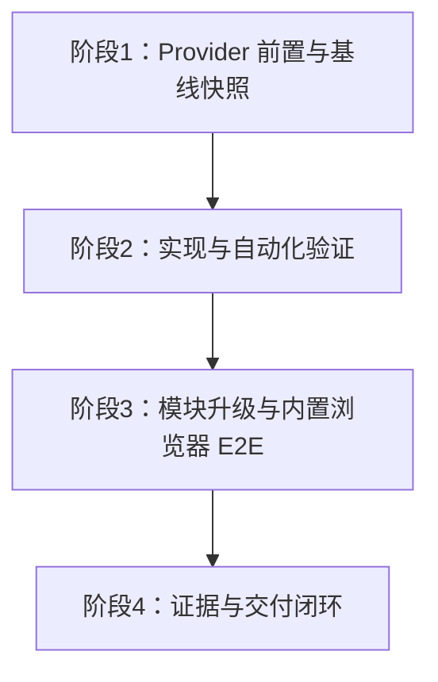

<!-- Skill bundle metadata
Source path: docs/skill/odoo-project-workflow/references/templates/Planning/IMPLEMENTATION_PLAN_TEMPLATE.md
Source version/status: v0.1; Draft
Synced: 2026-10-16
-->

# `odoo_record_retriever` Schema 修复实施计划

## 文档信息

| 项目 | 内容 |
|---|---|
| 文档 | `IMPLEMENTATION_PLAN_CC-LLM-TOOL-002` |
| 版本 | v1.0.0 |
| 状态 | Frozen |
| 基线有效性 | VALID |
| 项目 / 模块 | `odoo-llm` / `llm_tool`、`llm_openai` |
| 计划负责人 | 项目技术负责人 |
| 创建日期 | 2026-10-16 |
| 基线日期 | 2026-10-16 |
| 批准 / 基线记录 | 用户于 2026-10-16 明确批准冻结 CC-LLM-TOOL-002 并进入实施；本计划仅编排冻结 CC 中的范围、顺序与门禁，不扩展技术范围。 |

### 冻结门禁

本计划在 TDD-002 冻结后建立，作为 CC-LLM-TOOL-002 的执行顺序、依赖及验收基线。CC 与本计划按用户 2026-10-16 的明确授权冻结。计划不替代或修改 SRS、DDD、TDD 或 TV。

### 首个 CC 门禁检查表

- [x] SRS 适用性：N/A；这是现有工具技术契约修复，不增加业务流程。
- [x] DDD 适用性：N/A；不引入领域模型或不变量。
- [x] 适用 TV：TV-LLM-TOOL-002-01 已确认当前运行时缺陷；历史运行归因和真实 Provider Schema 接受情况由实施验证记录。
- [x] TDD-LLM-TOOL-002 v1.0.0 Frozen，与本计划范围一致。
- [x] 本计划按用户批准冻结 CC 并进入实施的授权建立并冻结。
- [x] 唯一计划阶段映射到拟建 / 冻结 CC-LLM-TOOL-002。

**门禁结果：** READY；Provider 前置验证作为实施阶段中的 P0 子门禁，未通过前不修改产品代码。

## 1. 上游基线

| 权威输入 | 版本 / ID | 状态 | 位置 |
|---|---|---|---|
| SRS | N/A | 不适用 | 见 TDD-002 §0.2 |
| DDD | N/A | 不适用 | 见 TDD-002 §0.2 |
| TV | TV-LLM-TOOL-002-01 v0.2 | 已核实当前运行时缺陷；历史归因 / Provider 验收待验证 | `../technical/TV-LLM-TOOL-002-schema-generation.md` |
| TDD | TDD-LLM-TOOL-002 v1.0.0 | Frozen | `../technical/TDD-LLM-TOOL-002.md` |
| Coding Contract | CC-LLM-TOOL-002 v1.0.0 | Frozen | `../intent/CC-LLM-TOOL-002_record_retriever_schema.md` |
| 上游代码 | `odoo-llm` 18.0，commit `609ec6dda3645165f6a4a843d7af5d286081a29d` | 锁定 | 当前嵌套 checkout |

基线代码若变化，先核对 CC 白名单和 TDD 契约；偏离时暂停并走对应变更流程。

## 2. 目标与范围

### 2.1 目标

修复 retriever 动态 Schema 生成、OpenAI Schema 转换及错误 fallback，使 Provider 所见参数与工具 callable / 执行校验一致，并由现有聊天层安全地呈现 Schema 错误。

### 2.2 范围内

- 按冻结 CC 修复 `llm.tool.get_input_schema()` 及三个指定 OpenAI formatter 方法。
- 在 CC 指定测试文件中覆盖 Schema、union、fail-closed、工具执行校验及回归。
- 完成规定的只读 ORM 前后快照、自动化测试、Provider E2E 和脱敏证据。

### 2.3 范围外

- `reasoning_effort` 修复、global search 桥接、其他工具、权限或执行 API、Provider 协议迁移及数据库数据修改。
- 修改 CC 白名单之外的文件；若发现必需改动，停止并修订上游设计 / CC。

### 2.4 约束

- 使用当前用户 `env`，不新增 `sudo()`，保留 ACL / record rules。
- 使用现有 `venv`、`odoo.conf`、运行实例端口 8091 和开发数据库 `odoo18ce`；不建立隔离数据库。
- 真实 Provider 验证只使用脱敏的最小请求；不记录凭据、完整 Prompt、业务记录或完整工具参数。
- 按 CC 顺序执行：前置 CC-OPENAI-001 Provider-only 验证、基线快照、自动化、聊天错误注入、最后内置浏览器 E2E。

## 3. 开工前置

| 前置项 | 要求 / 证据 | 负责人 | 优先级 | 状态 |
|---|---|---|---|---|
| 冻结基线 | TDD v1.0.0、CC v1.0.0、代码 commit 匹配 | 项目技术负责人 | P0 | 已满足 |
| CC-OPENAI-001 前置 | 严格 `CC-TEST-011` Provider-only 响应通过；历史状态保持原样 | 实施者 | P0 | PASS；ATR-CC-OPENAI-001 ATR-RUN-004 |
| Odoo 环境 | `venv` + `odoo.conf`，现有 `odoo18ce`、8091 | 实施者 | P0 | 已核验：Odoo 18、Python 3.11.9、PostgreSQL 16.14；HTTP 200 |
| 活动工具快照 | 按 CC-TEST-008 使用 Odoo shell 只读 ORM 采集 | 实施者 | P0 | 已完成；6 个活动工具；证据见 CC-002 ATR E-001 |
| Provider / 浏览器 | 已配置 Provider 可用；Codex 内置浏览器可操作 | 实施者 | P0（E2E 阶段） | E2E 前核验 |

## 4. 实施阶段

### 阶段 1：前置核验与基线快照

**目标：** 确认本 CC 的上游状态、Provider 前置测试和现存工具配置。

**输入 / 依赖：** TDD-002 v1.0.0、CC-002 v1.0.0、CC-OPENAI-001 记录、运行中的 `odoo18ce`。

**交付物：** 脱敏 ATR 前置记录；实施前活动 `llm.tool` 名称与 Schema 结构快照；Provider-only 测试状态引用。

**验收门禁：** `CC-OPENAI-001 CC-TEST-011` 按原契约 PASS；若失败则停止并报告；快照使用 Odoo shell / ORM 且无数据写入。

**验证证据：** CC-002 ATR；Provider-only 原始响应仅记录状态及目标 tool call 名称，不保存密钥 / Prompt / 参数值。

**CC 映射：** CC-LLM-TOOL-002 §7 `CC-TEST-008` 前置部分；CC-OPENAI-001 `CC-TEST-011`。

### 阶段 2：Schema 生成与转换修复

**目标：** 按 CC 方法级白名单落实动态 Schema、union 转换与 fail-closed。

**输入 / 依赖：** 阶段 1 门禁通过。

**交付物：** CC 白名单内生产代码和测试代码；IHR 实施事实。

**验收门禁：** CC-TEST-001–009 和 CC-TEST-011 自动化断言通过；无关工具格式化兼容；Schema 错误时 Provider HTTP 调用数为零。

**验证证据：** ATR 自动化测试记录、运行日志、脱敏 ORM 快照比较。

**CC 映射：** CC-LLM-TOOL-002 §4、§5、§6、§7。

### 阶段 3：运行实例升级与真实聊天验证

**目标：** 在现有开发实例验证 Provider 接受实际 Schema、工具参数经过校验并能读取当前用户可访问记录。

**输入 / 依赖：** 阶段 2 自动化门禁通过；用户指定内置浏览器、Provider 与开发实例可用。

**交付物：** 通过内置浏览器完成的 CC-TEST-010；模块升级及日志 / ORM 验证；ATR / HVR。

**验收门禁：** 真实 Provider 成功返回符合已发送 Schema 的 `odoo_record_retriever` 参数；工具在当前用户权限下执行；结果真实可读。若 Provider 拒绝 union，停止，不弱化 Schema。

**验证证据：** 浏览器 UI 观察与脱敏 HVR / ATR；XML-RPC 模块升级结果和 Odoo 日志检查。

**CC 映射：** CC-LLM-TOOL-002 `CC-TEST-010`、`CC-TEST-008` 实施后快照。

### 阶段 4：证据和交付闭环

**目标：** 校核基线、范围、证据及所有状态，完成本轮报告。

**交付物：** 完整 IHR、ATR、HVR 及 CC 后续关闭评估材料；工作报告。

**验收门禁：** 所有测试按真实执行状态记录；未运行或失败项不冒充 PASS；敏感信息脱敏；所有改动在白名单内。

**验证证据：** 当前 commit / 工作树、自动化运行结果、Odoo 服务日志、浏览器验证记录。

**CC 映射：** CC-LLM-TOOL-002 全部要求。

## 5. 阶段顺序与依赖

**关键路径：** Provider 前置验证 → 实施前快照 → 修复 / 自动化 → 模块升级 / 内置浏览器 E2E → ATR / HVR 闭环。

## 6. 里程碑

| 里程碑 | 范围 | 退出条件 | 目标 / 状态 |
|---|---|---|---|
| M1 基线就绪 | 阶段 1 | CC-001 前置 PASS 且工具快照完成 | 按实施运行状态更新 |
| M2 实现验证 | 阶段 2–3 | 自动化、模块升级、E2E 状态均如实记录 | 按实施运行状态更新 |
| M3 交付 | 阶段 4 | 文档追溯完整、脱敏检查完成 | 按实施运行状态更新 |

## 7. 验收与验证矩阵

| 设计约束 / TV | 阶段 | 验收标准 | 验证方法 / 证据 | CC / FR | 状态 |
|---|---|---|---|---|---|
| TV-LLM-TOOL-002-01：动态 Schema 可用 | 2 | 必填 `model`、可选字段类型 / 默认值精确符合 callable | CC-TEST-001–003；ATR | CC-002 | 待执行 |
| TDD §5.4 / §18：union 语义保留 | 2 | 不原地修改、不补猜测类型，转换前后语义一致 | CC-TEST-004、008；ATR | CC-002 | 待执行 |
| TDD §6.2：fail-closed / 受控错误 | 2 | Schema 失败时零 Provider HTTP 请求，错误不泄露内部细节 | CC-TEST-003、005、011；ATR | CC-002 | 待执行 |
| TDD §12：当前用户权限 | 2–3 | 工具执行继续使用调用用户 env / 权限规则 | CC-TEST-007、010；ATR / HVR | CC-002 | 待执行 |
| TDD §14.2：链路分层证据 | 1–3 | 依次区分 Schema、Provider Schema、参数和执行输入 | ATR / HVR 脱敏记录 | CC-002 | 待执行 |
| CC-OPENAI-001 前置 | 1 | 严格 Provider-only 真实响应有目标 tool call 且 HTTP 200 | CC-OPENAI-001 ATR/HVR 更新补充运行 | CC-002 前置 | 待执行 |
| CC-TEST-010：真实端到端 | 3 | Provider 依 Schema 产参，Odoo 执行并返回授权数据 | Codex 内置浏览器；HVR / ATR | CC-002 | 待执行 |

所有 `CC-TEST-001`–`CC-TEST-011` 均在阶段 2–3 逐项记录结果；不适用项须写理由，计划值不是通过证据。

## 8. 质量与验证策略

| 验证领域 | 适用性 | 要求 / 门禁 |
|---|---|---|
| 自动化 / ORM | 适用 | Odoo 模块测试，按 CC-TEST 顺序记录 ATR |
| 权限 / 安全 | 适用 | 验证无 sudo、新增权限不发生；真实 E2E 用当前用户 |
| 浏览器 / E2E | 适用 | Codex 内置浏览器，不用外部浏览器代替；现有数据库 |
| 性能 | 不适用 | 本轮只修复请求 Schema 生成 / 转换，不定义性能目标 |
| 升级 / 回滚 | 适用 | XML-RPC 升级既有模块；检查日志；不执行数据写入迁移 |
| 基线回归 | 适用 | 无关工具 formatter 和前后 ORM Schema 快照比较 |

## 9. 风险与应对

| 风险 | 概率 / 影响 | 缓解 | 回退 / 决策人 | 状态 |
|---|---|---|---|---|
| `CC-OPENAI-001 CC-TEST-011` 仍未满足严格 Provider-only 过程 | 中 / 高 | 实施前按原契约补跑；记录真实 HTTP 状态与工具名 | 失败则暂停；项目技术负责人 | Open |
| Provider 拒绝 `anyOf` union | 中 / 高 | 按 TDD 真实请求验证 | 停止并修订 TDD / CC；项目技术负责人 | Open |
| 无关工具依赖旧 formatter 行为 | 中 / 中 | 活动工具快照及 formatter 回归测试 | 若有范围外影响则停止；项目技术负责人 | Open |
| 内置浏览器或 Provider 不可用 | 中 / 中 | 阶段 1 / 3 核实环境并使用真实日志反馈 | E2E 如实 `NOT RUN` / `BLOCKED`，不改用隔离库；项目负责人 | Open |

## 10. 资源与环境

| 环境 / 资源 | 要求 | 负责人 | 可用性 / 状态 |
|---|---|---|---|
| Python | 项目 `venv`，当前 Python 3.11 | 实施者 | 实施时核验 |
| Odoo | Odoo 18，`odoo.conf`，HTTP 8091 | 实施者 | 运行时核验 |
| 数据库 | `odoo18ce`，不建隔离库 | 实施者 | 用户已指定 |
| 内置浏览器 | Codex in-app browser，已登录 Odoo | 实施者 | E2E 前核验 |
| Provider | 已配置 OpenAI 模型，真实请求 | 实施者 | 阶段 1 / 3 核验；敏感信息不落文档 |

## 11. 变更控制

- TDD、TV 或 CC 技术边界有影响时先暂停，按上游文档流程更新、批准并重新基线。
- 计划阶段 / 顺序变化须记录原因及影响；不得静默扩展 CC 白名单。
- 若需改动其他生产文件、数据库数据或 Provider 协议，停止并先修订相关权威文档与 CC。

## 12. 交付物与交接

| 交付物 | 阶段 | 验收证据 | 位置 / 状态 |
|---|---|---|---|
| 生产代码与自动化测试 | 2 | CC-TEST-001–009、011 ATR | CC 白名单路径 / 待实施 |
| Odoo 升级与浏览器 E2E 证据 | 3 | CC-TEST-008、010 ATR/HVR | `docs/intent/` / 待记录 |
| 实施记录及工作报告 | 4 | IHR / ATR / HVR / 基线 | `docs/intent/` / 待记录 |

## 13. 未决项

| ID | 问题 | 阻塞阶段 | 负责人 | 状态 |
|---|---|---|---|---|
| OD-002-01 | 严格 Provider-only 前置验证结果 | 阶段 2 开工 | 实施者 | 已关闭：CC-OPENAI-001 ATR-RUN-004 PASS |
| OD-002-02 | 当前运行实例 / Provider / 内置浏览器状态 | 阶段 1、3 | 实施者 | Odoo / Provider 已核验；内置浏览器在 E2E 前确认 |

## 14. 追溯

### 14.1 权威文件到计划

| 上游来源 | 计划阶段 | 验收 / 证据 |
|---|---|---|
| TV-LLM-TOOL-002-01 v0.2 | 1–2 | 缺陷前置诊断、动态 Schema / union 修复 |
| TDD-002 v1.0.0 §§5、6、12、14、16、18 | 1–4 | CC-TEST 矩阵与 ATR / HVR |
| CC-002 v1.0.0 §§4–9 | 1–4 | 精确白名单、保留行为、停止条件 |

### 14.2 计划到 Coding Closure

| 阶段 / 交付物 | CC | IHR / ATR / HVR | FR | PVR |
|---|---|---|---|---|
| 阶段 1–4 | CC-LLM-TOOL-002 | 实施时创建并回填 | CC 评估时创建 | N/A：本文件只覆盖单一 addon CC，不代替项目闭环判断 |

## 15. 变更历史

| 版本 | 日期 | 状态 | 变更与原因 | 影响 |
|---|---|---|---|---|
| v1.0.0 | 2026-10-16 | Frozen | 按用户批准冻结 CC-002 并进入实施，建立与其范围严格对应的实施阶段、依赖及验证门禁 | 本计划所有阶段；不改变 TDD / CC 技术契约 |
