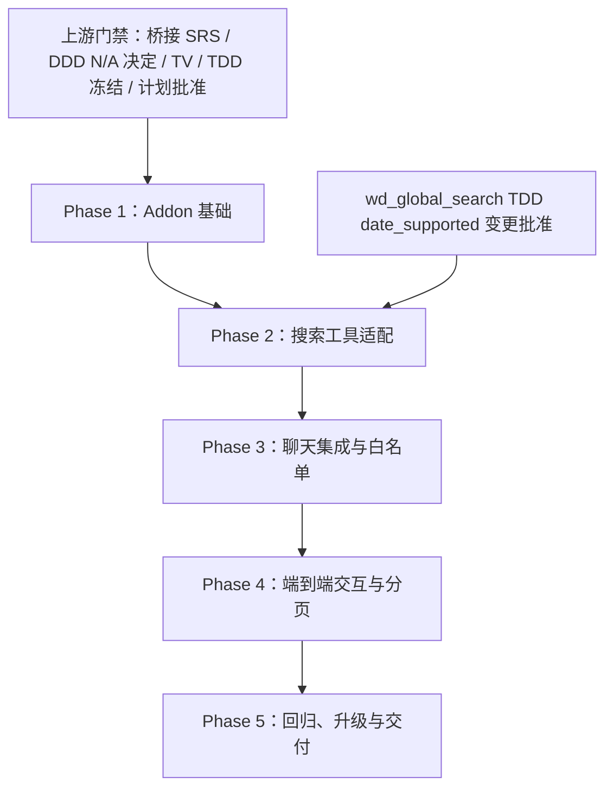

# wd_global_search_llm Implementation Plan

## Document Information

| Item | Value |
|---|---|
| Document | `IMPLEMENTATION_PLAN_wd_global_search_llm` |
| Version | v1.2 |
| Status | Frozen — development environment decision recorded from user instruction on 2026-10-15 |
| Baseline validity | VALID — approved against the recorded SRS / TDD versions; First CC Gate passed on 2026-10-15 |
| Project / Module | `wd_global_search_llm` |
| Plan owner | 待项目负责人指定 |
| Created | 2026-10-15 |
| Baseline date | 2026-10-15 |
| Approval / baseline record | 用户于 2026-10-15 批准冻结计划 v1.0、决定 DDD 不适用，并指定直接使用开发数据库 `odoo18ce`、不建立隔离数据库；本 v1.2 记录该环境决定及实测环境基线，SRS / TDD 保持 v1.0.0 |

### Freeze Gate

本计划 v1.2 延续用户批准的规划基线，并记录两项用户决定：本项目不需要 DDD；开发验证直接使用 `odoo.conf` 指定的本地开发数据库 `odoo18ce`，不建立独立隔离数据库。项目仍须遵守冻结 SRS / TDD；本次 First CC Gate 的运行版本、搜索域和开发环境依据见 §3。开发库使用范围限于 CC 授权的模块安装 / 升级和元数据核查，不得借此扩大业务数据读写范围。

### First CC Gate Checklist

- [x] 桥接 SRS v1.0.0 已独立冻结；现有 Global Search SRS V1.5 仍将 LLM / 完整自然语言解析排除在范围外，桥接基线不扩展该 SRS。
- [x] DDD 不适用决定已记录：用户于 2026-10-15 明确决定不需要 DDD；桥接只复用既有搜索服务，不引入新业务模型 / 状态 / 领域不变量，业务与技术语义分别由冻结 SRS / TDD 管理。
- [x] 适用的源代码级 Technical Verification 已关闭，结论及处置记录见 `TV_wd_global_search_llm.md`。
- [x] 运行时集成验证已映射到 Phase 2–4 acceptance gate；它不是 first CC gate 的预先阻塞项，执行结果仍须按实施证据记录。
- [x] TDD v1.0.0 已基于冻结 SRS 和源码级 TV 明确设计并由用户批准冻结；`TD-009` 已决议。
- [x] 本计划已完成用户评审 / 批准并冻结为 v1.2 有效规划基线；用户于 2026-10-15 明确指定使用 `odoo18ce` 开发数据库，不建立隔离数据库。
- [x] 本计划 v1.2 已将每个阶段映射到 CC ID 与范围，并将每个 CC 反向映射至一个计划阶段；首个 CC 创建后已按工作流回填其 Draft 路径，Phase 2–5 仍是拟建映射。
- [x] 已核查截至门禁时的失败、跳过、阻塞或缺失项：TV-LLM-01/02 为 CLOSED；桥接尚无 CC / IHR / ATR / HVR；TDD 测试均标为实施期 NOT RUN，不属于首 CC 前未处置失败项。
- [x] Phase 1 适用的 P0 readiness prerequisites 已满足：本地 Odoo / Python / PostgreSQL 与 pinned `odoo-llm` 源码版本已核实；`odoo18ce` 中 `global_search_baseline` 有效发布；用户接受以该开发库进行 Phase 1 验证；调用参数显式包含 `mymodules/odoo-llm`（见 §3）。权限 fixtures 在 Phase 2 / 3 对应 CC 中按测试需要建立，不作为 CC-01 的前置。

**Gate result：PASSED — 2026-10-15**

**门禁证据摘要：** DDD N/A 已记录；SRS / TDD / Implementation Plan 基线有效；本地 Odoo 18.0、Python 3.11.9、PostgreSQL Server 16.14 与 pinned `odoo-llm` commit 已核实；`odoo18ce` 中 `global_search_baseline` active 且有已发布版本 5；用户明确授权直接使用该开发库，不建立隔离数据库；通过显式 addons path 参数可发现 pinned `llm_tool`、`llm_assistant`、`llm_thread`、`llm_openai` 源码。没有本桥接实施期失败证据需要豁免。Phase 3 mock provider、Phase 2 基础模块 TDD amendment 和 Phase 4 / 5 real Provider 仍按各自阶段门禁执行，不阻止 CC-01。

## 1. Upstream Baselines

| Authority / Input | Version / ID | Status | Location |
|---|---|---|---|
| Global Search SRS | V1.5 | FROZEN；LLM / 完整自然语言解析明确 OUT，不覆盖本桥接需求 | [SRS_global_search.md](../../../../docs/requirement/SRS_global_search.md) |
| Bridge SRS | v1.0.0 | FROZEN — 用户于 2026-10-15 明确批准 | [SRS_wd_global_search_llm.md](../designing/SRS_wd_global_search_llm.md) |
| DDD | N/A | 用户于 2026-10-15 明确决定本项目不需要 DDD；理由见本节及 WGSL-OD-008 | 本计划 v1.2 §13 |
| TV / Spike | TV-LLM-01/02 | CLOSED — source-level feasibility verified; runtime tests are implementation evidence | [TV_wd_global_search_llm.md](../../../../docs/verification/TV_wd_global_search_llm.md) |
| Bridge TDD | v1.0.0 | FROZEN — user-approved; `TD-009` resolved | [TDD_wd_global_search_llm.md](../designing/TDD_wd_global_search_llm.md) |
| Existing Global Search TDD | v0.4 | FROZEN；仅定义既有 SearchService 边界，不含 LLM 桥接 | [TDD_global_search.md](../../../../docs/design/TDD_global_search.md) |
| Upstream `odoo-llm` source | branch `18.0`，commit `609ec6dda3645165f6a4a843d7af5d286081a29d` | Source commit matches pinned baseline; modules are not yet installed in `odoo18ce`, as expected before CC-01 | `mymodules/odoo-llm`; effective discovery verified with explicit addons path |

任何上游基线变更都必须先由其权威文档完成评审和批准，再评估本计划各阶段、交付物、验收条件和拟建 CC 的影响。本 v1.2 已按冻结 SRS / TDD、DDD N/A 和用户指定的开发数据库决定完成影响复核；若未来范围新增领域模型、领域不变量或独立业务状态，须重新评估 DDD 适用性并按变更控制复核本计划。

## 2. Objective and Scope

### 2.1 Objective

在桥接 SRS 和 TDD 获批冻结后，规划一个可选 Odoo addon `wd_global_search_llm`，将聊天中的自然语言搜索意图转换为既有 `wd_global_search` 搜索服务请求，并在当前用户权限边界内返回服务端生成的结构化结果。

### 2.2 In Scope（按冻结 SRS / TDD）

- 通过 `llm_tool` 注册只读全局搜索工具，复用 `SearchService`、`SearchRequest` 和 `SearchResponse`。
- 从聊天线程用户环境获取资源描述，并将资源 / 条件映射为现有搜索请求。
- 专用搜索 Assistant 的 provider 工具列表过滤与服务端工具执行白名单。
- 将搜索服务结果整理为 JSON 兼容响应；导航链接仅通过既有服务端导航校验生成。
- 复用 `llm_thread` 原生聊天界面；具体对话文案、澄清和结果呈现由桥接 SRS 定义。
- 通过自动化和集成验证证明权限、条件、资源范围、游标、链接和工具白名单行为。

### 2.3 Out of Scope（按冻结 SRS / TDD）

- 改造 `wd_global_search` 的搜索执行逻辑或复制 SearchService。
- 通过内部 HTTP 调用同一 Odoo 服务；绕过 ACL / Record Rules；以 `sudo()` 搜索业务记录。
- 创建、更新、删除业务记录或提供其他写操作工具。
- 由模型生成命中数、记录 ID、有效条件或导航 URL。
- 新建聊天结果卡片、搜索工作区或复杂前端体验，除非桥接 SRS 明确纳入。
- 未经需求批准的完整自然语言查询语言、任意 domain、布尔表达式或未配置字段查询。
- 除 Phase 2 所需的 `date_supported` 服务端描述元数据扩展外，不修改 `wd_global_search` 的搜索执行逻辑、权限边界或结果结构。该扩展必须在 `wd_global_search` 自身 TDD 的变更记录中登记，并按其变更流程评审、批准和冻结；桥接 TDD `TD-009` 只定义桥接依赖契约，不替代基础模块 TDD 的变更记录。

### 2.4 Constraints（冻结约束）

- 使用发起请求用户的 `env`，不接受模型提供的 uid / domain_key。
- 资源范围来自当前用户的 `resource_descriptors`；SearchService 执行最终授权校验。
- 仅专用助手可调用搜索工具；provider 暴露列表及实际执行入口都必须服务端强制白名单。
- 搜索结果、数量、分页游标和可导航链接以服务端返回值为唯一事实来源。
- `domain_key`、Business Date 可用性、工具 Schema 校验和最低用户交互边界已在冻结 SRS / TDD 中明确；运行实例的具体配置须在实施前核实。

## 3. Readiness Prerequisites

| Prerequisite | Required state / evidence | Owner | Priority | Status |
|---|---|---|---|---|
| Bridge SRS | 以冻结 v1.0.0 建立业务需求基线 | 需求负责人 | P0 | Complete — Frozen |
| Global Search SRS compatibility | 确认桥接不扩展 V1.5 的 LLM OUT 范围 | 需求负责人 | P0 | Complete — independent SRS |
| DDD applicability | 记录用户授权决定及理由：仅适配既有 SearchService，不引入新业务模型 / 状态 / 领域不变量 | 项目负责人 / 需求负责人 | P0（First CC） | Complete — N/A, user decision 2026-10-15 |
| Bridge TDD | 基于冻结 SRS / TV 形成并冻结 v1.0.0 技术基线 | 技术负责人 | P0 | Complete — Frozen |
| TV closure | 关闭影响 TDD 的源码级不确定性；运行时集成测试进入实施验证 | 技术负责人 / QA | P0 | Complete — source-level; runtime tests pending |
| Exact source compatibility | 记录本地开发运行时版本；比对 `odoo-llm` commit `609ec6dda3645165f6a4a843d7af5d286081a29d`；目标模块由 CC-01 首次安装 | 环境负责人 | P0 | Complete — Odoo 18.0; Python 3.11.9; PostgreSQL Server 16.14; source commit matches |
| Domain configuration | 确认 `odoo18ce` 中 `DOMAIN_KEY=global_search_baseline` 与有效已发布配置匹配 | 搜索模块负责人 | P0 | Complete — active domain; published version 5 |
| Development test environment | 用户指定使用 `odoo.conf` 中的 `odoo18ce`（127.0.0.1:5555），不建立隔离库；首 CC 仅做授权范围内的模块安装 / 升级与元数据核查 | 项目负责人（用户） | P0 | Complete — explicit user decision 2026-10-15; business-data fixtures deferred to relevant CCs |
| Effective addons path | Odoo 调用显式包含 `mymodules/odoo-llm`，避免依赖当前 `odoo.conf` 未包含的嵌套 addon 路径 | 环境负责人 | P0 | Complete — module path resolution verified with CLI override; no config edit |
| Mock provider harness | 可重复地产生工具调用和伪造工具调用的服务端集成测试 harness，用于 Phase 3 验证 provider payload 过滤及执行入口拒绝 | QA / LLM 技术负责人 | P0（Phase 3） | Unknown |
| Real provider readiness | 目标 Provider 支持 Tool Calling，且凭证、超时 / 失败配置及可审计 E2E 环境就绪 | LLM 运维负责人 | P1（Phase 4 / 5） | Unknown |
| Global Search TDD change record | 在修改 `wd_global_search.services.facade._resource_descriptor` 前，按既有冻结 TDD 变更流程创建递增版本，记录 `date_supported` 契约扩展，完成评审、批准和冻结；不改变其搜索 / 权限语义 | 搜索模块技术负责人 | P0（Phase 2） | Pending |
| Plan approval | 以上游冻结文档版本重审本计划并记录批准、有效基线 | 项目负责人 | P0 | Complete — user-approved Frozen v1.2; environment decision recorded |

任一适用于当前阶段的 P0 前置项未满足时，只允许继续不依赖该项的需求、设计或验证准备；不得进入受其阻塞的实施阶段或把该阶段 / 里程碑标为完成。计划批准和首个 CC 门禁等全局 P0 项在关闭前阻塞 Phase 1 及所有后续实现。

## 4. Implementation Phases

阶段顺序与 CC ID 已作为本计划 Frozen v1.2 的规划基线。First CC Gate 于 2026-10-15 通过；`CC-WGSL-001` 已在 `docs/intent/CC-WGSL-001.md` 起草为 Draft，尚待审阅 / 冻结；Phase 2–5 的 CC 仍为拟建。

### Phase 1: Addon 基础与依赖注册

**Objective**

建立独立、可选的桥接 addon 骨架，并确认 Odoo 对依赖关系及 `llm_tool` 工具注册记录的加载行为。

**Inputs and dependencies**

- 桥接 SRS、TDD、适用 TV 和本计划均已冻结 / 基线化。
- Odoo 18.0 / Python 3.11.9 / PostgreSQL Server 16.14 与 pinned `odoo-llm` commit 已核实。
- 用户指定开发数据库 `odoo18ce`；Odoo 命令显式增加 `--addons-path=addons,odoo/addons,mymodules,mymodules/odoo-llm`。

**Deliverables**

- addon manifest、目录、依赖声明和安装 / 升级数据定义。
- 最小工具注册及专用 Assistant 配置，范围严格服从获批 SRS。
- 在用户指定开发库上的安装 / 升级及依赖验证记录；不在该开发库执行模块卸载。

**Acceptance gate**

- 在用户指定的 `odoo18ce` 开发库上可安装和升级；依赖缺失时给出明确的模块依赖错误。此项不代表已执行，须由 CC-01 的实际证据确认。
- 工具 / Assistant 配置仅由 addon 数据定义提供，不更改上游 addon。
- 安装后 `llm.tool` 记录存在，工具名和参数 schema 与冻结 TDD §5.1 一致。
- 无桥接业务数据模型或迁移，除非冻结 TDD 明确批准。

**Verification evidence**

- Odoo 模块安装 / 升级日志、模块状态和数据记录核查；命令使用已核实的显式 addons path，记录在本阶段 ATR / IHR。不得在此开发库运行卸载验证。

**CC mapping**

- `CC-WGSL-001`（Draft）：addon 元数据、依赖、工具和 Assistant 基础注册；见 `docs/intent/CC-WGSL-001.md`。

**Estimate / owner / risk**

- Estimate: TBD，待环境和批准范围确定。
- Owner: Odoo 实施负责人待指定。
- Risk and response: 开发库不是隔离库 → 严格限定本阶段数据变更为 addon 安装 / 升级和工具 / Assistant 元数据；不执行卸载、不写业务记录；上游模型 / 字段签名变动 → 锁定 commit 并在对应 CC 验证。

### Phase 2: 当前用户搜索工具适配

**Objective**

实现聊天工具参数到现有搜索请求及服务端响应的适配，不复制搜索语义。

**Inputs and dependencies**

- Phase 1 完成。
- 冻结 TDD 已明确工具 Schema、允许的条件类型、默认资源范围、`domain_key` 与 `TD-009` 决策。

**Deliverables**

- 搜索工具参数 Schema 和结构错误处理。
- 当前用户 descriptors 获取、resource scope 校验、请求构造与 limit clamp。
- 在现有 `wd_global_search` 模块内扩展私有 helper `services.facade._resource_descriptor`，为授权资源增加服务端生成的 `date_supported` 布尔值；这是对基础模块的代码修改，不是桥接模块内的扩展。实施前须按既有流程创建该模块 TDD 的递增版本，记录变更并完成评审、批准和冻结；范围仅限描述元数据，不改搜索执行、权限边界或既有结果结构。
- 在 `wd_global_search` 服务测试中覆盖有 / 无 Business Date 配置两种资源，以及公开描述不泄露内部映射字段和策略。
- 直接调用 `SearchService.search(env, request, DOMAIN_KEY)`。
- `SearchResponse` 序列化、服务端可信字段映射和安全错误转换。
- 仅经 `resolve_form_navigation` 校验后附加的导航 URL。

**Acceptance gate**

- 普通关键词搜索的 count、条件、快照与 SearchService 响应一致。
- 多资源搜索明确传入授权资源集合；空 descriptors 不会导致空 scope 被解释成全资源搜索。
- 非法结构返回稳定工具错误，不泄露 traceback；未知字段 / 状态不被猜测或扩大解释。
- 搜索和导航都使用当前用户环境，不对业务记录使用 `sudo()`。
- 日期条件仅在冻结契约及描述元数据支持时启用；否则首版明确不支持。
- Business Date 已配置资源描述为 `date_supported=true`，未配置资源为 `false`；描述不泄露模型名、字段名、时区行为或私有映射；基础模块 TDD 变更记录已在实施前完成批准和冻结。

**Verification evidence**

- TransactionCase / ORM 集成证据、SearchService 请求与响应断言、ACL / Record Rule 情景记录。

**CC mapping**

- `CC-WGSL-002`（拟建）：搜索工具、请求 / 响应适配和安全导航。

**Estimate / owner / risk**

- Estimate: TBD，待接口验证和 fixtures 确认。
- Owner: Odoo 服务端负责人待指定。
- Risk and response: Schema 或 SearchService 请求契约不匹配 → 在 TV / TDD 阶段先验证，实施期不得猜测接口。

### Phase 3: 聊天工具暴露与执行白名单

**Objective**

让专用搜索助手能调用搜索工具，同时由服务端阻止线程配置修改或伪造调用扩展能力。

**Inputs and dependencies**

- Phase 1、Phase 2 完成。
- 冻结 TDD 已核实 `llm.thread` 和 `mail.message` 扩展方法的签名及调用顺序。
- P0 mock provider harness 已就绪；真实 Provider readiness 不阻塞此阶段的白名单集成验证。

**Deliverables**

- 专用线程的 provider 工具列表过滤及当前用户资源描述注入；每次 provider 请求构造时，在当前用户环境中重新读取 `resource_descriptors`，不得使用线程创建时的快照。权限或已发布配置变更后，下一次请求使用新描述。
- 工具实际执行入口的 assistant identity 与 tool name 白名单校验。
- 受控诊断日志与用户安全提示。

**Acceptance gate**

- 修改线程 `tool_ids` 添加创建 / 更新工具时，provider 请求不暴露额外工具。
- 对非搜索工具的伪造调用在执行入口被拒绝，且不触发目标工具。
- 白名单拒绝不泄露内部配置、工具实现细节或异常。
- 助手身份缺失 / 不匹配时失败关闭。
- 同一线程中用户权限或已发布搜索配置变化后，下一次 provider 请求重新读取资源描述；描述不沿用线程创建时的旧快照。

**Verification evidence**

- mock provider 驱动的 provider 请求构造测试和真实工具执行入口集成测试、拒绝日志与聊天文案检查。

**CC mapping**

- `CC-WGSL-003`（拟建）：聊天集成、provider 工具过滤、执行入口白名单。

**Estimate / owner / risk**

- Estimate: TBD，待确定 hook 稳定性。
- Owner: LLM 集成负责人待指定。
- Risk and response: 上游 hook 在升级后变化 → 锁版本，升级前重跑白名单集成场景。

### Phase 4: 端到端搜索交互与分页

**Objective**

在原生聊天中完成获批的自然语言搜索、澄清、结果摘要和后续分页交互。

**Inputs and dependencies**

- Phase 1–3 完成。
- 桥接 SRS 明确关键词、条件、状态词、日期表达、歧义澄清、结果展示和继续搜索语义。

**Deliverables**

- 聊天上下文和资源 / 字段 / 状态描述注入。
- 获批的自然语言到条件映射及无法确定时的澄清行为。
- 响应摘要、结构化搜索结果和 next_cursor 往返。
- 部分成功、无结果、限流和配置不可用的聊天呈现。

**Acceptance gate**

- LLM 只产出候选意图和条件；真实结果、数量、ID、有效条件和链接均由服务端工具返回。
- 用户上下文变化后，旧游标按 SearchService 规则拒绝；同一上下文的下一页正确续取。
- 歧义或未配置条件触发冻结 SRS 定义的澄清 / 错误路径，不静默猜测。
- 同一对话的明确追问只继承上一条成功搜索中已确认的资源、关键词和条件；新主题、失败搜索或不明确追问不继承。互斥日期范围 / 状态必须先澄清，未澄清前不执行搜索。
- 行为验收逐项对应冻结 SRS 的 AC。

**Verification evidence**

- Odoo 集成测试；如 SRS 要求真实 provider / 浏览器交互，增加受控 E2E 与 HVR，记录模型、provider、数据库和 fixture 基线。

**CC mapping**

- `CC-WGSL-004`（拟建）：自然语言交互、摘要、条件和分页体验。

**Estimate / owner / risk**

- Estimate: TBD；取决于 SRS 的自然语言能力与 UI 验收范围。
- Owner: 产品 / QA / Odoo 集成负责人待指定。
- Risk and response: LLM 输出不稳定 → 以确定性 schema / SearchService 校验收敛，未满足的意图要求澄清。

### Phase 5: 安全回归、升级与交付

**Objective**

验证已交付桥接模块的安全边界、兼容性、升级行为和项目追溯闭环。

**Inputs and dependencies**

- Phase 1–4 完成并通过各自门禁。
- 目标部署与 CI 验证环境就绪。

**Deliverables**

- 完整自动化和安全验证证据、用户 / 运维配置文档。
- 模块升级 / 回滚说明和实际演练记录（如适用）。
- FR、PVR、PCR 所需交付与追溯索引。

**Acceptance gate**

- 冻结 SRS AC、TDD 安全门禁及本计划验收矩阵全部有状态和证据引用。
- 所有失败、跳过、阻塞、缺失项按工作流完整记录；未经有效授权不得按“通过”处理。
- 当前上游版本与实施、ATR / HVR 证据可追溯。

**Verification evidence**

- CI / Odoo 集成运行记录、权限验证记录、升级日志、FR / PVR / PCR。

**CC mapping**

- `CC-WGSL-005`（拟建）：集成回归、升级 / 运维文档和项目收口证据。

**Estimate / owner / risk**

- Estimate: TBD，待测试环境、发布约束和验收范围确定。
- Owner: QA / 发布负责人待指定。
- Risk and response: provider 不可重复或环境不可用 → 记录 Blocked / Not Run，不伪造通过；先补齐受控验证条件。

## 5. Phase Order and Dependencies

**已完成的上游决定：** 用户已将 DDD 判定为 N/A，并指定 `odoo18ce` 作为开发验证库，理由及依据记录于 §3 / §13。**Critical path：** First CC Gate 已通过 → Phase 1 / `CC-WGSL-001` → **Phase 2 前按变更流程完成并冻结 `wd_global_search` TDD 对 `date_supported` 的递增版本** → Phase 2 / `CC-WGSL-002` → Phase 3 / `CC-WGSL-003` → Phase 4 / `CC-WGSL-004` → Phase 5 / `CC-WGSL-005`。源码级 TV 已关闭；运行时集成验证在 Phase 2–4 执行。若未来范围新增领域模型 / 不变量 / 独立业务状态，须重开 DDD 适用性评估。

**Parallel work and constraints：** 计划批准前可继续进行运行时版本盘点、测试环境准备和不改变代码的验证准备；任何工作不得构成 addon 实施或绕过首个 CC 门禁。Phase 2 与 Phase 3 接口由冻结 TDD 固定，不能并行变更同一工具契约。

## 6. Milestones

| Milestone | Included phases / deliverables | Exit criteria and evidence | Target / status |
|---|---|---|---|
| M0 — 上游基线就绪 | Bridge SRS、DDD N/A 决定、TV 处置、冻结 TDD、获批计划及环境证据 | 对应冻结文件、用户环境决定和只读核查记录可查；首 CC 门禁通过 | 日期 TBD；READY — First CC Gate passed 2026-10-15 |
| M1 — 搜索工具可安全调用 | Phase 1–3 | 工具执行、SearchService 适配、双层白名单和权限验证通过 | 日期 TBD；未开始 |
| M2 — 聊天体验验收 | Phase 4 | 冻结 SRS 的交互 AC 有实际验证证据 | 日期 TBD；未开始 |
| M3 — 项目交付 | Phase 5 | 安全回归、版本 / 升级证据、FR / PVR / PCR 追溯闭合 | 日期 TBD；未开始 |

目标日期和人日估算均未填写，因为尚无经批准的范围、团队容量和测试环境承诺。

## 7. Acceptance and Verification Matrix

以下是按冻结 SRS v1.0.0 和 TDD v1.0.0 建立的 Frozen v1.2 计划映射；实施证据仍须在对应阶段实际执行后填写。表中 `FR at CC closure` 表示对应 CC 实施结束后，由 CC 实施者依据实际 IHR / ATR / HVR 证据编写该 CC 的 FR；FR ID 在创建时登记，当前不预造或伪称已存在。

| Requirement / design obligation / TV item | Plan phase | Acceptance criterion | Verification method and evidence | CC / FR | Status |
|---|---|---|---|---|---|
| Bridge SRS v1.0.0 Frozen AC | Phase 1–5 | 按冻结 SRS 逐项映射验收，不改变 AC 含义 | 每个 AC 记录适用测试 / HVR 和运行证据 | `CC-WGSL-001`–`005` / 每个 CC 闭环时建立对应 FR | Frozen baseline; `CC-WGSL-001` drafted; implementation evidence not run |
| 当前用户环境 / `T-LLM-SEC-001`（TDD v1.0.0） | Phase 2–3 | SearchService 使用聊天用户 uid/context；无业务搜索 `sudo()` | TransactionCase + ACL / Record Rule 情景 + ATR | `CC-WGSL-002/003` / 每个 CC 闭环时建立对应 FR | Frozen design; implementation not run |
| 资源范围 / `T-LLM-SEC-003`（TDD v1.0.0） | Phase 2 | 仅使用当前用户可用 descriptors；空集合不变成全范围 | 资源隔离、未授权 key 和空 descriptors 集成测试 | `CC-WGSL-002` / CC 闭环时建立对应 FR | Frozen design; implementation not run |
| 直接调用 SearchService / `T-LLM-002`（TDD v1.0.0） | Phase 2 | 不复制搜索逻辑，不经内部 HTTP | 工具执行测试及调用边界检查 | `CC-WGSL-002` / CC 闭环时建立对应 FR | Frozen design; implementation not run |
| Provider / 执行双层工具白名单 / `T-LLM-SEC-004` | Phase 3 | 额外工具既不暴露也不能伪造执行 | mock provider 驱动 provider payload 检查 + 实际执行入口集成测试；不以 mock 代替真实 Provider E2E | `CC-WGSL-003` / CC 闭环时建立对应 FR | Frozen design; implementation not run |
| 服务端可信结果 / `T-LLM-SEC-006/007` | Phase 2–4 | 数量、条件、ID、快照、链接来自服务端结果 / 校验 | SearchResponse 映射断言和导航权限测试 | `CC-WGSL-002/004` / 每个 CC 闭环时建立对应 FR | Frozen design; implementation not run |
| 条件映射 / `TEST-LLM-COND-004` | Phase 2、4 | 未知状态 / 字段不被猜测；按 SRS 澄清或安全拒绝 | 条件矩阵测试和聊天澄清 HVR（如 SRS 要求） | `CC-WGSL-002/004` / 每个 CC 闭环时建立对应 FR | Frozen design; implementation not run |
| 多轮追问、条件冲突 / `FR-LLM-08`、`AC-09`、`AC-10` | Phase 4 | 只继承上一条成功搜索中已确认的资源、关键词和条件；新主题、失败搜索或不明确追问不继承；互斥条件未澄清前不执行 | 覆盖成功追问继承、失败 / 新主题不继承及互斥日期 / 状态澄清的对话场景测试和 HVR | `CC-WGSL-004` / CC 闭环时建立对应 FR | Frozen design; implementation not run |
| 只读保证 / `NFR-LLM-04` | Phase 3–5 | 任意请求和配置下不得触发业务写入 | 伪造工具调用集成测试、业务记录前后状态核验 | `CC-WGSL-003/005` / 每个 CC 闭环时建立对应 FR | Frozen design; implementation not run |
| Business Date 元数据 / `TD-009` | Phase 2 | SearchService descriptor 返回 `date_supported` 布尔值 | `TEST-LLM-DATE-DESC-012` / ATR 覆盖有 / 无 Business Date 配置两种资源，并断言公开描述不泄露模型、字段或私有映射 | `CC-WGSL-002` / CC 闭环时建立对应 FR | Frozen design; implementation not run |
| `wd_global_search` TDD 变更记录 | Phase 2 前置 | 基础模块 TDD 按变更流程递增版本，并已记录、评审、批准和冻结 descriptor 元数据扩展；搜索语义、权限和结果结构不变 | 核对新冻结 TDD 版本 / 变更记录，并在 Phase 2 IHR 中引用 | `CC-WGSL-002` / CC 闭环时建立对应 FR | Pending — required before Phase 2 implementation |
| 正常关键词、多资源、游标和空 descriptors | Phase 2、4 | 工具输出与真实搜索服务一致，翻页和空范围安全 | 对应 TransactionCase / 集成测试及 ATR | `CC-WGSL-002/004` / 每个 CC 闭环时建立对应 FR | Frozen design; implementation not run |
| 升级、兼容和项目闭环 | Phase 1、5 | 按锁定依赖版本安装 / 升级；证据追溯至当前基线 | Odoo upgrade run、CI、FR / PVR / PCR | `CC-WGSL-001/005` / 每个 CC 闭环时建立对应 FR | Environment baseline confirmed; execution evidence not yet run |

## 8. Quality and Verification Strategy

| Verification area | Applicable scope | Required evidence / gate |
|---|---|---|
| Automated / unit / ORM | 工具参数、适配、结果映射、资源 scope、cursor | 在受控 Odoo DB 运行 TransactionCase；保留命令、commit、日志和 ATR 原生状态 |
| Permissions and security | uid/context、ACL、Record Rules、多公司、字段可见性、白名单、链接 | 普通 / 受限用户和伪造调用场景；实际执行入口集成证据 |
| Browser / E2E / human | 仅按冻结 SRS 的聊天体验要求决定 | 若 AC 要求，使用指定 provider / browser / user fixture 记录 HVR；否则说明不适用理由 |
| Performance / capacity | 工具等待时间、资源数、结果数和 Provider 时延 | SRS / TDD 定义阈值后在经批准的目标型环境测量；目前没有阈值，不作性能通过声明；本地开发库决定不用于代表性容量结论 |
| Upgrade / migration / rollback | addon 安装、升级、卸载以及历史聊天保护 | 按 Odoo 模块版本运行安装 / 升级；保留 DB 和日志证据；回滚范围按获批发布约定 |
| Final baseline regression | 冻结 SRS / TDD 和兼容依赖上的全量范围 | CI / 集成回归绑定准确代码 commit 和基线文档版本，未运行项明确标记 |

## 9. Risks and Contingencies

| Risk | Probability / impact | Mitigation | Fallback / decision owner | Close condition | Status |
|---|---|---|---|---|---|
| Global Search SRS V1.5 明确排除 LLM | Certain / Critical | 桥接 SRS v1.0.0 已独立冻结；保持依赖边界 | 不将桥接授权解释为修改既有搜索范围 | N/A — independent SRS v1.0.0 已冻结且本计划保持依赖边界 | Resolved — independent SRS |
| 日期支持能力需公开给自然语言条件映射 | Medium / High | TDD `TD-009` 冻结为授权资源描述增加 `date_supported`；SearchService 仍负责校验执行 | 通过 `TEST-LLM-DATE-DESC-012` 在实施中验证 | Phase 2 的配置 / 未配置测试通过，并确认无内部映射泄露 | Resolved in design; implementation test pending |
| `odoo-llm` hook / Schema 与本地源码核查版本不一致 | Medium / High | 锁定完整 commit 与目标实例 addon 版本；升级时重新核查 | 技术负责人确定兼容版本；不支持时修改 TDD / 依赖约束 | 目标 Odoo / addon 版本及 `odoo-llm` commit 已登记并比对一致，Phase 1 / 3 hook 与 Schema 验证通过 | Open |
| Provider 工具 schema 不能表达动态授权字段 | Medium / High | TDD 固定结构 Schema + 每次调用的授权资源描述 + SearchService 最终验证；TV 源码核查已确认可行 | 按冻结契约实现并以集成测试验证 | N/A — 结构 schema 与每次请求资源描述契约已在 TDD v1.0.0 冻结；实施正确性另由 Phase 2 / 3 验证 | Resolved in design; implementation test pending |
| UI 允许修改 `tool_ids` 或伪造工具执行 | High / Critical | provider 列表过滤和执行入口双重服务端校验，并做集成测试 | 任一层无法强制时不得开放部署 | Phase 3 mock provider 驱动的集成测试证明额外工具既不进入 provider payload，伪造执行又在服务端拒绝且未触发工具 | Open |
| 跨资源条件语义不一致或模型误解业务状态 | Medium / High | 描述只暴露允许条件；SearchService 校验；歧义走 SRS 定义的澄清 | 拒绝或要求澄清，不静默扩大查询 | Phase 2 / 4 条件矩阵及对话 HVR 通过，覆盖跨资源字段、未知状态、AND 组合和互斥条件澄清 | Open |
| 真实 Provider / E2E 无法稳定复现 | Medium / Medium | 区分隔离的服务端契约测试与受控 Provider 场景，固定测试提示 / 模型版本 | 记录 `Blocked` / `Not Run`，不得以 mock 冒充真实 E2E | 目标 Provider / 模型版本、凭证与测试用例可审计且真实 E2E 可复现；mock 只关闭服务端白名单风险，不关闭本风险 | Open |

## 10. Resources and Environments

| Resource / environment | Requirement | Owner | Availability / status |
|---|---|---|---|
| Odoo runtime | Odoo、Python、PostgreSQL Server 版本；运行时 addons path | 环境负责人 | Odoo 18.0 / Python 3.11.9 / PostgreSQL Server 16.14 confirmed；使用 `--addons-path=addons,odoo/addons,mymodules,mymodules/odoo-llm` |
| `odoo-llm` source | 冻结完整 git commit；模块首次安装版本按该源码基线 | LLM 维护者 | Commit `609ec6dda3645165f6a4a843d7af5d286081a29d` verified; add-ons resolve with explicit path; installation belongs to CC-01 |
| Global Search | 与冻结接口版本匹配的 `wd_global_search` 和已发布 `DOMAIN_KEY` 配置 | 搜索模块维护者 | `odoo18ce` has active `global_search_baseline`, published version 5 |
| Development database | 用户批准的开发验证数据库及操作边界 | 项目负责人（用户） | `odoo.conf` → `odoo18ce`, host `127.0.0.1`, port `5555`; isolated DB explicitly declined |
| Permission fixtures | 管理员、普通用户、受限用户、多公司 / Record Rule 用户及安全结果记录 | QA / 安全负责人 | Phase 2 / 3 relevant CC deliverables; not a First CC prerequisite; no permission test executed in this turn |
| LLM Provider | Tool Calling、凭证托管、可审计请求 / 响应、可控超时 | LLM 运维负责人 | 未知 |
| Browser / CI | 受支持浏览器与可重现 Odoo addon 测试 pipeline | QA / CI 负责人 | 未知 |
| 人员 | 需求负责人、技术负责人、Odoo 开发、QA、环境 / Provider 运维 | 项目负责人 | 尚未指派 |

## 11. Change Control

- **SRS / DDD / TDD / TV 变化：** 返回对应权威文档流程，完成审批和影响分析后更新本计划及阶段 / CC 映射；受影响工作在此之前保持暂停。
- **Implementation Plan 阶段 / 估算变化：** 记录原因、受影响阶段、依赖、验收、CC 映射和批准状态；Draft 期间不形成冻结变更。
- **发现实现与冻结契约不一致：** 立即暂停受影响 CC；不得在计划或 CC 中静默改变上游契约。
- **依赖升级：** 重新核对 `odoo-llm` 扩展签名 / 调用顺序、工具 Schema、权限执行环境及 provider 能力；影响 TDD 时先走 TDD 变更程序。

## 12. Deliverables and Project Handoff

| Deliverable | Planned phase | Acceptance evidence | Final location / status |
|---|---|---|---|
| 桥接 SRS | 上游门禁 | 批准 / 冻结记录和 AC | v1.0.0 Frozen；[SRS_wd_global_search_llm.md](../designing/SRS_wd_global_search_llm.md) |
| DDD 适用性决定 | 上游门禁 | 用户授权的 N/A 决定及理由 | N/A — 用户于 2026-10-15 决定不需要 DDD；见本计划 v1.2 §13 |
| 技术验证记录与冻结 TDD | 上游门禁 | 关闭适用 TV、解决 TD-009、TDD 审批冻结 | TV-LLM-01/02 CLOSED；TDD v1.0.0 Frozen |
| `wd_global_search` TDD `date_supported` amendment | Phase 2 前置 | 递增 TDD 版本、变更记录、评审 / 批准 / 冻结证据 | `docs/design/TDD_global_search.md` 当前 v0.4 Frozen；amendment 尚未创建 |
| Implementation Plan 有效基线 | 上游门禁 | 计划影响复核、审批和首 CC gate 记录 | 本文件 v1.2 Frozen；First CC Gate PASSED 2026-10-15 |
| addon / 工具 / Assistant | Phase 1–4 | 对应 CC、IHR、ATR、必要 HVR 和 FR | 尚未实施 |
| 集成回归、运行 / 升级说明 | Phase 5 | 绑定实际代码和文档版本的 PVR / PCR 证据 | 尚未实施 |

项目关闭时逐项将计划交付物追溯到 CC、FR 和 PVR / PCR 证据。计划阶段完成不代表需求覆盖或验收通过。

## 13. Open Decisions and Follow-up

| ID | Question / TODO | Blocking phases | Owner | Due / status |
|---|---|---|---|---|
| WGSL-OD-001 | 桥接需求采用独立 SRS 还是正式 amendment？ | All; first CC gate | 需求负责人 | RESOLVED — independent SRS v1.0.0 Frozen |
| WGSL-OD-002 | 首版支持哪些用户、资源、字段和自然语言意图？ | Phase 2–4 | 产品 / 需求负责人 | v1.0.0 Frozen — published authorized resources; ambiguous / unsupported intent follows SRS clarification rules |
| WGSL-OD-003 | Business Date 元数据通过何种 descriptor API 暴露，或首版是否排除日期条件？ | Phase 2 | 搜索 / 技术负责人 | RESOLVED — TDD TD-009 `date_supported` |
| WGSL-OD-004 | Provider schema 如何与当前授权资源 / 条件描述配合？ | Phase 2–3 | LLM 技术负责人 | RESOLVED in TDD §5.1 / §6.2 — fixed shape schema, per-call authorized descriptors, SearchService final validation |
| WGSL-OD-005 | 目标开发实例与冻结 `odoo-llm` 源码 commit / 模块版本是否匹配？ | All implementation | 环境 / LLM 负责人 | RESOLVED for development baseline — Odoo 18.0 / Python 3.11.9 / PostgreSQL Server 16.14; source commit matches; module install/version evidence will be recorded by CC-01 |
| WGSL-OD-006 | 结果摘要、链接、分页和澄清的最低验收要求是什么？ | Phase 4 | 产品负责人 | Minimum behavior Frozen in SRS v1.0.0; detailed presentation remains follow-up per OPEN-LLM-03 |
| WGSL-OD-007 | 专用助手 / 工具数据定义的访问权限、启用流程和升级策略是什么？ | Phase 1（用户启用）, Phase 5（发布） | 技术 / 运维负责人 | OPEN — 本地开发库 `odoo18ce` 可用于开发验证；助手仍 fail-closed，不对终端用户开放 / 启用，直至访问组与启用流程获批；Phase 5 发布前必须决议 |
| WGSL-OD-008 | 本项目是否需要 DDD？ | First CC gate | 项目负责人（用户） | RESOLVED — 用户于 2026-10-15 决定 N/A；本桥接仅适配既有 SearchService，无新业务模型、领域状态或不变量；冻结 SRS / TDD 分别承载业务 / 技术语义 |
| WGSL-OD-009 | `wd_global_search` TDD 如何记录 `date_supported` descriptor 元数据扩展？ | Phase 2 | 搜索模块技术负责人 | OPEN — Phase 2 实施前按既有变更流程创建递增 TDD 版本并完成评审、批准和冻结；不得只改变更记录或借桥接 TDD 代替 |
| WGSL-OD-010 | 首 CC 是否必须使用独立隔离数据库？ | First CC gate | 项目负责人（用户） | RESOLVED — 用户于 2026-10-15 明确指定直接使用 `odoo.conf` 配置的本地开发库 `odoo18ce`，不批准建立隔离数据库；范围按 §3 与 Phase 1 限定 |

## 14. Traceability

### 14.1 Authority to Plan

| SRS / DDD / TDD / TV reference | Plan phase | Planned acceptance / evidence |
|---|---|---|
| SRS Global Search V1.5 OUT: LLM / full NL | 上游门禁 | 证明桥接 SRS / amendment 已建立，不声称 V1.5 授权桥接 |
| Bridge SRS v1.0.0 Frozen AC | Phase 1–5 | 按冻结业务验收标准映射计划矩阵及运行验证证据 |
| Bridge TDD v1.0.0 §5–§6 Frozen | Phase 2 | 搜索请求、资源描述、条件能力和响应契约遵循冻结基线 |
| Bridge TDD v1.0.0 §12 / `T-LLM-SEC-*` | Phase 2–5 | 验证用户环境、授权、双层白名单和可信结果 |
| Bridge TDD `TEST-LLM-*` | Phase 2–5 | 设计测试均为 NOT RUN；实施时记录 ATR / HVR 实际证据 |
| DDD applicability / `WGSL-OD-008` | First CC gate | N/A — 用户授权决定及理由记录于计划 §13；如范围引入新领域结构则重评 |
| `TD-009` Business Date descriptor | Phase 2 | 实现 `date_supported` 并通过 `TEST-LLM-DATE-DESC-012` 验证 |
| Existing Global Search TDD amendment / `WGSL-OD-009` | Phase 2 前置 | 先为 `date_supported` descriptor 扩展建立并冻结递增的基础模块 TDD 版本；桥接 TDD 不替代该变更记录 |

### 14.2 Plan to Coding Closure

每个 CC 的 FR 是该 CC 的闭环产物，不在 Phase 1 前预先创建。CC 实施者在实施完成后，依据该 CC 的实际 IHR、ATR、适用的 HVR 及验收证据编写 FR；项目负责人 / 指定评审人核对需求追溯与证据后，按 FR 模板记录 Closure 状态。FR 内容从对应冻结 SRS AC 和 TDD 契约派生，必须反映实际证据，不得用计划中的预期结果代替。FR ID 在创建时登记并回填本表；`CC-WGSL-001` 目前为 Draft 且未开始实施，Phase 2–5 的 CC 仍为拟建，因此尚无 FR 文件或 FR ID。

| Plan phase / deliverable | CC | IHR / ATR / HVR | FR | PVR evidence |
|---|---|---|---|---|
| Phase 1: addon 基础 | `CC-WGSL-001` | Draft — [CC-WGSL-001.md](../intent/CC-WGSL-001.md)；First CC Gate 已于 2026-10-15 通过 | 实施开始后创建；闭环时由实施者建立并登记 FR | 待创建 |
| Phase 2: 搜索工具适配 | `CC-WGSL-002`（拟建） | First CC Gate 已通过；待按 Phase 1 依赖和门禁创建 | CC 闭环时由实施者创建；ID 在创建时登记 | 待创建 |
| Phase 3: 聊天集成与白名单 | `CC-WGSL-003`（拟建） | First CC Gate 已通过；待按 Phase 2 依赖和门禁创建 | CC 闭环时由实施者创建；ID 在创建时登记 | 待创建 |
| Phase 4: 端到端交互与分页 | `CC-WGSL-004`（拟建） | First CC Gate 已通过；待按 Phase 3 依赖和门禁创建 | CC 闭环时由实施者创建；ID 在创建时登记 | 待创建 |
| Phase 5: 回归与交付 | `CC-WGSL-005`（拟建） | First CC Gate 已通过；待按 Phase 4 依赖和门禁创建 | CC 闭环时由实施者创建；ID 在创建时登记 | 待创建 |

## 15. Change History

| Version | Date | Status | Change and reason | Affected phases / baselines |
|---|---|---|---|---|
| v0.1 | 2026-10-15 | Draft | 根据仓库 workflow 模板起草；明确 SRS / TDD 缺失门禁，提供暂定阶段及拟建 CC 映射供评审 | All; no Frozen baseline |
| v0.2 | 2026-10-15 | Draft | 新增桥接 SRS v0.1.0 Draft 后，更新上游状态、TDD 版本及 SRS AC 追溯；门禁仍未通过 | All; no Frozen baseline |
| v0.3 | 2026-10-15 | Draft | 同步 SRS v0.1.1 与 TDD v0.1.3，补入多轮追问、冲突条件和只读验收映射；门禁仍未通过 | All; no Frozen baseline |
| v0.4 | 2026-10-15 | Draft | 记录用户批准并冻结的 SRS / TDD v1.0.0，迁移 SRS 到模块 designing 目录，登记 TV 结果并复核阶段追溯 | All; plan remains Draft / IMPACT REVIEW REQUIRED |
| v0.5 | 2026-10-15 | Draft | 落实计划评审意见：拆分 mock / real Provider 门禁，明确 Global Search TDD 变更前置、每次请求读取 descriptors、多轮继承 / 冲突验收、FR 创建生命周期、风险关闭条件、OD-007 fail-closed 策略及 DDD 当前阻塞状态 | Phase 1–5; remains Draft / IMPACT REVIEW REQUIRED |
| v1.0 | 2026-10-15 | Frozen | 用户明确批准冻结 Implementation Plan；按 SRS / TDD v1.0.0 建立有效规划基线并迁移至 addon 文档目录。运行环境等首 CC 前置仍保持未决，不因此视为通过 | Phase 1–5; first CC gate remains BLOCKED |
| v1.1 | 2026-10-15 | Frozen | 记录用户明确决定 DDD 不适用于本项目及其范围依据；完成首 CC 前证据审计，确认当前无实施期失败 / 豁免项；未更改 SRS / TDD 技术或业务基线 | First CC gate remained BLOCKED by runtime compatibility, published search domain, and test environment |
| v1.2 | 2026-10-15 | Frozen | 按用户明确决定使用 `odoo18ce` 开发数据库、不建立隔离库；记录 Odoo / Python / PostgreSQL、已发布域和有效 addons path 的只读核查；将权限 fixtures 限定为对应 Phase 2 / 3 CC 工作；First CC Gate PASSED | Phase 1–5; SRS / TDD unchanged; CC-WGSL-001 eligible to draft |
| v1.2 trace update | 2026-10-16 | Administrative traceability update; Frozen v1.2 scope unchanged | 按 workflow 回填 `CC-WGSL-001` Draft 文件路径与当前状态；修正已关闭门禁的过期状态文字；未改变上游基线、阶段范围或验收语义 | Phase 1 mapping only; SRS / TDD unchanged |
